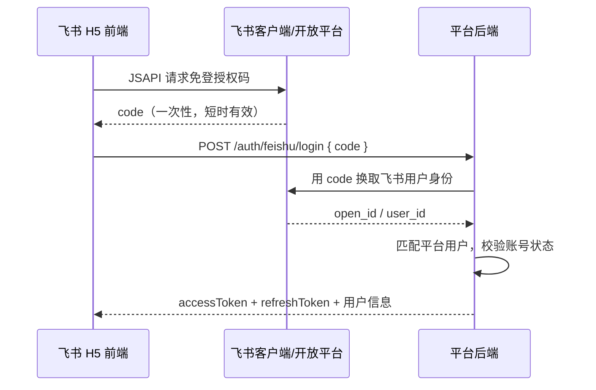

# 福州软件职业技术学院 · 五年计划指标管理平台 API 统一约定文档

| 项目 | 内容 |
| --- | --- |
| 文档版本 | V0.2（草案） |
| 编写日期 | 2026-10-26 |
| 依据文档 | [五年计划指标管理平台-需求文档.md](./五年计划指标管理平台-需求文档.md)（V0.5） |
| 适用对象 | 后端服务、PC Web 前端、飞书 H5（PC / 移动端）、可视化大屏、第三方集成（飞书、中台） |

> 本文档规定所有接口**共同遵守**的规则：地址、命名、数据类型、认证、请求和响应格式、错误码、文件、枚举、日志、安全、版本等。第 15 章是按需求模块整理的接口资源清单草案，字段细节以开发阶段生成的 OpenAPI 文档为准。
>
> 用词说明：**必须** = 强制；**应** = 强烈建议，不遵守要有理由；**可** = 可选。

---

## 1. 总则

1. **资源导向（RESTful）**：URL 表示资源，HTTP 方法表示操作；状态流转等非增删改查的业务动作，统一用“动作子路径”表示（见 2.5）。
2. **统一响应**：所有 JSON 接口必须返回统一结构（见第 6 章），文件流接口除外。
3. **语义化状态码**：HTTP 状态码表示错误大类，`code` 表示具体业务错误。
4. **服务端兜底**：权限、数据范围、守恒校验、状态流转校验必须由服务端完成，前端校验只用来改善体验。
5. **可追溯**：每个请求都有 `requestId`，所有写操作自动写入审计日志。
6. **向后兼容**：同一主版本内只能做兼容性变更（见第 12 章）。

---

## 2. 基础约定

### 2.1 协议与地址

- 必须使用 **HTTPS**。
- 统一前缀：`/api/v1`。

| 环境 | 基础地址（示例，部署时确定） |
| --- | --- |
| 开发 | `https://dev-metrics.example.edu.cn/api/v1` |
| 测试 | `https://test-metrics.example.edu.cn/api/v1` |
| 生产 | `https://metrics.example.edu.cn/api/v1` |

### 2.2 编码与内容类型

| 场景 | Content-Type |
| --- | --- |
| 普通请求和响应 | `application/json; charset=utf-8` |
| 文件上传 | `multipart/form-data` |
| 分片上传的分片内容 | `application/octet-stream` |
| 文件下载 | 通过签名地址获取（见第 8 章），不经过业务接口直接返回文件流 |

- 字符编码统一为 **UTF-8**。
- 除文件上传外，请求体不得超过 **1 MB**。

### 2.3 命名规范

| 对象 | 规则 | 示例 |
| --- | --- | --- |
| URL 路径 | 全小写，单词之间用 `-`；资源用**复数名词** | `/plans`、`/audit-logs`、`/major-groups` |
| 路径参数 | 小驼峰，带 `Id` 后缀 | `/plans/{planId}/indicators` |
| 查询参数 | 小驼峰 | `?unitId=xx&pageSize=20` |
| JSON 字段 | 小驼峰 | `totalTarget`、`yearTargets` |
| 枚举值 | 全大写，单词之间用下划线 | `A_PLUS`、`PENDING_REVIEW` |
| 布尔字段 | 以 `is` / `has` 开头 | `isQuantifiable`、`isHistorical`、`hasAttachment` |
| 时间字段 | 以 `At` 结尾（日期时间），以 `Date` 结尾（只有日期） | `createdAt`、`dueDate` |
| 主键 / 外键 | `id` / `xxxId` | `planId`、`ownerId` |
| 比率字段 | 以 `Rate` 结尾 | `completionRate`、`growthRate` |
| 数量字段 | 以 `Count` 结尾 | `taskCount` |

业务术语的英文命名必须统一：

| 中文 | 英文 | 中文 | 英文 |
| --- | --- | --- | --- |
| 计划 | plan | B 任务 | task |
| 模板 | template | 填报 | submission |
| 主体 | subject | 审核 | review |
| S 级任务（后台目录） | direction | 指标调整（延期 / 转移） | adjustment |
| 指标（A / A+） | indicator | 里程碑 | milestone |
| 指标层级 | level | 执行单元 | orgUnit / unit |
| 分解矩阵 | allocation | 专业群 | majorGroup |
| 下发 | distribute | 年度核算 | settle |
| 校级项目负责人 / 学院项目负责人 | owner | 审计日志 | auditLog |

### 2.4 HTTP 方法语义

| 方法 | 用途 | 幂等 |
| --- | --- | :-: |
| `GET` | 查询，不得修改数据 | ✅ |
| `POST` | 新建资源，或执行业务动作 | ❌（要求幂等时配合 `Idempotency-Key`，见 5.6） |
| `PUT` | 整体替换（如年度目标、分解矩阵） | ✅ |
| `PATCH` | 部分更新：只修改请求中传了的字段 | ✅ |
| `DELETE` | 删除；业务数据一律**逻辑删除** | ✅ |

### 2.5 URL 设计

- 资源嵌套**最多两层**：`/plans/{planId}/indicators` ✅；`/plans/{planId}/indicators/{indicatorId}/tasks/{taskId}` ❌（应改为 `/tasks/{taskId}`）。
- 已知 ID 的单个资源，直接用顶层路径访问：`/indicators/{indicatorId}`、`/tasks/{taskId}`。
- **业务动作**统一写成 `POST /{资源}/{id}/{动词}`，动词用小写加 `-` 连接：

| 动作 | 路径 |
| --- | --- |
| 指标体系定稿 | `POST /plans/{planId}/indicators/finalize` |
| 下发 | `POST /plans/{planId}/distribute` |
| 确认接收 | `POST /tasks/{taskId}/accept` |
| 提交填报 | `POST /submissions/{submissionId}/submit` |
| 审核 | `POST /submissions/{submissionId}/review` |
| 调整审批 | `POST /adjustments/{adjustmentId}/decision` |
| 年度核算 | `POST /plans/{planId}/years/{year}/settle` |

### 2.6 请求头与响应头

**请求头**

| 名称 | 必填 | 说明 |
| --- | :-: | --- |
| `Authorization` | 除公开接口外必填 | `Bearer {accessToken}` |
| `Content-Type` | 有请求体时必填 | 见 2.2 |
| `X-Request-Id` | 否 | 客户端生成的 UUID；不传则由服务端生成 |
| `Idempotency-Key` | 部分接口必填 | UUID，见 5.6 |
| `X-Client-Type` | 是 | `WEB` / `FEISHU_PC` / `FEISHU_MOBILE` / `SCREEN` |
| `X-Client-Version` | 否 | 前端版本号，便于排查问题 |

**响应头**

| 名称 | 说明 |
| --- | --- |
| `X-Request-Id` | 与响应体中的 `requestId` 相同 |
| `Retry-After` | 返回 429 时，提示多少秒后可以重试 |
| `Deprecation` / `Sunset` | 接口即将下线时返回（见第 12 章） |

---

## 3. 数据类型约定

### 3.1 基本类型

| 类型 | JSON 类型 | 规则 | 示例 |
| --- | --- | --- | --- |
| ID | string | 64 位雪花 ID **必须用字符串传输**，避免 JS 丢失精度 | `"1849000000000000101"` |
| 业务编号 | string | A：`A01`；A+：`A01-1`；B：`A01-1-{单元编码}` | `"A01-2-C03"` |
| 年度 | integer | 自然年（需求文档 Q8） | `2026` |
| 日期 | string | `YYYY-MM-DD` | `"2026-12-31"` |
| 日期时间 | string | ISO 8601，带时区。服务端统一返回 `+08:00`，接收任意时区 | `"2026-10-22T16:08:43+08:00"` |
| 指标数值 | number | 最多 4 位小数；服务端用 Decimal 存储和计算，前端**不得**自行汇总 | `12.5` |
| 比率 / 百分比 | number | **一律用小数传输**（0.15 表示 15%），最多 6 位小数，前端负责 ×100 显示 | `0.15` |
| 布尔 | boolean | 只能是 `true` / `false` | `true` |
| 枚举 | string | 见第 9 章；前端遇到未知枚举值时显示原值，不得报错 | `"A_PLUS"` |
| 文件大小 | integer | 单位：字节 | `52428800` |

### 3.2 空值规则

- 响应中的字段**必须始终存在**，没有值时返回 `null`，不得省略字段。
- 数组没有元素时返回 `[]`，不得返回 `null`。
- 字符串“没有值”用 `null` 表示，不用空串 `""`。
- `PATCH` 请求：**不传**某字段表示不修改；传 `null` 表示清空（仅限可空字段）。

### 3.3 通用字段

所有可修改的业务资源都必须带有以下字段：

| 字段 | 类型 | 说明 |
| --- | --- | --- |
| `id` | string | 主键 |
| `version` | integer | 乐观锁版本号，见 5.7 |
| `createdAt` / `updatedAt` | string | 创建 / 更新时间 |
| `createdBy` / `updatedBy` | UserRef | 创建人 / 更新人 |

### 3.4 引用对象

接口返回关联对象时，统一用精简的引用结构，不展开完整对象：

```json
{
  "owner": { "id": "1849000000000000201", "name": "张三" },
  "unit": { "id": "1849000000000000301", "code": "C03", "name": "数字影视传媒产业学院" },
  "indicator": { "id": "1849000000000000101", "code": "A01-2", "name": "新增省级教学成果奖", "level": "A_PLUS" }
}
```

### 3.5 指标值对象 `MetricValue`

填报值、认定值、完成值统一使用 `MetricValue`，**由统计口径 `statCaliber` 决定使用哪个字段**，其他字段为 `null`：

| statCaliber | 采集字段 | 含义 | 服务端计算的只读字段 |
| --- | --- | --- | --- |
| `INCREMENT` 增量累计型 | `amount` | 本次新增数量 | — |
| `STOCK` 存量时点型 | `total` | 当前总量 | `increment`（与上年相比的增量） |
| `GROWTH` 增长率型 | `total` | 本年总量（不直接填增长率） | `growthRate` |
| `RATIO` 占比型 | `numerator`、`denominator` | 分子、分母 | `rate` |
| `DIRECT_PERCENT` 直填百分比型 | `percent` | 直接填写的百分比（小数） | — |
| `BOOLEAN` 是否型 | `achieved` | 是否完成 | — |

```json
{ "amount": null, "total": null, "numerator": 62, "denominator": 100, "percent": null, "achieved": null, "rate": 0.62, "growthRate": null, "increment": null }
```

### 3.6 年度目标对象 `YearTarget`

```json
{ "year": 2026, "target": 1 }
```

`target` 的含义同样由 `statCaliber` 决定：

| statCaliber | `target` 含义 | 类型 |
| --- | --- | --- |
| `INCREMENT` | 当年的增量目标 | number |
| `STOCK` / `GROWTH` | 当年年末应达到的总量 | number |
| `RATIO` / `DIRECT_PERCENT` | 当年应达到的比率（小数） | number |
| `BOOLEAN` | 计划完成的那一年为 `true`，其他年份为 `null` | boolean / null |

### 3.7 S / A / A+ / B 核心资源字段

| 资源 / DTO | 字段 | 类型 | 契约规则 |
| --- | --- | --- | --- |
| `DirectionDtos` | `leaderId` | string / null | S 总负责人 ID；新增、修改时传该字段，配置对象必须是启用且具有 `LEADER` 角色的用户。仅建立责任关联，不新增角色、数据范围或审批节点 |
| `DirectionDtos` | `leader` | UserRef / null | S 列表和详情返回的总负责人精简引用，只读；未配置时为 `null`，与 `leaderId` 同时返回 |
| `Indicator` | `isQuantifiable` | boolean | 仅 A 使用；`false` 时只保留 S 归属、名称、性质、说明和负责人，量化字段均为 `null`，不生成 A+ / B，不进入填报、审核、核算和完成率统计 |
| `Indicator` | `directionId` | string / null | 草稿 A 可空，定稿必须归属 S；只能由 ADMIN 在系统管理中修改，普通指标表单、列表和详情不展示该字段或 S 信息 |
| `OrgUnit` | `isBAssignable` | boolean | 与既有 `isEnabled` 共同决定能否承接新 B；分解预览、保存、下发和转移接收统一校验二者均为 `true`，不得按单元编码硬编码 |
| `Task` | `isHistorical` | boolean | 列表和详情必须返回。`true` 时目标冻结、全部执行写操作禁止，详情和审计仍按数据范围可读 |
| `IndicatorDtos` | `bSummaries` | array | 指标详情的下属 B 概要数组，空时返回 `[]`；数组项使用 `level=B` 和 `isHistorical` |
| 统计树节点 | `level` / `isHistorical` | string / boolean | B 叶节点固定返回 `level=B`，并返回 `isHistorical`；所有节点均不返回 `directionId`，统计树固定为 A → A+ → B，不包含 S 层 |

B 的层级枚举、DTO 字段和统计叶节点只使用上述命名，不提供兼容别名。普通业务接口、统计、大屏及模板结构预览不得返回 S 名称、方向筛选或方向下钻数据；系统管理的 S 接口和模板后台复制逻辑除外。

---

## 4. 认证与鉴权

### 4.1 登录方式

| 场景 | 方式 | 接口 |
| --- | --- | --- |
| 飞书内打开（PC / 移动端） | 飞书 H5 免登：前端通过飞书 JSAPI 取得临时授权码 `code`，交给后端换取平台 Token | `POST /auth/feishu/login` |
| 普通浏览器 | 跳转到飞书 OAuth 授权页，授权后回调平台，再用 `code` 换取 Token | `GET /auth/feishu/authorize-url` → `POST /auth/feishu/login` |
| 备用 | 账号密码 + 图形验证码 | `POST /auth/login` |



### 4.2 Token

| Token | 有效期 | 说明 |
| --- | --- | --- |
| `accessToken` | 2 小时 | JWT，放在 `Authorization: Bearer ...` 中 |
| `refreshToken` | 7 天 | 只用于 `POST /auth/refresh`。**每次刷新都会签发新的 refreshToken，旧的立即失效** |

- Token **不得**出现在 URL 中；前端应保存在内存或 `sessionStorage` 中。
- 退出登录（`POST /auth/logout`）后，服务端必须让 refreshToken 失效。
- 账号被停用或角色变更后，用户在下一次刷新 Token 时生效；涉及高风险的变更，可以由服务端强制让 Token 失效。

### 4.3 鉴权模型

- **功能权限**：用户可能同时有多个角色（`ADMIN`、`LEADER`、`SCHOOL_OWNER`、`UNIT_OWNER`），服务端按所有角色的**并集**计算权限，前端不需要传当前角色。
- **数据权限**：
  - 平台管理员、校领导：全校数据；
  - 校级项目负责人：自己负责的 A / A+ 及其下属的 B；
  - 学院项目负责人：本单元的 B 任务。
- S 总负责人只是 `direction.leaderId` 的责任关联，不新增角色或数据范围，不改变 LEADER 全校可见规则及既有调整审批链；S 配置仅限 ADMIN 的 `system:manage`。
- 前端通过 `GET /auth/me` 获取 `roles`、`permissions`（权限码）和 `dataScope`，用来控制菜单和按钮的显示；**服务端必须对每个请求重新校验**。
- 访问超出数据范围的资源时，返回 `403` + `20005`。

**权限码命名**：`{资源}:{动作}`，例如：

| 权限码 | 含义 |
| --- | --- |
| `plan:manage` | 新建、修改、归档计划，管理模板 |
| `indicator:edit` | 编辑 A / A+ 指标 |
| `allocation:edit` | 编辑分解矩阵 |
| `task:distribute` | 下发 B 任务 |
| `task:accept` | 确认接收 B 任务 |
| `submission:submit` | 填报和提交 |
| `submission:review` | 审核 |
| `adjustment:apply` | 发起延期 / 转移 |
| `adjustment:decide` | 初审、确认接收、审批 |
| `settlement:manage` | 年度核算、解锁、五年核算 |
| `screen:view` | 查看大屏 |
| `audit-log:view` / `audit-log:export` | 查看 / 导出日志 |
| `system:manage` | 系统管理 |

---

## 5. 请求约定

### 5.1 分页

| 参数 | 类型 | 默认值 | 说明 |
| --- | --- | --- | --- |
| `page` | integer | 1 | 页码，从 1 开始 |
| `pageSize` | integer | 20 | 每页条数，最大 100 |

不分页的列表接口（如字典、执行单元）必须在接口文档中说明，且最多返回 1000 条。

### 5.2 排序

`sort=字段:方向`，多个字段之间用英文逗号分隔；方向为 `asc` 或 `desc`。只允许按接口文档列出的字段排序。

```
GET /api/v1/tasks?sort=dueDate:asc,code:asc
```

### 5.3 过滤

| 规则 | 示例 |
| --- | --- |
| 等值过滤：参数名与字段名相同 | `?unitId=xx&year=2026` |
| 多值过滤：值之间用英文逗号分隔 | `?status=PENDING_REVIEW,REJECTED` |
| 范围过滤：`xxxFrom` / `xxxTo`，两端都包含 | `?createdAtFrom=2026-01-01T00:00:00+08:00&createdAtTo=2026-12-31T23:59:59+08:00` |
| 关键字模糊搜索 | `?keyword=教学成果` |

### 5.4 参数校验

- 服务端必须校验所有参数（必填、类型、长度、取值范围、枚举、业务规则）。
- 名称类字段 ≤ 200 字，说明类字段 ≤ 2000 字，只允许纯文本，**不接受 HTML**。
- 请求中的未知字段会被忽略；已知字段的类型不对时，返回 `400` + `10001`。

### 5.5 只读字段

`id`、`version` 以外的系统字段（`createdAt`、`code`、`status`、各种计算值等），即使客户端传了也会被忽略。**状态只能通过业务动作接口改变**，不能用 `PATCH` 直接修改。

### 5.6 幂等

下列接口**必须**带 `Idempotency-Key`（UUID）：

- 下发、确认接收、提交填报、审核；
- 发起调整、调整审批（`decision`）；
- 导入确认、年度核算、五年核算、解锁；
- 创建导出任务。

规则：

- 服务端保存 Key **24 小时**；
- 同一个 Key、相同的请求体再次提交时，直接返回第一次的结果；
- 同一个 Key、不同的请求体，返回 `409` + `10004`。

### 5.7 并发控制（乐观锁）

- 可修改的资源都有 `version` 字段。`PUT` / `PATCH` 以及会改变资源状态的业务动作，请求中**必须**带上当前的 `version`。
- 版本号不一致时，返回 `409` + `10005`，`errors[0].message` 中会带上最新的版本号；前端应提示用户“数据已被他人修改，请刷新后重试”。
- 典型场景：多人同时编辑分解矩阵、审核和撤回同时发生、并发审批。

### 5.8 批量操作

- 路径：`POST /{资源}/batch-{动作}`，例如 `POST /submissions/batch-review`。
- 每次最多 200 条。
- 默认**逐条处理**（某一条失败不影响其他条），响应格式如下：

```json
{
  "code": 0,
  "message": "success",
  "data": {
    "successCount": 18,
    "failCount": 2,
    "failures": [
      { "index": 3, "id": "1849000000000000501", "code": 60001, "message": "当前状态不允许审核" }
    ]
  },
  "requestId": "6f1c0c2e-1d7a-4b8e-9d0f-2b7a1c3e4f50"
}
```

---

## 6. 响应约定

### 6.1 统一响应结构

```json
{
  "code": 0,
  "message": "success",
  "data": {},
  "requestId": "6f1c0c2e-1d7a-4b8e-9d0f-2b7a1c3e4f50"
}
```

| 字段 | 类型 | 说明 |
| --- | --- | --- |
| `code` | integer | 业务码，`0` 表示成功，其他值见第 7 章 |
| `message` | string | 中文提示，可以直接展示给用户 |
| `data` | object / array / null | 业务数据；没有返回内容时为 `null` |
| `requestId` | string | 请求追踪 ID |
| `errors` | array | 只在出错时出现：`[{ "field": "字段路径", "message": "说明" }]` |

### 6.2 分页响应

```json
{
  "code": 0,
  "message": "success",
  "data": {
    "items": [],
    "total": 128,
    "page": 1,
    "pageSize": 20
  },
  "requestId": "..."
}
```

### 6.3 错误响应

```json
{
  "code": 50001,
  "message": "B 分解合计与 A+ 目标不一致，不能下发",
  "data": null,
  "requestId": "...",
  "errors": [
    { "field": "indicators[0].yearTargets[2026]", "message": "A01-2 在 2026 年：各学院合计 0，A+ 目标 1" }
  ]
}
```

### 6.4 HTTP 状态码

| HTTP 状态码 | 使用场景 | 业务码范围 |
| --- | --- | --- |
| 200 | 成功（包括新建和业务动作） | 0 |
| 400 | 参数格式或校验错误 | 10001、10002 |
| 401 | 未登录、Token 无效或过期 | 20001–20003 |
| 403 | 没有功能权限或数据权限 | 20004、20005 |
| 404 | 资源不存在或已删除 | 10003 |
| 409 | 状态冲突、版本冲突、幂等冲突 | 10004、10005，以及各模块的状态类错误 |
| 413 | 文件或请求体过大 | 80002 |
| 422 | 违反业务规则（守恒、截止期等） | 各模块的规则类错误 |
| 429 | 请求过于频繁 | 10006 |
| 500 | 服务器内部错误 | 10099 |
| 502 / 503 | 依赖的外部服务（飞书、中台、预览服务）不可用 | 90001–90003 |

### 6.5 前端统一处理

| 情况 | 处理方式 |
| --- | --- |
| `401` + `20002`（Token 过期） | 自动调用刷新接口，成功后重试原请求一次；刷新失败时重新登录（飞书内自动重新免登） |
| `401` + `20001` / `20003` | 直接重新登录 |
| `403` | 提示没有权限 |
| `409` + `10005` | 提示数据已被修改，引导用户刷新 |
| `400` / `422` | 把 `errors` 对应到表单字段，或用弹窗展示 `message` |
| `5xx` | 显示通用错误，并附上 `requestId`，方便反馈 |

---

## 7. 错误码

### 7.1 编码规则

- 共 5 位数字，`0` 表示成功。
- 第 1 位表示模块：`1` 通用、`2` 认证权限、`3` 计划模板、`4` 指标、`5` 分解下发、`6` 填报审核、`7` 调整审批、`8` 文件、`9` 集成。
- 错误码一经发布，**不能改变含义**；不再使用的错误码保留不用，不能复用。

### 7.2 错误码表

| 错误码 | HTTP | 含义 |
| --- | --- | --- |
| 0 | 200 | 成功 |
| 10001 | 400 | 参数校验失败 |
| 10002 | 400 | 请求体格式错误 |
| 10003 | 404 | 资源不存在 |
| 10004 | 409 | 幂等键冲突（相同 Key、不同请求体） |
| 10005 | 409 | 数据已被他人修改（版本冲突） |
| 10006 | 429 | 请求过于频繁 |
| 10099 | 500 | 系统内部错误 |
| 20001 | 401 | 未登录或缺少 Token |
| 20002 | 401 | Token 已过期 |
| 20003 | 401 | Token 无效 |
| 20004 | 403 | 没有操作权限 |
| 20005 | 403 | 没有数据权限（超出本人负责范围或本单元） |
| 20006 | 401 | 飞书免登失败 |
| 20007 | 403 | 账号已停用，或飞书账号未绑定平台用户 |
| 20008 | 401 | 用户名或密码错误 |
| 20009 | 403 | 登录失败次数过多，账号暂时锁定 |
| 30001 | 409 | 计划当前状态不允许此操作 |
| 30002 | 409 | 计划已归档，只能查看 |
| 30003 | 404 | 模板不存在或已停用 |
| 30004 | 422 | 计划起止年份不合法 |
| 40001 | 422 | Excel 导入校验未通过 |
| 40002 | 422 | 各年度目标之和不等于五年总量 |
| 40003 | 422 | A+ 目标之和不等于 A 目标（汇总方式为自动汇总时） |
| 40004 | 409 | 指标已下发，不能删除 |
| 40005 | 409 | 指标体系已定稿，修改目标需要发起目标调整 |
| 40006 | 422 | 层级或量化性质不合法（A+ 必须挂在可量化 A 下；A+ 不能再拆；只有 A+ 可生成新 B；不可量化 A 不设置量化字段） |
| 40007 | 422 | 计量类型与统计口径不匹配（仅适用于可量化指标） |
| 40008 | 409 | 存在下级数据，不能删除（S 下有 A、A 下有 A+） |
| 50001 | 422 | 历史 B 冻结目标加非历史 B 目标与 A+ 目标不一致 |
| 50002 | 422 | B 任务没有指定学院项目负责人 |
| 50003 | 409 | 任务已下发 |
| 50004 | 409 | 该年度尚未激活，不能填报 |
| 50005 | 409 | 指标体系尚未定稿，不能下发 |
| 50006 | 409 | 历史 B 任务只读（`TASK_HISTORICAL_READ_ONLY`），禁止确认接收、填报、审核、调整、补做及其他写操作 |
| 60001 | 409 | 当前状态不允许此操作（提交、撤回、审核） |
| 60002 | 422 | 缺少必须上传的佐证材料 |
| 60003 | 409 | 该年度已核算锁定 |
| 60004 | 422 | 驳回时必须填写审核意见 |
| 60005 | 422 | 认定值不能大于填报值 |
| 60006 | 422 | 填报值与统计口径不匹配（见 3.5） |
| 70001 | 422 | 调整数量超过尚未完成的量 |
| 70002 | 422 | 违反守恒规则 |
| 70003 | 422 | 目标年份超出规划期，或早于原年份 |
| 70004 | 409 | 该额度已有进行中的调整申请（额度已冻结） |
| 70005 | 403 | 当前登录人不是这一环节的审批人 |
| 70006 | 422 | 该统计口径不支持此调整类型 |
| 80001 | 422 | 文件格式不支持 |
| 80002 | 413 | 文件超过大小限制 |
| 80003 | 422 | 分片缺失或校验失败 |
| 80004 | 404 | 文件不存在，或签名地址已过期 |
| 80005 | 502 | 文件预览转换失败 |
| 90001 | 502 | 飞书接口调用失败 |
| 90002 | 401 | 飞书回调签名校验失败 |
| 90003 | 503 | 中台接口不可用 |

---

## 8. 文件上传、预览与下载

### 8.1 上传方式

| 方式 | 适用场景 | 接口 |
| --- | --- | --- |
| 直接上传 | ≤ 20 MB | `POST /files`（multipart，字段 `file`、`bizType`） |
| 分片上传 | > 20 MB（视频等），支持断点续传 | 见 8.2 |

### 8.2 分片上传流程

1. `POST /files/multipart/init`，请求体为 `{ fileName, size, mimeType, sha256, bizType }`，返回 `{ uploadId, partSize, partCount }`。如果服务器上已有相同 `sha256` 的文件，直接返回 `fileInfo`（秒传）。
2. `PUT /files/multipart/{uploadId}/parts/{partNumber}`：上传分片，分片编号从 1 开始，分片默认 5 MB。
3. `GET /files/multipart/{uploadId}`：查询已上传的分片，用于断点续传。
4. `POST /files/multipart/{uploadId}/complete`：合并分片并校验 `sha256`，返回 `fileInfo`。

### 8.3 文件对象 `FileInfo`

```json
{
  "id": "1849000000000000701",
  "fileName": "2026省级教学成果奖获奖文件.pdf",
  "size": 2097152,
  "mimeType": "application/pdf",
  "category": "PDF",
  "bizType": "SUBMISSION_ATTACHMENT",
  "status": "TEMP",
  "transcodeStatus": null,
  "uploadedAt": "2026-10-22T16:20:00+08:00",
  "uploadedBy": { "id": "1849000000000000201", "name": "张三" }
}
```

### 8.4 文件绑定与清理

- 刚上传的文件状态为 `TEMP`。业务数据（填报、调整申请、里程碑）保存时，通过 `fileIds` 引用文件，文件状态变为 `BOUND`。
- `TEMP` 文件超过 24 小时没有被引用，会被自动清理。
- 填报一旦提交，所引用的文件**不能物理删除**；修改材料时，只能在新版本中替换引用，原文件随历史记录保留。

### 8.5 格式与大小（默认值，可在系统参数中修改）

| 分类 `category` | 扩展名 | 单个文件上限 |
| --- | --- | --- |
| `DOCUMENT` | doc、docx、xls、xlsx、ppt、pptx、txt | 50 MB |
| `PDF` | pdf | 50 MB |
| `IMAGE` | jpg、jpeg、png、gif、bmp、webp | 20 MB |
| `VIDEO` | mp4、mov、avi、wmv | 500 MB |
| `ARCHIVE` | zip、rar（不支持在线预览） | 200 MB |

服务端必须**同时**校验扩展名和文件头（魔数），不能只看扩展名。

### 8.6 预览与下载

| 接口 | 返回 |
| --- | --- |
| `GET /files/{fileId}/preview` | `{ previewType, url, expiresAt }`。`previewType` 为 `IMAGE` / `PDF` / `OFFICE` / `VIDEO` / `UNSUPPORTED` |
| `GET /files/{fileId}/download-url` | `{ url, expiresAt }` |

- `url` 是**签名地址**，有效期 10 分钟，只能在有效期内使用。
- 获取预览或下载地址时，服务端都要按业务数据的权限做校验；下载操作写入审计日志。
- 视频文件转码完成前，`transcodeStatus` 为 `PROCESSING`，此时预览接口返回原始文件地址或提示稍后再试。

---

## 9. 枚举字典

前端应通过 `GET /dicts/enums` 一次性获取所有枚举的中文名称，不要在前端写死。响应结构为「枚举名 → (枚举值 → 中文名)」的嵌套对象，如 `{ "PlanStatus": { "DRAFT": "草稿", ... }, ... }`。

| 枚举 | 值 | 中文 |
| --- | --- | --- |
| `PlanStatus` 计划状态 | `DRAFT` / `ACTIVE` / `ARCHIVED` | 草稿 / 执行中 / 已归档 |
| `PlanSource` 新建方式 | `BLANK` / `TEMPLATE` / `COPY` | 空白 / 从模板 / 复制计划 |
| `SubjectType` 主体 | `SCHOOL` / `MAJOR_GROUP` | 校级 / 专业群 |
| `IndicatorLevel` 层级 | `A` / `A_PLUS` / `B` | A 类（校级原始任务）/ A+ 类（唯一可分解指标）/ B 类（执行单元任务） |
| `IndicatorNature` 指标性质 | `CONSTRAINT` / `DEVELOPMENT` | 约束性 / 发展性 |
| `MeasureType` 计量类型 | `NUMBER` / `BOOLEAN` / `PERCENT_QUANTIFIABLE` / `PERCENT_DIRECT` | 数值 / 是否 / 百分比-可量化 / 百分比-不可量化 |
| `StatCaliber` 统计口径 | `INCREMENT` / `STOCK` / `GROWTH` / `RATIO` / `DIRECT_PERCENT` / `BOOLEAN` | 增量累计型 / 存量时点型 / 增长率型 / 占比型 / 直填百分比型 / 是否型 |
| `TargetDirection` 达成方向 | `HIGHER_BETTER` / `LOWER_BETTER` | 越大越好 / 越小越好 |
| `RollupMode` 汇总方式 | `AUTO_SUM` / `MANUAL` | 自动汇总 / 手工认定 |
| `OrgUnitType` 执行单元类型 | `COLLEGE` / `INTERNATIONAL_COLLEGE` / `MARXISM_COLLEGE` / `SCHOOL_OFFICE` | 二级学院 / 国际学院 / 马克思主义学院 / 校办公室 |
| `Role` 角色 | `ADMIN` / `LEADER` / `SCHOOL_OWNER` / `UNIT_OWNER` | 平台管理员 / 校领导 / 校级项目负责人 / 学院项目负责人 |
| `TaskStatus` B 任务状态 | `PENDING_DISTRIBUTION` / `DISTRIBUTED` / `IN_PROGRESS` / `TRANSFERRED_OUT` / `CLOSED` | 待下发 / 已下发 / 执行中 / 已全部转出 / 已结束 |
| `TaskYearStatus` B 年度状态 | `NOT_ACTIVATED` / `IN_PROGRESS` / `PENDING_REVIEW` / `ADJUSTING` / `ACHIEVED` / `NOT_ACHIEVED` / `MAKEUP_PENDING` / `MADE_UP` | 未激活 / 进行中 / 待审核 / 调整审批中 / 已达标 / 未达标 / 待补做 / 已补做 |
| `SubmissionStatus` 填报状态 | `DRAFT` / `PENDING_REVIEW` / `APPROVED` / `REJECTED` / `WITHDRAWN` | 草稿 / 待审核 / 已通过 / 已驳回 / 已撤回 |
| `ReviewResult` 审核结果 | `APPROVED` / `REJECTED` | 通过 / 驳回 |
| `AdjustmentType` 调整类型 | `POSTPONE` / `TRANSFER` / `POSTPONE_TRANSFER` / `TARGET_CHANGE` | 延期 / 转移 / 延期 + 转移 / 目标调整 |
| `AdjustmentStatus` 调整状态 | `PENDING_OWNER_REVIEW` / `PENDING_RECEIVER_CONFIRM` / `PENDING_LEADER_APPROVAL` / `APPROVED` / `REJECTED` / `WITHDRAWN` | 待初审 / 待接收方确认 / 待校领导审批 / 已生效 / 已驳回 / 已撤回 |
| `ApprovalNode` 审批环节 | `OWNER_REVIEW` / `RECEIVER_CONFIRM` / `LEADER_APPROVAL` | 校级负责人初审 / 接收方确认 / 校领导审批 |
| `Decision` 审批决定 | `APPROVE` / `REJECT` | 同意 / 驳回（拒绝） |
| `MilestoneStatus` 里程碑状态 | `NOT_STARTED` / `IN_PROGRESS` / `COMPLETED` / `OVERDUE` / `POSTPONED` | 未开始 / 进行中 / 已完成 / 逾期 / 已延期 |
| `FileBizType` 文件用途 | `SUBMISSION_ATTACHMENT` / `ADJUSTMENT_ATTACHMENT` / `MILESTONE_ATTACHMENT` / `IMPORT_FILE` | 填报材料 / 调整附件 / 里程碑附件 / 导入文件 |
| `FileCategory` 文件分类 | `DOCUMENT` / `PDF` / `IMAGE` / `VIDEO` / `ARCHIVE` | 文档 / PDF / 图片 / 视频 / 压缩包 |
| `PreviewType` 预览方式 | `IMAGE` / `PDF` / `OFFICE` / `VIDEO` / `UNSUPPORTED` | — |
| `ExportType` 导出类型 | `INDICATORS` / `TASKS` / `STATS_REPORT` / `SETTLEMENT` / `AUDIT_LOGS` | 指标体系 / B 任务 / 统计报表 / 核算结果 / 操作日志 |
| `JobStatus` 异步任务状态 | `PENDING` / `RUNNING` / `SUCCEEDED` / `FAILED` | 排队中 / 执行中 / 成功 / 失败 |
| `NotificationType` 通知类型 | `TASK_DISTRIBUTED` / `DEADLINE_REMINDER` / `REVIEW_RESULT` / `ADJUSTMENT_TODO` / `ADJUSTMENT_RESULT` / `WARNING` | 任务下发 / 截止提醒 / 审核结果 / 调整待办 / 调整结果 / 预警 |
| `AuditAction` 日志动作 | `LOGIN` / `CREATE` / `UPDATE` / `DELETE` / `IMPORT` / `EXPORT` / `FINALIZE` / `DISTRIBUTE` / `ACCEPT` / `SUBMIT` / `WITHDRAW` / `REVIEW` / `ADJUST_APPLY` / `ADJUST_DECIDE` / `SETTLE` / `UNLOCK` / `PERMISSION_CHANGE` / `FILE_DOWNLOAD` / `FILE_PREVIEW` / `SYNC_ORG` | — |
| `ClientType` 客户端 | `WEB` / `FEISHU_PC` / `FEISHU_MOBILE` / `SCREEN` | — |
| `PlanYearStatus` 计划年度状态 | `NOT_ACTIVATED` / `ACTIVE` / `LOCKED` | 未激活 / 已激活 / 已核算锁定 |
| `IndicatorStatus` 指标状态 | `DRAFT` / `FINALIZED` / `DISTRIBUTED` | 草稿 / 已定稿 / 已下发 |
| `MakeupStatus` 补做状态 | `PENDING` / `DONE` / `CANCELLED` | 待补做 / 已补做 / 已取消 |
| `FileStatus` 文件状态 | `TEMP` / `BOUND` | 临时 / 已绑定 |
| `StorageType` 存储类型 | `LOCAL` / `MINIO` | 本地 / 对象存储 |
| `PushStatus` 推送状态 | `PENDING` / `SENT` / `FAILED` / `SKIPPED` | 待推送 / 已推送 / 推送失败 / 无需推送 |
| `AchieveStatus` 达成状态 | `NOT_STARTED` / `IN_PROGRESS` / `ACHIEVED` / `EXCEEDED` / `NOT_ACHIEVED` / `LAGGING` | 未开始 / 进行中 / 已达成 / 超额达成 / 未达成 / 进度滞后 |
| `TranscodeStatus` 转码状态 | `PROCESSING` / `SUCCEEDED` / `FAILED` | 转码中 / 成功 / 失败 |
| `UploadSessionStatus` 上传会话状态 | `UPLOADING` / `COMPLETED` / `EXPIRED` | 上传中 / 已完成 / 已过期 |
| `FeishuEventStatus` 飞书事件处理状态 | `RECEIVED` / `PROCESSED` / `FAILED` | 已接收 / 已处理 / 处理失败 |

**计量类型与统计口径的合法组合**（不符合时返回 `40007`）：

| MeasureType | 允许的 StatCaliber |
| --- | --- |
| `NUMBER` | `INCREMENT`、`STOCK` |
| `BOOLEAN` | `BOOLEAN` |
| `PERCENT_QUANTIFIABLE` | `GROWTH`、`RATIO` |
| `PERCENT_DIRECT` | `DIRECT_PERCENT` |

**调整类型与统计口径的适用关系**（不符合时返回 `70006`，对应需求文档 5.6.1）：

| AdjustmentType | 适用的 StatCaliber |
| --- | --- |
| `POSTPONE` | `INCREMENT`、`BOOLEAN`（是否型为修改计划完成年份） |
| `TRANSFER` / `POSTPONE_TRANSFER` | `INCREMENT` |
| `TARGET_CHANGE` | 全部口径（仅限管理员发起） |

**执行单元初始化数据**（来自需求文档 2.1；`code` 用于 B 任务编号，上线后不能修改）：初始 `isEnabled` 均为 `true`，但只有同时满足 `isEnabled=true`、`isBAssignable=true` 的单元才能承接新 B。后续资格由系统管理配置，不得写死编码。

| code | name | type | isBAssignable |
| --- | --- | --- | :-: |
| `C01` | 智能产业学院 | `COLLEGE` | true |
| `C02` | 数字金融产业学院 | `COLLEGE` | true |
| `C03` | 数字影视传媒产业学院 | `COLLEGE` | true |
| `C04` | 数据产业学院 | `COLLEGE` | true |
| `C05` | 游戏产业学院 | `COLLEGE` | true |
| `C06` | 智能建造产业学院 | `COLLEGE` | true |
| `C07` | 现代通信产业学院 | `COLLEGE` | true |
| `C08` | 未来技术产业学院 | `COLLEGE` | true |
| `C09` | 国际学院 | `INTERNATIONAL_COLLEGE` | false |
| `C10` | 马克思主义学院 | `MARXISM_COLLEGE` | false |
| `S01` | 校办公室 | `SCHOOL_OFFICE` | false |

---

## 10. 审计日志约定

- 所有写操作（`POST` / `PUT` / `PATCH` / `DELETE`）、导出和文件下载，都由**服务端统一自动记录**，前端不需要调用记录日志的接口。
- 日志字段：`id`、`occurredAt`、`operator`（UserRef）、`roles`、`unit`、`action`（AuditAction）、`resourceType`、`resourceId`、`resourceCode`、`before`（JSON）、`after`（JSON）、`stakeholders`（相关干系人 UserRef 数组）、`reason`、`clientType`、`ip`、`requestId`。
- 以下**敏感操作**的请求体中必须带 `reason`（原因，≤ 500 字），否则返回 `10001`：
  - 年度数据解锁；
  - 管理员代填或代审；
  - 目标调整（`TARGET_CHANGE`）；
  - 删除已定稿的数据；
  - 修改用户角色。
- 日志只能追加，不提供修改和删除接口。
- 日志中**不得**记录密码、Token、验证码；手机号等个人信息需要脱敏。

---

## 11. 飞书集成约定

| 项目 | 约定 |
| --- | --- |
| 免登 | 见 4.1；`code` 只能使用一次，后端换取用户身份后立即作废 |
| 事件回调 | `POST /api/v1/integrations/feishu/events`。不使用平台 Token，按飞书开放平台的规则校验签名和 Verification Token，并处理 `url_verification`；**3 秒内**返回，耗时的处理放到异步执行；按 `event_id` 去重 |
| 卡片交互回调 | `POST /api/v1/integrations/feishu/card-actions`（P1，例如在消息卡片上直接“确认接收”）。校验规则同上，业务操作仍按第 4 章校验权限 |
| 消息推送 | 由服务端主动发送应用消息或卡片。消息里的链接通过飞书 AppLink 打开平台网页应用中的对应页面（具体格式以飞书开放平台文档为准） |
| 组织同步 | `POST /integrations/feishu/sync-org`（P1，管理员手动触发），也可以定时同步；同步结果写入审计日志 |
| 失败处理 | 飞书接口调用失败时按指数退避最多重试 3 次；消息推送失败不影响主业务，只记录日志，站内待办照常生成 |

---

## 12. 版本与兼容

- 主版本号写在 URL 中（`/api/v1`）。
- **兼容性变更**可以直接在 v1 中发布：新增接口、新增可选参数、新增响应字段、新增枚举值、新增错误码。
- **不兼容变更**必须升级为 v2：删除或改名字段、修改字段类型或含义、新增必填参数、修改错误码含义。
- 旧版本在新版本上线后至少保留 **6 个月**；即将下线的接口在响应头中返回 `Deprecation: true` 和 `Sunset: {日期}`。
- 前端必须容忍**未知字段**和**未知枚举值**。

---

## 13. 安全约定

| 项目 | 约定 |
| --- | --- |
| 传输 | 全站 HTTPS，开启 HSTS |
| 跨域 | 只允许白名单中的来源（平台域名、飞书网页应用域名） |
| Token | JWT 签名密钥要定期轮换；Token 不写入日志和 URL |
| 登录保护 | 同一账号连续失败 5 次，锁定 15 分钟（`20009`）；账号密码登录需要图形验证码 |
| 频率限制 | 登录：每个 IP 每分钟 10 次；普通接口：每个用户每分钟 300 次；导出：每个用户每分钟 5 次；超过时返回 `429` |
| 越权防护 | 每次按 ID 访问资源，都要校验数据范围（见 4.3），防止通过修改 ID 访问他人数据 |
| 输入输出 | 只接受纯文本；数据库访问使用参数化查询；前端渲染时进行转义 |
| 文件 | 扩展名白名单 + 文件头校验；通过签名地址访问；建议做病毒扫描（P1） |
| 敏感信息 | 响应和日志中的手机号、证件号等需要脱敏 |

---

## 14. 接口文档与联调

- 后端通过代码注解生成 **OpenAPI 3** 文档。开发和测试环境开放 `/api/v1/openapi.json` 和 Swagger UI，**生产环境关闭**。
- 每个接口的文档必须包括：功能说明、所需权限码、数据范围、请求和响应示例、可能返回的错误码、是否需要 `Idempotency-Key` 和 `version`。
- 接口新增或变更，需要先更新 OpenAPI 文档并通知前端，再提交代码。
- 前端可以基于 OpenAPI 文档生成类型定义和 Mock 数据，进行并行开发。

---

## 15. 接口资源清单（草案）

> 说明：所有路径都省略 `/api/v1` 前缀。“权限”列只是概要，详细规则见需求文档 3.2 节和本文 4.3 节。⚡ 表示必须带 `Idempotency-Key`。

### 15.1 认证（M0）

| 方法 | 路径 | 说明 | 权限 |
| --- | --- | --- | --- |
| POST | `/auth/feishu/login` | 飞书免登，用 `code` 换取 Token；未配置飞书或身份核验失败 20006，账号停用 / 已绑他人 20006/20007 | 公开 |
| GET | `/auth/feishu/authorize-url` | 获取浏览器的飞书授权跳转地址（可选 `state` 查询参数）；未配置飞书 20006 | 公开 |
| GET | `/auth/feishu/config` | 飞书集成可用性 `{ enabled }`；`false` 时前端自动隐藏飞书入口（登录前可查） | 公开 |
| POST | `/auth/login` | 账号密码登录 | 公开 |
| POST | `/auth/refresh` | 刷新 Token | 公开（带 refreshToken） |
| POST | `/auth/logout` | 退出登录 | 已登录 |
| GET | `/auth/me` | 当前用户、角色、权限码、数据范围 | 已登录 |

### 15.2 计划与模板（M1）

| 方法 | 路径 | 说明 | 权限 |
| --- | --- | --- | --- |
| GET | `/plans` | 计划列表（首页卡片，含整体完成率） | 已登录 |
| POST | `/plans` | 新建计划（`source`：BLANK / TEMPLATE / COPY） | `plan:manage` |
| GET | `/plans/{planId}` | 计划详情 | 已登录 |
| PATCH | `/plans/{planId}` | 修改计划属性 | `plan:manage` |
| POST | `/plans/{planId}/activate` | 启动执行 | `plan:manage` |
| POST | `/plans/{planId}/archive` | 归档 | `plan:manage` |
| POST | `/plans/{planId}/save-as-template` | 另存为模板 | `plan:manage` |
| GET | `/templates` | 模板列表 | `plan:manage` |
| GET / PATCH | `/templates/{templateId}` | 模板详情 / 修改 | `plan:manage` |
| POST | `/templates/{templateId}/copy` | 复制模板 | `plan:manage` |
| POST | `/templates/{templateId}/disable` / `enable` | 停用 / 启用 | `plan:manage` |

> 模板后台快照必须保留 S 及 A 归属，供另存、复制计划和复制模板使用；模板结构、原始 JSON 预览及普通业务导出不得暴露 S 名称、`directionId` 或方向树。S 数据只由后台复制逻辑携带，不提供对外方向维度。

### 15.3 指标体系（M2）

| 方法 | 路径 | 说明 | 权限 |
| --- | --- | --- | --- |
| GET | `/plans/{planId}/indicators` | 指标列表；`view=tree` 返回 A → A+ 树；可按 `level`、`isQuantifiable`、`ownerId`、`keyword` 过滤，不支持 S/方向过滤，响应不含 S 信息 | 已登录（按数据范围） |
| POST | `/plans/{planId}/indicators` | 新增 A（带 `isQuantifiable`），或在可量化 A 下新增 A+（必须带 `parentId`）；不可量化 A 只校验基础字段 | `indicator:edit` |
| GET | `/indicators/{indicatorId}` | 指标详情（含量化指标的年度目标、下属 A+，以及 `bSummaries`）；不返回 S 信息 | 按数据范围 |
| PATCH | `/indicators/{indicatorId}` | 修改指标（带 `version`）；不可量化 A 仅可修改名称、性质、说明、负责人，S 归属须走系统管理接口 | `indicator:edit` |
| DELETE | `/indicators/{indicatorId}` | 删除（未下发时才可以） | `indicator:edit` |
| PUT | `/indicators/{indicatorId}/year-targets` | 设置可量化 A / A+ 的五年总量和年度目标；不可量化 A 返回 40006 | `indicator:edit` |
| PUT ⚡ | `/indicators/{indicatorId}/year-targets/{year}/manual-value` | MANUAL 汇总可量化 A 的人工认定 `{ value, note?, version }`：认定值即该年 A 完成值并重算达成状态；年度未激活 50004、已锁定 60003（阶段 8 补录） | `indicator:edit` + 负责人数据范围 |
| GET | `/plans/{planId}/indicators/import-template` | 下载 Excel 导入模板（含 `isQuantifiable`，不含 S 展示列；S 归属由系统管理维护） | `indicator:edit` |
| POST | `/plans/{planId}/indicators/import-preview` | 上传 Excel，返回 `importId`、逐行解析结果和错误 | `indicator:edit` |
| POST ⚡ | `/plans/{planId}/indicators/import-confirm` | 确认导入 `{ importId }` | `indicator:edit` |
| POST ⚡ | `/plans/{planId}/indicators/finalize` | 定稿：所有 A 必须归属 S；可量化 A/A+ 校验量化字段及拆分守恒，不可量化 A 跳过量化校验 | `plan:manage` |

> 非量化 A 的 `measureType`、`statCaliber`、`unit`、`targetDirection`、`rollupMode`、`baselineValue`、`totalTarget`、`yearTargets`、材料要求等量化字段均返回 `null`（数组按 3.2 返回 `[]`），不得用于分解、下发、填报、审核、核算或完成率计算。S 结构与 A 归属定稿后锁定，S 总负责人可在执行期更换。

### 15.4 分解与下发（M3）

| 方法 | 路径 | 说明 | 权限 |
| --- | --- | --- | --- |
| GET | `/indicators/{indicatorId}/allocation` | 仅获取 A+ 的分解矩阵：合格执行单元 × 年度、历史冻结目标及合计校验结果；其他层级返回 40006 | `allocation:edit` |
| PUT | `/indicators/{indicatorId}/allocation` | 保存非历史 B 草稿，允许合计不一致；仅接受启用且 `isBAssignable=true` 的单元，不得修改历史冻结目标 | `allocation:edit` |
| POST ⚡ | `/plans/{planId}/distribute` | 仅下发 A+ 下的非历史 B；`indicatorIds` 为空时处理全部可下发 A+，强制校验“历史冻结目标 + 非历史目标 = A+ 目标”并再次校验单元资格 | `task:distribute` |
| POST ⚡ | `/plans/{planId}/years/{year}/activate` | 激活非历史任务年度，激活后才能填报；历史任务跳过且不生成待办或提醒 | `settlement:manage` |
| GET | `/tasks` | B 任务列表（可按 `unitId`、`indicatorId`、`year`、`status`、`yearStatus`、`isHistorical` 过滤），每项返回 `isHistorical` | 按数据范围 |
| GET | `/tasks/{taskId}` | B 任务详情（各年度目标、完成值、状态、`isHistorical`）；历史任务及既有记录只读可见 | 按数据范围 |
| POST ⚡ | `/tasks/{taskId}/accept` | 学院确认接收非历史任务；历史任务禁止写入 | `task:accept` |

> 分解预览、草稿保存、下发和转移接收必须共用同一套 `isEnabled && isBAssignable` 校验，初始仅 C01–C08 合格，但接口不得按编码硬编码。历史 B 不出现在可编辑矩阵行中，其目标作为只读冻结基数参与守恒；历史任务详情、目标、已审核完成值、快照和审计不删除、不重编号。
>
> 历史 B 的确认接收、填报写入、提交、撤回、单笔/批量审核、调整发起或处理、补做及年度批处理写入，均由服务端统一返回 `409 + 50006（TASK_HISTORICAL_READ_ONLY）`；批量请求混入历史任务时不得部分写入。历史记录查询不受此限制。

### 15.5 填报（M4）与审核（M5）

| 方法 | 路径 | 说明 | 权限 |
| --- | --- | --- | --- |
| GET | `/tasks/{taskId}/submissions` | 某 B 任务的填报记录；历史任务既有记录仍可读 | 按数据范围 |
| POST | `/tasks/{taskId}/submissions` | 新建非历史任务填报草稿；历史任务禁止 | `submission:submit` |
| GET | `/submissions/{submissionId}` | 填报详情（含材料、审核记录）；历史记录只读 | 按数据范围 |
| PATCH | `/submissions/{submissionId}` | 修改非历史任务的草稿或被驳回填报；历史任务禁止 | `submission:submit` |
| DELETE | `/submissions/{submissionId}` | 删除非历史任务的草稿；历史任务禁止 | `submission:submit` |
| POST ⚡ | `/submissions/{submissionId}/submit` | 提交非历史任务审核；历史任务禁止 | `submission:submit` |
| POST ⚡ | `/submissions/{submissionId}/withdraw` | 撤回非历史任务的待审核填报（审核前才可以）；历史任务禁止 | `submission:submit` |
| GET | `/reviews/pending` | 待审核列表，只包含非历史任务，不包含迁移时已终止记录 | `submission:review` |
| POST ⚡ | `/submissions/{submissionId}/review` | 审核非历史任务：`{ result, comment, approvedValue? }`，`approvedValue` 用于核减；历史任务禁止 | `submission:review` |
| POST ⚡ | `/submissions/batch-review` | 批量审核通过；仅接受非历史任务，混入历史或已终止记录时不得写入 | `submission:review` |

> 迁移历史任务时，其草稿、待审核等在途填报必须逐笔终止并记录“任务层级与命名体系调整”原因和审计轨迹，不得自动审核通过；终止记录不再进入待办、审核或提醒。历史任务的填报、审核、材料和审计查询仍按原数据范围开放。

### 15.6 指标调整（M6）

| 方法 | 路径 | 说明 | 权限 |
| --- | --- | --- | --- |
| POST | `/adjustments/preview` | 试算非历史任务调整前后的数据和守恒校验（不保存）；转移接收单元须启用且可承接新 B，历史任务禁止 | `adjustment:apply` |
| POST ⚡ | `/adjustments` | 对非历史 B 发起调整；接收单元资格与分解预览、保存、下发使用同一校验，历史冻结目标不可调整 | `adjustment:apply` |
| GET | `/adjustments` | 申请列表；`scope=MINE` 我发起的 / `TODO` 待我处理 / `ALL` 全部；`TODO` 排除历史及已终止记录 | 按数据范围 |
| GET | `/adjustments/{adjustmentId}` | 详情（含审批环节、调整前后快照）；历史记录只读 | 按数据范围 |
| POST ⚡ | `/adjustments/{adjustmentId}/decision` | 当前环节处理非历史申请：`{ decision, comment, version }`；历史或迁移已终止申请禁止处理，审批链不增加 S 节点 | `adjustment:decide` |
| POST ⚡ | `/adjustments/{adjustmentId}/withdraw` | 申请人撤回非历史申请（生效前才可以）；历史或已终止申请禁止 | 申请人 |
| GET | `/tasks/{taskId}/adjustments` | 某 B 任务的调整历史时间线；历史任务记录仍可读 | 按数据范围 |

> 迁移历史任务时，其在途调整必须逐笔终止，记录体系调整原因、前后快照和审计轨迹，释放未生效冻结额度，不得自动使调整生效。终止后的申请只读，不再进入待办或提醒。

### 15.7 里程碑（M7）

| 方法 | 路径 | 说明 | 权限 |
| --- | --- | --- | --- |
| GET | `/milestones` | 按 `indicatorId` 或 `taskId` 查询；历史任务里程碑只读 | 按数据范围 |
| POST | `/milestones` | 为可量化 A、A+ 或非历史 B 新建里程碑；不可量化 A 和历史任务禁止 | `indicator:edit` / `submission:submit` |
| PATCH / DELETE | `/milestones/{milestoneId}` | 修改 / 删除非历史对象里程碑；不可量化 A 和历史任务禁止 | 同上 |
| GET | `/tasks/{taskId}/makeups` | 补做记录；历史任务既有记录只读 | 按数据范围 |
| POST ⚡ | `/makeups/{makeupId}/complete` | 非历史任务补做完成（PENDING → DONE，来源年度 MAKEUP_PENDING → MADE_UP；带 `version`）；历史任务禁止 | `submission:submit`（本单元） |

> 年度核算、补做生成及其他年度批处理必须跳过历史任务；不得为历史任务生成补做、待办或提醒。历史任务的全部写守卫由服务端执行，不能依赖前端隐藏按钮。

> 说明（阶段 5 补录）：`POST /makeups/{makeupId}/complete` 为新增行——PRD FR-M7-03 要求补做完成后标记“已补做”，原表只有查询入口；记录的生成入口在 M8 年度核算。删除里程碑的 `version` 经查询参数传递。

### 15.8 统计核算（M8）、大屏（M9）与导出

| 方法 | 路径 | 说明 | 权限 |
| --- | --- | --- | --- |
| GET | `/plans/{planId}/stats/overview?year=` | 总体概览；不含 S/方向维度，不可量化 A 不参与完成率 | 已登录（按数据范围） |
| GET | `/plans/{planId}/stats/by-unit?year=` | 按执行单元统计 | 同上 |
| GET | `/plans/{planId}/stats/by-indicator?year=` | 按可量化 A 级指标统计，返回 `IndicatorStat[]`；不提供 S/方向筛选或图表数据 | 同上 |
| GET | `/plans/{planId}/stats/tree?year=` | 可量化指标按 A → A+ → B 逐级下钻；节点不返回 `directionId`，B 叶节点返回 `level=B` 和 `isHistorical`；不接受方向参数、不返回 S 层 | 同上 |
| GET | `/indicators/{indicatorId}/trend` | 可量化指标各年度目标和实际的趋势；不可量化 A 无趋势数据 | 同上 |
| POST ⚡ | `/plans/{planId}/years/{year}/settle` | 年度核算并锁定；跳过历史任务的批处理写入和补做生成，历史已审核值仍保留用于历史统计 | `settlement:manage` |
| GET | `/plans/{planId}/years/{year}/settlement` | 年度核算结果查询（含逐任务明细与待补做关联；未核算时 items 为空） | 已登录（按数据范围） |
| POST ⚡ | `/plans/{planId}/years/{year}/unlock` | 解锁年度数据（必须带 `reason`） | `settlement:manage` |
| POST ⚡ | `/plans/{planId}/final-settle` | 五年核算；不可量化 A 不参与，历史任务不生成新的核算写入 | `settlement:manage` |
| GET | `/plans/{planId}/final-settlement` | 五年核算结果查询（未核算返回 10003） | 已登录 |
| GET | `/screens/{planId}?year=` | 大屏聚合数据（可缓存 1–5 分钟）；A 级指标面板字段为 `byIndicator: IndicatorStat[]`，并提供 A → A+ → B 下钻，不含 S、方向筛选或方向下钻 | `screen:view` |
| POST ⚡ | `/exports` | 创建异步导出任务：`{ type: ExportType, params }`，返回 `exportId` | 视导出类型而定 |
| GET | `/exports/{exportId}` | 查询导出任务状态；成功时返回签名下载地址 | 任务创建人 |

`GET /plans/{planId}/stats/by-indicator?year=` 的统一响应 `data` 为 `IndicatorStat[]`，无数据时返回 `[]`。`GET /screens/{planId}?year=` 的 `byIndicator` 使用同一数组项结构，不保留方向维度字段。

| 字段 | 类型 | 说明 |
| --- | --- | --- |
| `indicatorId` | string | 可量化 A 的指标 ID |
| `code` | string | A 指标编号 |
| `name` | string | A 指标名称 |
| `aPlusCount` | integer | 该 A 下的 A+ 数量 |
| `taskCount` | integer | 当前可执行的非历史 B 数量，历史任务不计入 |
| `achievedCount` | integer | 上述当前任务中的已达标数量 |
| `completionRate` | number / null | 所选年度完成率，小数传输；无有效计算基数时为 `null` |
| `cumulativeRate` | number / null | 五年累计完成率，小数传输；无有效计算基数时为 `null` |

> 所有 Excel 导出**统一走异步导出任务**，避免大数据量时请求超时。

> 说明（规范符合性补录 2026-10-24）：
> - `GET /screens/{planId}` 响应新增 `coreNumbers = { indicatorACount, indicatorAPlusCount, taskCount, materialCount, approvedThisYearCount }`（界面设计规范 9.1④ 核心数字条；materialCount = 该计划填报记录下挂的佐证材料文件数）；`adjustmentStats` 新增 `postponeCount` / `transferCount`（`POSTPONE_TRANSFER` 双重计入两个分项）。均为新增字段，旧客户端不受影响。
> - `GET /plans/{planId}/stats/tree` 仅接受计划、年度及通用分页/数据范围参数，树固定为 A → A+ → B；节点不含 `directionId`，B 叶子使用 `level=B` 并返回 `isHistorical`；不提供 S/方向参数或方向下钻。
> - `GET /tasks` 列表项与 `GET /tasks/{taskId}` 详情新增 `deadline`（YYYY-MM-DD，填报截止日 = 展示年度 + 系统参数 `plan.fillDeadline`，默认 12-31；无展示年度为 null）；`GET /todos` 的 `items[]` 新增 `deadline`（仅 FILL / REVIEW 有值）。新增系统参数 `plan.fillDeadline`（V6 迁移，默认 `12-31`，界面设计规范 A8）。
>
> 说明（五年累计进度补录 2026-10-25）：年度目标是过程刻度，五年总量目标才是 100%（如「五年 5 本教材」不必每年 1 本）。运行期新增五年累计口径字段，取值规则与五年核算一致（INCREMENT 各年完成值之和；STOCK/GROWTH 最新有数据年总量；RATIO/DIRECT_PERCENT 最新有数据年比率；BOOLEAN 任一年完成为 1），完成率 = 累计完成 ÷ 五年总量目标：
> - `GET /plans/{planId}/stats/overview` 新增 `cumulativeCompletionRate`（可见可量化 A 指标累计完成率的算术平均，按数据范围过滤，不可量化 A 不进入分母）；
> - `GET /plans/{planId}/stats/tree` 节点（A / A+ / B）新增 `cumulativeActual` / `cumulativeRate`；
> - `GET /plans/{planId}/stats/by-unit` 与 `by-indicator` 新增 `cumulativeRate`（范围内可量化 B 任务累计完成率按既定口径汇总）；
> - `GET /indicators/{indicatorId}/trend` 新增 `cumulativeActual` / `cumulativeRate`（MANUAL 汇总的 A 优先取人工认定值）；
> - `GET /tasks` 列表项与 `GET /tasks/{taskId}` 详情新增 `cumulativeActual` / `cumulativeRate`。
> 均为新增字段，旧客户端不受影响。
>
> 统计统一口径：不可量化 A 不进入统计树、A 级完成率或完成率分母，也不计入大屏核心数字的 A / A+ 数量；历史任务的已审核完成值继续在历史统计及相应完成值汇总中保留，不得简单过滤删除。当前待办、预警、提醒和可执行数量（含 `coreNumbers.taskCount`）必须排除历史任务，年度批处理不得为其生成新记录。统计、大屏和普通业务导出均不包含 S/方向维度。

### 15.9 日志（M10）、待办和通知（M11）

| 方法 | 路径 | 说明 | 权限 |
| --- | --- | --- | --- |
| GET | `/audit-logs` | 查询日志（时间范围、单元、指标、动作、操作人） | `audit-log:view` |
| GET | `/todos` | 我的待办：待填报、待审核、待确认接收、待审批；列表和计数均排除历史任务及迁移已终止记录 | 已登录 |
| GET | `/notifications` | 站内消息 | 已登录 |
| POST | `/notifications/{notificationId}/read` | 标记已读 | 已登录 |
| POST | `/notifications/read-all` | 全部标记为已读 | 已登录 |

> 说明（阶段 7 补录）：
> - `GET /todos` 不分页，响应 `{ items, summary }`：`items[] = { type, bizId, bizCode, detail, todoSince }`，`type ∈ { FILL 待填报, REVIEW 待审核, ACCEPT 待确认接收, APPROVAL 待审批 }`；`bizId` 语义：FILL / ACCEPT = B 任务 id，REVIEW = 填报 id，APPROVAL = 调整申请 id；`summary` 为各类型计数。聚合口径：FILL = 本单元非历史任务进行中 / 待补做 / 年度已激活未惰性激活的任务年度；REVIEW 与 `/reviews/pending` 同口径；ACCEPT = 本单元已下发未确认接收的非历史任务；APPROVAL = 非历史且未终止调整申请当前环节的期望处理人。所有类型和 `summary` 数量均排除历史任务、迁移已终止记录，不得再为其生成提醒。
> - `GET /notifications` 分页响应在标准结构上增加 `unreadCount`（未读总数，用于角标）；`unreadOnly=true` 只查未读；`type` 按 NotificationType 过滤。`read` / `read-all` 仅本人消息，无需幂等键（天然幂等）；`read-all` 返回 `{ readCount }`。
> - `GET /audit-logs` 过滤参数：`occurredAtFrom` / `occurredAtTo`（ISO 8601，两端都包含）、`unitId`、`action`（英文逗号多值）、`operatorId`、`resourceType`、`resourceId`；默认 `occurredAt` 倒序。审计日志导出走统一异步导出（`POST /exports`，`type=AUDIT_LOGS`，权限 `audit-log:export`，`params` 与查询同形、无需 planId，见 16.6）。

### 15.10 系统管理（M12）与文件

| 方法 | 路径 | 说明 | 权限 |
| --- | --- | --- | --- |
| GET / POST | `/plans/{planId}/directions` | 系统管理“S 级任务”面板的 S 列表 / 新增；列表和详情 DTO 同时返回 `leaderId` 与 `leader`（UserRef / null），新增时传 `leaderId` | `system:manage`（仅 ADMIN） |
| PATCH / DELETE | `/directions/{directionId}` | 修改 S 名称、排序、`leaderId` / 删除 S；负责人须具有 LEADER 角色，定稿后仅可更换总负责人 | `system:manage`（仅 ADMIN） |
| PUT | `/indicators/{indicatorId}/direction` | 设置草稿 A 的 S 归属 `{ directionId, version }`；定稿后禁止，A+ 沿用所属 A | `system:manage`（仅 ADMIN） |
| GET / POST | `/org-units` | 执行单元列表 / 新增；资源包含 `isEnabled`、`isBAssignable` | 已登录 / `system:manage` |
| PATCH | `/org-units/{unitId}` | 修改、停用或配置“可承接新 B”（`isBAssignable`）；既有历史任务不受影响 | `system:manage` |
| GET / POST | `/major-groups` | 专业群列表 / 新增 | 已登录 / `system:manage` |
| PATCH | `/major-groups/{majorGroupId}` | 修改专业群 | `system:manage` |
| GET / POST | `/users` | 用户列表 / 新增 | `system:manage` |
| GET | `/users/options` | 用户选项（负责人选择等轻量场景，返回启用用户的 id/name/username） | 已登录 |
| PATCH | `/users/{userId}` | 修改或停用用户 | `system:manage` |
| PUT | `/users/{userId}/roles` | 设置用户角色（必须带 `reason`） | `system:manage` |
| POST | `/users/{userId}/password-reset` | 重置用户密码（重置后吊销该用户全部 refreshToken） | `system:manage` |
| GET | `/dicts/enums` | 全部枚举的中文名称 | 已登录 |
| GET / PUT | `/dicts/{dictType}` | 字典（计量单位等） | 已登录 / `system:manage` |
| GET / PATCH | `/settings` | 系统参数 | `system:manage` |
| POST | `/files` | 直接上传 | 已登录 |
| POST | `/files/multipart/init` | 初始化分片上传 | 已登录 |
| PUT | `/files/multipart/{uploadId}/parts/{partNumber}` | 上传分片 | 上传人 |
| GET | `/files/multipart/{uploadId}` | 查询已上传的分片 | 上传人 |
| POST | `/files/multipart/{uploadId}/complete` | 完成分片上传 | 上传人 |
| GET | `/files/{fileId}` | 文件信息 | 按业务权限 |
| GET | `/files/{fileId}/preview` | 获取预览地址 | 按业务权限 |
| GET | `/files/{fileId}/download-url` | 获取下载地址 | 按业务权限 |

### 15.11 集成（M13）

| 方法 | 路径 | 说明 | 鉴权方式 |
| --- | --- | --- | --- |
| POST | `/integrations/feishu/events` | 飞书事件回调 | 飞书签名 |
| POST | `/integrations/feishu/card-actions` | 飞书卡片交互回调（P1） | 飞书签名 |
| GET | `/integrations/feishu/status` | 飞书集成状态（配置概览 + 最近一次同步结果，P15 飞书集成 Tab） | `system:manage` |
| POST ⚡ | `/integrations/feishu/sync-org` | 手动同步组织架构（P1） | `system:manage` |

---

## 16. 示例

### 16.1 飞书免登

```http
POST /api/v1/auth/feishu/login
Content-Type: application/json
X-Client-Type: FEISHU_MOBILE

{ "code": "f2a9c7e1b3d4" }
```

```json
{
  "code": 0,
  "message": "success",
  "data": {
    "accessToken": "eyJhbGciOi...",
    "accessTokenExpiresAt": "2026-10-22T18:10:00+08:00",
    "refreshToken": "rt_7b1d...",
    "refreshTokenExpiresAt": "2026-10-29T16:10:00+08:00",
    "user": {
      "id": "1849000000000000201",
      "name": "张三",
      "unit": { "id": "1849000000000000303", "code": "C03", "name": "数字影视传媒产业学院" },
      "roles": ["UNIT_OWNER"]
    }
  },
  "requestId": "0b6e8a52-31f4-4c7e-a1f9-5d2c7b8e9a10"
}
```

### 16.2 新增 A+ 指标

```http
POST /api/v1/plans/1849000000000000001/indicators
Authorization: Bearer eyJhbGciOi...
```

```json
{
  "level": "A_PLUS",
  "parentId": "1849000000000000100",
  "name": "新增省级教学成果奖",
  "nature": "CONSTRAINT",
  "measureType": "NUMBER",
  "statCaliber": "INCREMENT",
  "unit": "项",
  "targetDirection": "HIGHER_BETTER",
  "description": "以省教育厅公布的获奖文件为准，按第一完成单位统计",
  "baselineValue": null,
  "totalTarget": 4,
  "yearTargets": [
    { "year": 2026, "target": 1 },
    { "year": 2027, "target": 1 },
    { "year": 2028, "target": 0 },
    { "year": 2029, "target": 1 },
    { "year": 2030, "target": 1 }
  ],
  "ownerId": null,
  "evidenceRequirement": "获奖文件、证书扫描件"
}
```

> `ownerId` 为 `null` 时沿用上级 A 的负责人；主体和 S 归属由服务端在后台沿用，请求及普通详情均不展示 S。上级 A 必须可量化。

### 16.3 保存分解矩阵（A+ → B）

```http
PUT /api/v1/indicators/1849000000000000101/allocation
```

```json
{
  "version": 5,
  "rows": [
    {
      "unitId": "1849000000000000301",
      "ownerId": "1849000000000000211",
      "yearTargets": [
        { "year": 2026, "target": 1 }, { "year": 2027, "target": 0 },
        { "year": 2028, "target": 0 }, { "year": 2029, "target": 0 }, { "year": 2030, "target": 0 }
      ]
    },
    {
      "unitId": "1849000000000000303",
      "ownerId": "1849000000000000201",
      "yearTargets": [
        { "year": 2026, "target": 0 }, { "year": 2027, "target": 1 },
        { "year": 2028, "target": 0 }, { "year": 2029, "target": 1 }, { "year": 2030, "target": 1 }
      ]
    }
  ]
}
```

```json
{
  "code": 0,
  "message": "success",
  "data": {
    "indicatorId": "1849000000000000101",
    "version": 6,
    "isBalanced": true,
    "summary": [
      { "year": 2026, "indicatorTarget": 1, "allocatedTarget": 1, "diff": 0 },
      { "year": 2027, "indicatorTarget": 1, "allocatedTarget": 1, "diff": 0 },
      { "year": 2028, "indicatorTarget": 0, "allocatedTarget": 0, "diff": 0 },
      { "year": 2029, "indicatorTarget": 1, "allocatedTarget": 1, "diff": 0 },
      { "year": 2030, "indicatorTarget": 1, "allocatedTarget": 1, "diff": 0 }
    ]
  },
  "requestId": "..."
}
```

> 请求 `rows` 只能包含启用且可承接新 B 的单元及非历史任务。响应的 `allocatedTarget` 按“历史冻结目标 + 非历史 B 目标”计算；本例历史冻结基数为 0。`isBalanced = false` 时仍可保存非历史草稿，但下发会返回 `50001`（见 6.3 示例）；历史目标不可通过本接口修改。

### 16.4 填报并提交（占比型）

假设 B 任务 `1849000000000000602` 是占比型（`RATIO`）指标，例如“双师型教师占比”：

```http
POST /api/v1/tasks/1849000000000000602/submissions
```

```json
{
  "year": 2026,
  "value": { "numerator": 62, "denominator": 100 },
  "remark": "截至 2026 年 10 月，本院专任教师 100 人，其中双师型 62 人",
  "fileIds": ["1849000000000000701", "1849000000000000702"]
}
```

返回的草稿 `id` 为 `1849000000000000801`，`version` 为 `1`。然后提交：

```http
POST /api/v1/submissions/1849000000000000801/submit
Idempotency-Key: 3f9a1c7e-6b2d-4e8f-9a0b-1c2d3e4f5a6b
```

```json
{ "version": 1 }
```

### 16.5 发起转移申请并审批

B 任务 `1849000000000000601`（`A01-2-C03`，增量累计型）把 2026 年的 1 项转给另一个学院，并在 2027 年完成：

```http
POST /api/v1/adjustments
Idempotency-Key: 8c2e4a6b-0d1f-4a3c-9e5b-7f6a8d9c0b1e
```

```json
{
  "type": "POSTPONE_TRANSFER",
  "taskId": "1849000000000000601",
  "toUnitId": "1849000000000000305",
  "items": [
    { "fromYear": 2026, "toYear": 2027, "amount": 1 }
  ],
  "reason": "本院 2026 年申报项目未获立项，经协商由游戏产业学院在 2027 年承接",
  "fileIds": []
}
```

```json
{
  "code": 0,
  "message": "success",
  "data": {
    "id": "1849000000000000901",
    "status": "PENDING_OWNER_REVIEW",
    "currentNode": "OWNER_REVIEW",
    "version": 1,
    "snapshot": {
      "before": [
        { "taskCode": "A01-2-C03", "year": 2026, "target": 1 },
        { "taskCode": "A01-2-C05", "year": 2027, "target": 0 }
      ],
      "after": [
        { "taskCode": "A01-2-C03", "year": 2026, "target": 0 },
        { "taskCode": "A01-2-C05", "year": 2027, "target": 1 }
      ]
    }
  },
  "requestId": "..."
}
```

各环节的处理人调用同一个接口：

```http
POST /api/v1/adjustments/1849000000000000901/decision
Idempotency-Key: 1a2b3c4d-5e6f-4a7b-8c9d-0e1f2a3b4c5d
```

```json
{ "decision": "APPROVE", "comment": "同意", "version": 1 }
```

> 依次经过 `OWNER_REVIEW` → `RECEIVER_CONFIRM` → `LEADER_APPROVAL`。全部通过后，状态变为 `APPROVED`，同时生成调整前后快照并写入审计日志。

### 16.6 查询审计日志

```http
GET /api/v1/audit-logs?action=ADJUST_APPLY,ADJUST_DECIDE&occurredAtFrom=2026-01-01T00:00:00+08:00&occurredAtTo=2026-12-31T23:59:59+08:00&page=1&pageSize=20&sort=occurredAt:desc
```

导出同样条件的日志：

```http
POST /api/v1/exports
Idempotency-Key: 5d4c3b2a-1f0e-4d9c-8b7a-6f5e4d3c2b1a
```

```json
{
  "type": "AUDIT_LOGS",
  "params": {
    "action": ["ADJUST_APPLY", "ADJUST_DECIDE"],
    "occurredAtFrom": "2026-01-01T00:00:00+08:00",
    "occurredAtTo": "2026-12-31T23:59:59+08:00"
  }
}
```
