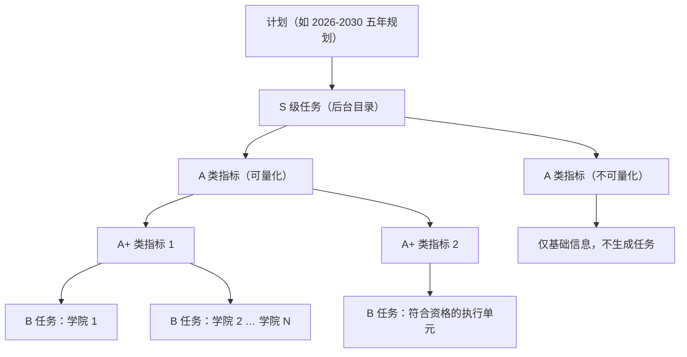
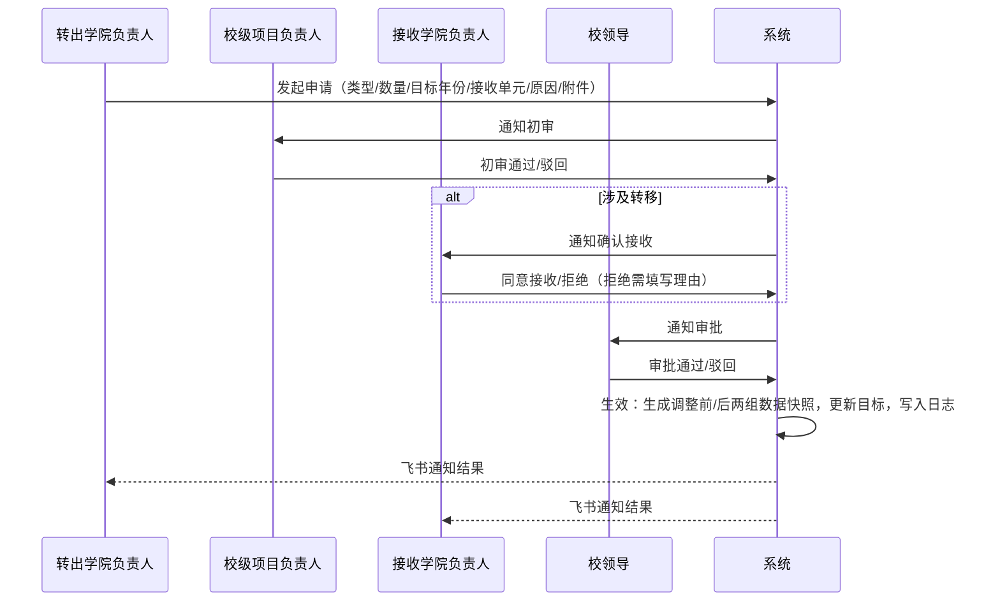
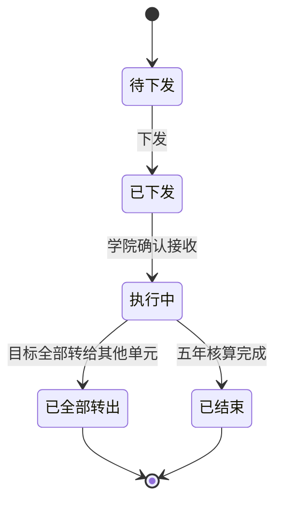
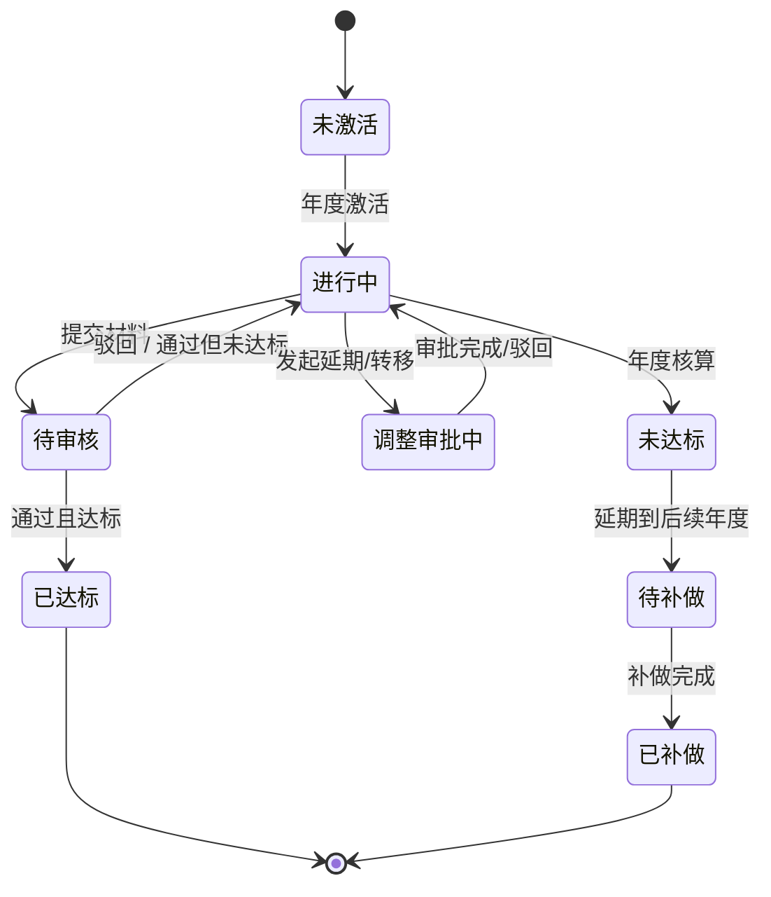
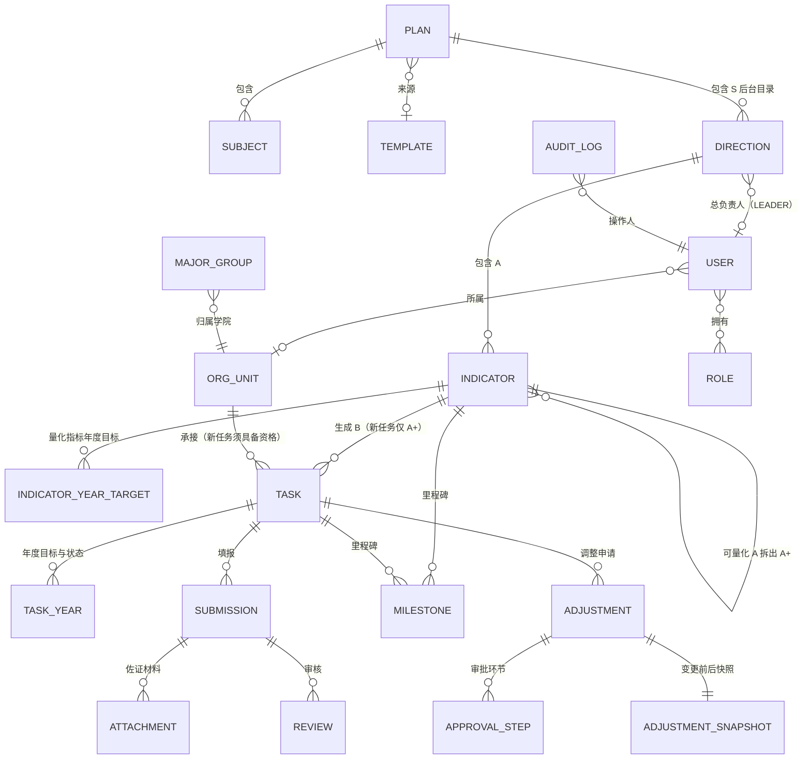

# 福州软件职业技术学院 · 五年计划指标管理平台 需求规格说明书

| 项目 | 内容 |
| --- | --- |
| 文档版本 | V0.5（草案，待业务方确认） |
| 编写日期 | 2026-10-26 |
| 输入材料 | 《要点.txt》、《对话分析.txt》（2026-10-22 需求讨论会纪要）、《草图.jpg》、业务方关于 S / A / A+ / B 的补充说明 |
| 关联文档 | [API统一约定文档.md](./API统一约定文档.md) |
| 文档状态 | 需求梳理阶段，暂不进入开发 |

> 阅读说明：文中标注 **【推断】** 的内容是根据材料做的合理推断，标注 **【待确认】** 的内容需要业务方拍板。所有待确认事项汇总在第 11 章。

**修订记录**

| 版本 | 日期 | 修订内容 |
| --- | --- | --- |
| V0.1 | 2026-10-22 | 初稿 |
| V0.2 | 2026-10-22 | 按业务方说明修订指标层级：A 类为最高级，A+ 为从 A 拆出的可下分指标，B 为下发到各学院的任务。作废 V0.1 中“A = 约束性目标、A+ = 发展性目标”的推断。新增层级汇总校验规则（4.5）和“达成方向”字段；同步更新功能、流程、数据模型和待确认事项；新增配套的《API 统一约定文档》 |
| V0.3 | 2026-10-22 | 按业务方要求不再跟进草图细节，删除草图相关待确认项（原 Q2、Q17）；新增 Q24、Q25 |
| V0.4 | 2026-10-22 | 补充 8 个二级学院名称，新增 2.1 执行单元清单和建议编码 |
| V0.5 | 2026-10-26 | 统一为 S / A / A+ / B 层级；S 收敛为后台目录，A 区分可量化与不可量化，仅 A+ 可分解；新 B 按单元资格分配到八院，原非八院及 A 直承任务转为只读历史；同步调整统计、模板和系统管理规则 |

---

## 1. 项目概述

### 1.1 背景

学校制定了五年发展规划（推断为“十五五”规划，周期 2026–2030 年），规划内容拆成多个 **S 级任务**（仅作后台目录）和**关键产出指标**，可量化指标需要逐级分解、下发到符合资格的学院执行，并按年度和五年周期核算完成情况。

目前的主要问题：

1. **没有可视化系统**：指标和进度只能线下看，不直观，领导无法实时掌握全局。
2. **调整没有留痕**：五年周期长，年度任务需要动态调整（延期、在学院之间转移），现在调整过程没有记录，学院之间容易互相扯皮。
3. **材料分散**：各学院的佐证材料（文档、图片、PDF、视频等）分散提交，审核和追溯都很困难。

### 1.2 建设目标

建设一个**模板化、可复用**的指标管理平台，覆盖“目标录入 → 量化分解 → 任务下发 → 材料提交 → 校级审核 → 年度/五年核算 → 可视化展示”的全过程，并做到：

- 指标调整全程留痕、可审批、可追溯、可导出；
- 自动计算完成率和增长率；
- 平台本身与具体规划解耦，以后的规划、专项计划可以直接套模板新建；
- 接入飞书，降低使用门槛。

### 1.3 范围边界

| 在范围内 | 不在范围内 |
| --- | --- |
| 指标录入、量化、分解、下发、填报、审核、核算、展示 | 制定具体业务指标（指标内容由业务方提供） |
| 平台管理员、校领导、校级项目负责人、学院项目负责人四类账号 | 学院内部的人员委派和分工（学院自行处理） |
| 指标延期、转移的申请、审批和留痕 | 第一版的自动/智能审核（第一版只做人工审核） |
| 飞书免登、工作台入口、消息通知 | 中台深度对接和飞书多维表格双向同步（放二期，接口先预留） |

---

## 2. 术语定义

| 术语 | 定义 |
| --- | --- |
| 计划 | 一个完整的规划实例，如“2026–2030 五年发展规划”，包含周期、指标体系、分解数据和执行数据 |
| 模板 | 从计划中抽出的结构（S 归属、指标定义、计量类型、填写说明、默认分解方式等），不含执行数据，用来快速新建计划；S 归属仅在后台保存和复制，模板结构及原始 JSON 预览不展示 S |
| 主体 | 指标的归属范围，分为**校级**和**专业群** |
| S 级任务 | 复用 `direction` 的后台顶层目录，用于归类 A。仅平台管理员可在系统管理中配置 S、具有校领导角色的总负责人及 A 归属；普通业务页、统计和大屏不展示 S，也不提供方向筛选、图表或下钻 |
| 关键产出指标 | 具体考核的指标项，按层级分为 A 类和 A+ 类；A+ 分解下发后形成 B 类任务 |
| A 类指标 | 校级原始任务，由校级项目负责人负责，分为**可量化**和**不可量化**两种。可量化 A 可拆出 A+；不可量化 A 只保留 S 归属、名称、性质、说明和负责人，不生成任务，不参与填报、审核、年度/五年核算及完成率统计 |
| A+ 类指标 | 从可量化 A 拆出的量化指标，是**唯一可分解下发**的指标层级；一个 A 可以拆出一个或多个 A+，A+ 不能再拆 A+ |
| B 类任务 | A+ 分解到符合承接资格的执行单元后形成的具体任务，是学院填报、提交材料、审核、延期/转移的最小单位；编号仍为 `{A+编号}-{单元编码}`，如 `A01-1-C01` |
| 历史任务 | 迁移前属于 C09、C10、S01 的任务及原 A 直承任务，以 `isHistorical=true` 标识。保留原 ID、编号、目标、已审核完成值和审计记录，只读，不删除、不重编号 |
| 指标性质 | **约束性**（必须完成）/ **发展性**（争取完成、有挑战的目标）。这是指标的属性，与 S / A / A+ / B 层级无关 |
| 计量类型 | 数值型、是否型、百分比型（可量化 / 不可量化），仅适用于可量化 A、A+ 及其 B；不可量化 A 不设置计量类型和统计口径。详见 4.3 |
| 执行单元 | 任务承接组织。初始保留 11 个单元；新 B 只能分配给 `isEnabled=true` 且 `isBAssignable=true` 的单元，初始仅 C01–C08 具备承接资格。资格由配置决定，禁止在代码中写死学院编码 |
| 量化 | 把目标拆成“五年总量 + 每年增量” |
| 分解 | 可量化 A 拆出 A+；仅 A+ 再按执行单元拆成 B |
| 下发 | 把 B 任务正式交给执行单元，执行单元开始可见、可填报 |
| 佐证材料 | 证明任务完成情况的附件，支持文档、图片、PDF、视频等 |
| 指标调整 | 在执行过程中对已下发且非历史的 B 任务做变更，包括**延期**（推到后面年份）和**转移**（转给其他符合资格的执行单元） |
| 里程碑 | 指标或任务上的关键节点，用来跟踪阶段性完成情况和“未完成→后续补做”的情况 |
| 基线值 | 规划起始前一年（默认 2025 年）的实际值，用来计算增长率 |

### 2.1 执行单元清单

8 个二级学院的名称由业务方提供。编码用于 B 任务编号（如 `A01-2-C01`），上线后不能修改。初始资格如下；“可承接新 B”与“启用”是两个独立配置，新 B 必须同时满足两项为真。

| 编码 | 名称 | 类型 | 可承接新 B（初始） | 说明 |
| --- | --- | --- | :-: | --- |
| C01 | 智能产业学院 | 二级学院 | 是 | |
| C02 | 数字金融产业学院 | 二级学院 | 是 | |
| C03 | 数字影视传媒产业学院 | 二级学院 | 是 | |
| C04 | 数据产业学院 | 二级学院 | 是 | |
| C05 | 游戏产业学院 | 二级学院 | 是 | |
| C06 | 智能建造产业学院 | 二级学院 | 是 | |
| C07 | 现代通信产业学院 | 二级学院 | 是 | |
| C08 | 未来技术产业学院 | 二级学院 | 是 | |
| C09 | 国际学院 | 国际学院 | 否 | 正式名称待确认；既有任务保留为只读历史 |
| C10 | 马克思主义学院 | 马克思主义学院 | 否 | 正式名称待确认；既有任务保留为只读历史 |
| S01 | 校办公室 | 校办公室 | 否 | 既有任务保留为只读历史，不再默认承接 A |

---

## 3. 用户角色与权限

### 3.1 角色定义

会议确定的是三层角色。因为“指标转移需要校领导审批”，这里额外增加了“校领导”角色【待确认】。

| 角色 | 对应人员 | 主要职责 |
| --- | --- | --- |
| 平台管理员 | 发展规划处 / 系统管理员 | 管理计划、模板、S 级任务、组织、账号、字典；配置 S 的校领导总负责人和 A 归属；录入和导入指标；全局查看；导出日志；可代为审核 |
| 校领导【新增，待确认】 | 分管校领导 | 审批指标调整（延期/转移）；查看大屏和全校统计；可被指定为 S 总负责人，仅建立责任关联 |
| 校级项目负责人（项目直接干系人） | 每条 A 类指标的校级负责人 | 对负责的 A 类指标做量化、拆出 A+、分解并下发 B 任务、审核学院材料、初审调整申请 |
| 学院项目负责人（学院项目干系人） | 各执行单元指定的 B 任务负责人 | 查看本单元的 B 任务、填报完成值、上传佐证材料、发起延期/转移申请、确认接收转入的任务 |

> 学院以下的人员分工由学院自己管理，平台不管。如果学院内部有多人协同填报，建议由学院项目负责人统一提交（是否允许设置“学院填报员”子账号属于【待确认】）。

### 3.2 权限矩阵

| 功能 | 平台管理员 | 校领导 | 校级项目负责人 | 学院项目负责人 |
| --- | :-: | :-: | :-: | :-: |
| 新建/复制计划、管理模板 | ✅ | ❌ | ❌ | ❌ |
| 录入/导入指标体系 | ✅ | ❌ | 仅负责的指标（编辑） | ❌ |
| 量化分解、下发任务 | ✅ | ❌ | 仅负责的指标 | ❌ |
| 填报完成值、上传材料 | 可代填 | ❌ | ❌ | 仅本单元任务 |
| 审核材料 | ✅（代审） | 查看 | 仅负责的指标 | ❌ |
| 发起延期/转移申请 | ✅ | ❌ | ✅ | 仅本单元任务 |
| 确认接收转入任务 | ❌ | ❌ | ❌ | 仅本单元 |
| 审批延期/转移 | ❌ | ✅ | 初审 | ❌ |
| 查看统计/大屏 | 全校 | 全校 | 负责的指标 + 全校概览 | 本单元 + 全校概览【待确认】 |
| 查看/导出操作日志 | ✅ | ✅（查看） | 负责指标相关 | 本单元相关 |
| 系统管理（组织、账号、字典） | ✅ | ❌ | ❌ | ❌ |
| 配置 S、总负责人及 A 归属 | ✅ | ❌ | ❌ | ❌ |

**数据权限原则**：学院只能看到和操作本单元的任务；校级项目负责人只能管理自己负责的指标；管理员和校领导可以看全校数据。S 总负责人不新增角色或数据范围，不改变 LEADER 全校可见规则及“校级负责人初审 → 接收方确认 → 校领导审批”的既有审批链。

---

## 4. 指标体系与数据规则

### 4.1 指标层级结构（S / A / A+ / B）

现行层级统一为 **S → A → A+ → B**。S 只是后台目录，不是统计或业务展示维度；A 是校级原始任务；只有 A+ 可以分解下发为 B。

| 层级 | 含义 | 负责人 | 目标 | 谁来填报 |
| --- | --- | --- | --- | --- |
| S 级任务 | A 的后台顶层目录，仅系统管理可见 | 校领导总负责人，仅建立责任关联，不新增角色 | 不设置、不汇总 | 无 |
| A 类（可量化） | 校级原始任务，可拆出 A+ | 校级项目负责人 | 五年总量 + 每年增量 | 不直接填报，由下级汇总或手工认定 |
| A 类（不可量化） | 只保留 S 归属、名称、性质、说明和负责人 | 校级项目负责人 | 不设置 | 无；不生成任务，不参与填报、审核、核算和完成率 |
| A+ 类 | 从可量化 A 拆出的量化指标，唯一可分解层级 | 默认沿用 A 的校级项目负责人，可另行指定 | 五年总量 + 每年增量 | 不直接填报，由下属 B 汇总 |
| B 类 | A+ 分解到符合资格单元的任务 | 学院项目负责人 | 本单元的五年总量 + 每年增量 | ✅ 学院填报、提交材料 |

**示例**

| 层级 | 编号 | 内容 | 五年目标 | 2026 年目标 |
| --- | --- | --- | --- | --- |
| A | A01 | 新增省级及以上教学成果奖 | 5 项 | 1 项 |
| A+ | A01-1 | 新增国家级教学成果奖 | 1 项 | 0 项 |
| A+ | A01-2 | 新增省级教学成果奖 | 4 项 | 1 项 |
| B | A01-2-C01 | 智能产业学院：新增省级教学成果奖 | 1 项 | 1 项 |
| B | A01-2-… | 其余符合资格学院按分解结果 | 合计 4 项 | 合计 1 项 |

**分配规则**

| 情形 | 处理方式 |
| --- | --- |
| A 类-可量化 | 可拆出一个或多个 A+；每个 A+ 再按执行单元分解为 B |
| A 类-不可量化 | 只维护基础信息，不拆 A+、不生成 B，不进入任何执行和核算流程 |
| 专业群的 A 类 | 同样按是否可量化处理，不再默认生成专业群所属学院的直承任务 |
| A+ 分解、转移接收及草稿预览 | 执行单元必须同时满足 `isEnabled=true`、`isBAssignable=true`；初始仅 C01–C08，统一读取配置，禁止写死编码 |

> 原“不可下分 A 直接生成校办公室或指定单位任务”的规则自 V0.5 起作废。迁移前已经存在的 A 直承任务不删除、不重编号，按 4.6 节作为只读历史保留。

### 4.2 指标字段

指标录入字段参照业务方现有表格扩展而来。普通指标编辑页不显示 S；S 及 A 归属只在系统管理的“S 级任务”面板维护。

| 字段 | 适用层级 | 说明 | 必填 |
| --- | --- | --- | :-: |
| 指标编号 | A / A+ | 系统生成或导入。A 为 `A01`，A+ 为 `A01-1`；B 任务编号自动生成为 `A01-1-{单元编码}` | ✅ |
| 指标层级 | A / A+ | A 类 / A+ 类；B 使用任务层级枚举 | ✅ |
| 上级 A 类指标 | A+ | A+ 必须挂在一条可量化 A 下面 | ✅ |
| 是否可量化 `isQuantifiable` | A | 可量化：可设置目标并拆出 A+；不可量化：只维护基础信息 | ✅ |
| S 归属 `directionId` | A（A+ 后台沿用） | 草稿 A 可暂空，定稿前必须由 ADMIN 在系统管理中归属到 S；普通业务表单不显示 | 定稿必填 |
| 所属主体 | 可量化 A（A+ 沿用） | 校级 / 专业群（选专业群时还需选择具体专业群）；不可量化 A 不设置 | 量化必填 |
| 关键产出指标名称 | A / A+ | 如“新增省级以上教学成果奖” | ✅ |
| 指标性质 | A / A+ | 约束性 / 发展性（A+ 默认沿用 A 的设置） | ✅ |
| 计量类型 | 可量化 A / A+ | 数值 / 是否 / 百分比-可量化 / 百分比-不可量化；不可量化 A 为 `null` | 量化必填 |
| 计量单位 | 可量化 A / A+ | 项、个、人、张、门、% 等（字典维护）；不可量化 A 为 `null` | 量化必填 |
| 统计口径 | 可量化 A / A+ | 增量累计型 / 存量时点型 / 增长率型 / 占比型 / 直填百分比型 / 是否型（见 4.4）；不可量化 A 为 `null` | 量化必填 |
| 达成方向 | 可量化 A / A+ | 越大越好（默认）/ 越小越好（如生师比）；不可量化 A 为 `null` | 量化必填 |
| 汇总方式 | 可量化 A | 自动汇总（A+ 与 A 的单位、口径一致时）/ 手工认定（不一致时由校级项目负责人认定 A 的完成情况） | 量化必填 |
| 指标填写说明 | A / A+ | 不可量化 A 填写任务说明；量化指标填写统计口径、认定标准、佐证材料要求 | ✅ |
| 基线值 | 可量化 A / A+ | 2025 年的实际值（增长率型、存量型必填）；不可量化 A 为 `null` | 视类型 |
| 五年目标总量 | 可量化 A / A+ | 五年总目标；不可量化 A 为 `null` | 量化必填 |
| 年度目标 | 可量化 A / A+ | 规划期每年的增量目标（存量型填年末存量）；不可量化 A 不生成年度目标 | 量化必填 |
| 校级项目负责人 | A（A+ 默认沿用） | 项目直接干系人 | ✅ |
| 佐证材料要求 | 可量化 A / A+ | 必须上传的材料类型和数量（B 沿用）；不可量化 A 不设置 | ❌ |
| 里程碑 | 可量化 A / A+ / B | 见 5.7；不可量化 A 不设置 | ❌ |

> **关于 S / A / A+ / B（V0.5 修订）**：A 是校级原始任务，可量化与不可量化取代原“可下分 / 不可下分”分类；只有 A+ 可分解为 B。不可量化 A 的计量类型、统计口径、单位、达成方向、汇总方式、基线值、目标及材料配置均为空，不参与任何完成值或完成率计算。V0.1 中“A = 约束性目标值、A+ = 发展性目标值”的推断仍然作废；约束性 / 发展性只作为“指标性质”字段。

### 4.3 计量类型

本节仅适用于可量化 A、A+ 及其 B。“百分比-不可量化”指百分比无法由平台采集的原始数值推算，不等于“不可量化 A”；不可量化 A 不选择任何计量类型。

| 计量类型 | 示例 | 采集方式 | 完成判定 |
| --- | --- | --- | --- |
| 数值型 | 新增省级项目 3 项、培训 500 人次 | 填报数量 + 佐证材料 | 审核通过的累计值 ≥ 目标值 |
| 是否型 | 是否建成省级高水平产教融合基地 | 填报“是/否” + 佐证材料 | 审核通过且为“是” |
| 百分比-可量化 | 五年科研经费增长 15%；双师型教师占比 ≥ 60% | **不直接填百分比**，只采集原始数据（总量，或分子/分母），由系统计算百分比 | 系统算出的百分比 ≥ 目标 |
| 百分比-不可量化 | 学生满意度 ≥ 90%（来自第三方调查） | 直接填写百分比 + 来源说明和佐证材料 | 填报值 ≥ 目标 |

### 4.4 统计口径与计算规则

以下规则仅对可量化 A、A+、B 三个层级适用。各层级之间如何汇总，见 4.5；不可量化 A 不参与计算。

#### 4.4.1 增量累计型（数值型最常见）

- 五年总量目标 = 各年度增量目标之和（系统强制校验）。
- 年度完成值 = 当年审核通过的填报增量之和。
- 年度完成率 = 年度完成值 ÷ 年度目标增量。
- 五年累计完成值 = 各年度完成值之和；五年完成率 = 五年累计完成值 ÷ 五年总量目标。

#### 4.4.2 存量时点型

- 年度目标是**年末应达到的总量**，不是增量。
- 年度完成值 = 当年最后一次审核通过的总量值。
- 年度增量 = 本年总量 − 上年总量（由系统计算）。

#### 4.4.3 增长率型 / 占比型（百分比-可量化）

**(a) 增长率型**（例：五年增长 15%）

- 系统采集每年的**总量原始值**，不采集增长率本身。
- 年度增长率 = 今年总量 ÷ 去年总量 − 1（2026 年的“去年”就是基线值）。
- 五年增长率 = 2030 年总量 ÷ 基线值 − 1。
- 年度目标的设定方式（由校级负责人选择）：
  - 手动输入每年的目标总量；
  - 系统辅助按**复利**拆分：每年增长率 = (1 + 15%)^(1/5) − 1 ≈ 2.83%；
  - 系统辅助按**线性**拆分：每年增加 基线值 × 15% ÷ 5。
- 每年核算一次当年是否达到年度目标；五年结束后统一核算五年目标。

**(b) 占比型**（例：双师型教师占比 ≥ 60%）

- 采集分子（如双师型教师数）和分母（如专任教师总数），占比 = 分子 ÷ 分母。
- A+ 分解为 B 时，**A+ 的占比 = 各 B 分子之和 ÷ 各 B 分母之和**，而不是各学院百分比的简单平均。

#### 4.4.4 直填百分比型（百分比-不可量化）

- 直接填写百分比，必须附上数据来源和佐证材料。
- 需要下发时，必须由可量化 A 先拆出 A+，再分解到学院；各学院分别设目标、分别核算，A 的值由校级项目负责人单独认定【待确认】。不允许由 A 直接生成新任务。

#### 4.4.5 是否型

- 需要指定计划完成的年份（即里程碑年）。到了该年份仍未完成，就判为当年未达标，并进入“待补做”状态（见 5.7）。

#### 4.4.6 状态判定与预警

下表是用于统计和展示的**达成状态**；B 任务的**流程状态**见 6.2。

| 状态 | 判定 |
| --- | --- |
| 未开始 | 已下发，还没有任何审核通过的数据 |
| 进行中 | 有审核通过的数据，但还没达到目标 |
| 达标 | 完成值达到目标值（越大越好：≥ 目标；越小越好：≤ 目标） |
| 超额 | 完成率 > 100% |
| 未达标 | 年度核算时完成值没有达到目标值 |
| 滞后预警 | 年内的完成进度明显落后于时间进度，阈值可配置（例如到 9 月底完成率 < 50%） |

### 4.5 层级汇总与校验规则

| 规则 | 说明 | 校验时机 |
| --- | --- | --- |
| A+ → B 分解守恒 | 每个年度“历史 B 的冻结目标 + 非历史 B 的目标” = A+ 的年度目标；五年总量同样守恒。历史目标只能作为冻结基数，不可编辑 | 非历史草稿可以保存；下发前强制校验 |
| A → A+ 拆分守恒 | 可量化 A 汇总方式为“自动汇总”时，各 A+ 的目标之和 = A 的目标；不可量化 A 不校验 | 指标体系定稿前强制校验 |
| B → A+ 完成值汇总 | A+ 的完成值 = 各 B 审核通过的完成值之和。占比型为 Σ分子 ÷ Σ分母；增长率型先汇总各单元总量，再计算增长率；历史已审核值按历史统计口径保留 | 实时 |
| A+ → A 完成值汇总 | 自动汇总：A 的完成值 = 各 A+ 完成值之和；手工认定：由校级项目负责人填写认定结果并附说明 | 实时 / 年度核算 |
| 调整守恒 | 非历史 B 之间的延期和转移不改变 A+ 的五年总量，历史冻结目标保持不变 | 调整生效时 |

> 比率类指标（增长率型、占比型、直填百分比型）的目标不能简单相加，所以不做目标求和校验，只按上表方式汇总完成值。不可量化 A 不参与本表任何校验、汇总和完成率计算。

### 4.6 新 B 承接与只读历史任务

1. **历史标记**：迁移时，将 C09、C10、S01 下的既有任务及所有原 A 直承任务标记为 `isHistorical=true`，包括八院中由原 A 直接生成的任务。保留全部任务 ID、编号、状态、目标、已审核完成值、调整快照和审计日志，不删除、不重编号。
2. **冻结目标与统计**：历史任务目标作为所属 A+ 守恒校验的冻结基数，不能被草稿、下发或调整修改；历史已审核完成值继续保留在历史统计中。当前待办、预警和可执行数量一律排除历史任务。
3. **在途数据处理**：迁移时逐笔终止历史任务的在途填报和调整，记录“任务层级与命名体系调整”原因及对应快照、审批和审计轨迹，释放未生效冻结额度；不得自动审核通过、不得自动使调整生效。
4. **写操作守卫**：历史任务禁止确认接收、新建/修改/删除填报、提交、撤回、单笔/批量审核、发起或处理调整、补做及年度批处理写入，服务端统一返回 `409 + 50006（TASK_HISTORICAL_READ_ONLY）`；年度激活、核算、补做生成等待办批处理必须跳过历史任务，待办和提醒也不得为其生成新记录。
5. **只读访问**：历史任务详情、年度目标、填报与审核记录、调整历史、里程碑和审计日志仍按原数据范围可读；页面显示“只读历史”标识并隐藏写操作，服务端守卫为最终边界。

---

## 5. 功能需求

优先级说明：**P0** = 一期必须做；**P1** = 一期尽量做；**P2** = 二期。

### 5.1 计划与模板管理（M1）

草图底部的设计是：首页用卡片展示计划，第一张卡片是“+”（新建），后面是“五年计划”等已有计划。

| 编号 | 需求 | 优先级 |
| --- | --- | :-: |
| FR-M1-01 | 首页以卡片形式列出计划（名称、周期、状态、整体完成率），第一张是“+ 新建计划” | P0 |
| FR-M1-02 | 新建计划有三种方式：空白新建、从模板新建、复制已有计划（可选是否带上分解数据） | P0 |
| FR-M1-03 | 计划属性：名称、起止年份（默认 2026–2030，可设任意年限）、基线年、年度核算截止日、状态（草稿 / 执行中 / 已归档） | P0 |
| FR-M1-04 | 把计划另存为模板（后台保留 S 及 A 归属、指标定义、计量类型、填写说明、默认分解规则，不含执行数据）；模板结构和原始 JSON 预览不展示 S，复制时仍由后台携带 S 归属 | P0 |
| FR-M1-05 | 所有计划和模板共用同一套业务流程：上传目标 → 量化 → 下发 → 提交 → 审核 → 调整审批 | P0 |
| FR-M1-06 | 模板支持编辑、复制、停用 | P1 |
| FR-M1-07 | 计划归档后只读，数据长期保留 | P1 |

### 5.2 指标体系录入（M2）—“上传目标”

| 编号 | 需求 | 优先级 |
| --- | --- | :-: |
| FR-M2-01 | 维护“A 类指标 → A+ 类指标”结构，支持新增、编辑、排序、删除（下发后不能删除）；S 及 A 归属仅在系统管理中维护，普通指标页不显示 S | P0 |
| FR-M2-02 | 通过 **Excel 批量导入**指标（平台提供标准模板，列与业务方现有表格一致，用“层级”和“上级编号”两列表示 A 与 A+ 的关系），导入前预览并校验，错误逐行提示 | P0 |
| FR-M2-03 | 按 4.2 节的字段录入指标，字段校验规则随层级、是否可量化和计量类型联动；不可量化 A 只显示并校验 S 归属、名称、性质、说明、负责人，量化字段允许为空 | P0 |
| FR-M2-04 | 为每条 A 类指标指定校级项目负责人（A+ 默认沿用） | P0 |
| FR-M2-05 | 以树形总表查看指标（A 可展开为 A+），列为：层级 / 是否可量化 / 关键产出指标 / 指标性质 / 类型 / 单位 / 五年目标 / 各年度目标；不显示 S 或方向筛选 | P0 |
| FR-M2-06 | 指标体系导出为 Excel；普通业务导出不含 S 或方向维度 | P0 |
| FR-M2-07 | 指标体系定稿（锁定）后才能分解下发；定稿时所有 A 必须归属 S，可量化 A/A+ 校验量化字段和守恒，不可量化 A 跳过量化校验；定稿后 S 结构及 A 归属锁定，总负责人可在执行期更换；目标值变更必须走“目标调整”审批（见 5.6） | P1 |
| FR-M2-08 | **拆出 A+**：仅对可量化 A 新增一个或多个 A+，系统按 4.5 节校验拆分守恒；不可量化 A 不生成 A+ 或任务 | P0 |

### 5.3 量化分解与任务下发（M3）

| 编号 | 需求 | 优先级 |
| --- | --- | :-: |
| FR-M3-01 | **年度量化**：为每条可量化 A、A+ 设置五年总量和每年增量（或年末存量），系统校验各年之和等于五年总量；不可量化 A 不设置 | P0 |
| FR-M3-02 | **分解为 B**：每条 A+ 按“执行单元 × 年度”矩阵录入各学院的目标，系统实时校验“历史冻结目标 + 非历史目标”等于 A+ 的目标（规则见 4.5）；非历史草稿不一致时可以保存，但不能下发 | P0 |
| FR-M3-03 | 只有 A+ 可以分解下发；任何 A 都不能直接生成新任务，不可量化 A 不进入分解页 | P0 |
| FR-M3-04 | 分解预览、草稿保存、下发及转移接收统一校验执行单元 `isEnabled=true` 且 `isBAssignable=true`；初始仅 C01–C08 可承接新 B，资格从单元配置读取，禁止写死编码 | P0 |
| FR-M3-05 | 每条非历史 B 任务都必须指定学院项目负责人（直接干系人） | P0 |
| FR-M3-06 | 增长率型指标提供复利 / 线性拆分辅助（见 4.4.3） | P1 |
| FR-M3-07 | **下发方式**【推断，待确认】：B 任务的五年分解一次下发，学院能看到五年目标；年度任务在每年开始时自动（或手动）**激活**，激活后才能填报；历史任务不激活 | P0 |
| FR-M3-08 | 下发前预览，可以整批下发，也可以按 A 或 A+ 下发（实际只处理其下 A+）；下发后通过飞书通知学院负责人 | P0 |
| FR-M3-09 | 学院收到非历史 B 任务后点“确认接收”，系统记录确认时间，作为责任凭证；历史任务只读，不能确认接收 | P1 |

### 5.4 任务执行与材料提交（M4）

| 编号 | 需求 | 优先级 |
| --- | --- | :-: |
| FR-M4-01 | **学院工作台**：列出本单元 B 任务，展示所属 A / A+、五年目标、本年目标、已完成值、完成率、状态、截止时间；历史任务显示“只读历史”，不计入待办、预警和可执行数量 | P0 |
| FR-M4-02 | **填报**：非历史任务按计量类型填写完成值（数值 / 是否 / 总量 / 分子分母 / 百分比），并填写完成情况说明；历史任务只能查看填报记录，所有写入口隐藏且由服务端拒绝 | P0 |
| FR-M4-03 | **佐证材料上传**：支持多个文件，格式包括 doc/docx、xls/xlsx、ppt/pptx、pdf、jpg/png、mp4/mov 等；单文件大小上限可配置（建议文档 ≤ 50MB，视频 ≤ 500MB）；大文件支持断点续传 | P0 |
| FR-M4-04 | 填报频率【推断】：年度内随时可以多次提交（每次是一笔增量或一个最新总量），按年度核算 | P0 |
| FR-M4-05 | 提交前可存草稿；提交后进入审核，审核期间不能修改；被驳回后可以修改再提交 | P0 |
| FR-M4-06 | 查看历史提交记录和审核意见 | P0 |
| FR-M4-07 | 里程碑进度更新（见 5.7） | P1 |

### 5.5 校级审核（M5）

| 编号 | 需求 | 优先级 |
| --- | --- | :-: |
| FR-M5-01 | 审核人默认是 B 所属 A / A+ 的校级项目负责人【推断】，平台管理员可以代审 | P0 |
| FR-M5-02 | 待审列表可按计划、指标、学院、提交时间筛选，只包含非历史任务；历史填报及审核记录可从任务详情只读查看，单笔和批量审核均禁止写入 | P0 |
| FR-M5-03 | **在线预览**佐证材料（Office 文档、PDF、图片、视频），不用下载 | P0 |
| FR-M5-04 | 审核结果为“通过”或“驳回”，驳回必须填写意见；只有审核通过的数据才计入完成值 | P0 |
| FR-M5-05 | 审核时可以核减数量（例如学院报 3 项，审核只认定 2 项），并记录原值和认定值 | P1 |
| FR-M5-06 | 审核结果通过飞书通知提交人 | P0 |
| FR-M5-07 | 第一版只做人工审核；以后再考虑规则校验、智能辅助审核 | P2 |

### 5.6 指标调整：延期 / 转移（M6）——核心特色功能

#### 5.6.1 调整类型

| 类型 | 说明 | 守恒规则 |
| --- | --- | --- |
| 延期 | 某学院当年完不成，把该 B 未完成的量推到后面某一年 | 该 B 的五年总量不变，只改变年度分布；最晚只能推到规划末年 |
| 转移 | 把某学院非历史 B（某年度）的部分或全部目标转给另一个符合 `isEnabled && isBAssignable` 的执行单元 | A+ 总量不变：转出方 B 减多少，接收方 B 就加多少；接收方原本没有该 A+ 的 B 时，系统自动新建非历史任务；历史冻结目标不变 |
| 延期 + 转移 | 转给其他学院，并且在后面的年份完成 | 同时满足上面两条 |
| 目标调整 | 修改可量化 A 或 A+ 的目标值（如规划中期调整），并同步调整下属的 A+ / 非历史 B | 只有管理员能发起，必须校领导审批【P1】；不可量化 A 无目标可调整 |

> 适用范围【推断】：延期和转移主要针对增量累计型指标，按“数量”调整；是否型只支持延期（改计划完成年份）；存量时点型和比率类指标不按数量转移，需要变更时走“目标调整”。

#### 5.6.2 审批流程

| 编号 | 需求 | 优先级 |
| --- | --- | :-: |
| FR-M6-01 | 学院负责人、校级项目负责人或管理员可以对非历史 B 发起延期 / 转移申请；必须填写调整数量、目标年份、接收单元、原因，可以上传附件；历史任务及其在途调整只读，不能发起、撤回或审批 | P0 |
| FR-M6-02 | 系统自动校验守恒规则，以及“调整数量 ≤ 尚未完成的量”；转移接收单元必须同时启用且可承接新 B，草稿预览与正式申请使用同一资格校验 | P0 |
| FR-M6-03 | 审批链固定为：校级项目负责人初审 → （转移时）接收方确认 → 校领导审批；S 总负责人不新增审批节点 | P0 |
| FR-M6-04 | 审批通过后才生效；生效时同时保存**原指标**和**变更后指标**两组数据，以版本形式留存 | P0 |
| FR-M6-05 | 每条 B 任务都能查看完整的调整历史（时间线：申请人、各环节审批人、意见、调整前后值） | P0 |
| FR-M6-06 | 审批过程中被调整的那部分额度会被冻结，不能重复申请 | P0 |
| FR-M6-07 | 接收方确认这一步是否必需，可按计划配置【建议保留，避免扯皮】 | P1 |
| FR-M6-08 | 年度核算时如果有未完成的量，系统提示学院在规定期限内选择：申请延期 / 申请转移 / 确认未达标 | P1 |

### 5.7 里程碑管理（M7）

| 编号 | 需求 | 优先级 |
| --- | --- | :-: |
| FR-M7-01 | 为可量化 A、A+ 或非历史 B 定义里程碑：名称、计划完成时间、交付物要求、关联的年度目标；不可量化 A 不设置，历史任务里程碑只读 | P0 |
| FR-M7-02 | 里程碑状态：未开始 / 进行中 / 已完成 / 逾期 / 已延期 | P0 |
| FR-M7-03 | **未完成→后续补做**：非历史任务某年度未达标的缺口自动生成“待补做”记录，并关联到补做年份；补做完成后，原年度标记为“已补做”；历史任务不生成或完成补做 | P0 |
| FR-M7-04 | 在甘特图或时间轴上查看里程碑 | P1 |

### 5.8 统计核算（M8）

| 编号 | 需求 | 优先级 |
| --- | --- | :-: |
| FR-M8-01 | 可量化指标的完成值、完成率、增长率、达标状态按第 4.4 节规则自动实时计算，并按 4.5 节从 B 汇总到 A+，再汇总到 A；不可量化 A 不参与 | P0 |
| FR-M8-02 | **年度核算**：到了年度核算截止日，锁定当年非历史任务数据，生成年度核算结果（按 A / A+ / B、学院、年度汇总）；历史任务跳过所有批处理写入，其已审核完成值仍可用于历史统计；锁定后要修改，需要管理员解锁并留痕 | P0 |
| FR-M8-03 | **五年核算**：规划期结束后统一核算可量化指标五年目标完成情况；不可量化 A 不参与，历史任务不生成新的核算写入 | P0 |
| FR-M8-04 | 多维度统计报表：按主体、A 级指标（`by-indicator`）、指标层级（A / A+ / B）、学院、年度、指标性质统计，可导出 Excel；不提供 S/方向筛选、图表或下钻，原方向统计由现有 A/`by-indicator` 统计替代 | P0 |
| FR-M8-05 | 预警：滞后、即将到期、逾期未提交，阈值可配置；不可量化 A 和历史任务不生成预警，当前可执行数量排除历史任务 | P1 |

### 5.9 可视化大屏（M9）

| 编号 | 需求 | 优先级 |
| --- | --- | :-: |
| FR-M9-01 | 大屏首页（适配 1920×1080）：整体完成率、约束性 / 发展性指标达标数、本年度进度与时间进度对比；不可量化 A 和历史任务的当前可执行数量不计入 | P0 |
| FR-M9-02 | 各执行单元完成率排名和对比，单元数量由统计数据驱动，不写死 11 个 | P0 |
| FR-M9-03 | 展示 A 级指标（`by-indicator`）完成情况，可逐级下钻 A → A+ → 各学院 B；不展示 S，不提供方向图表或方向下钻 | P0 |
| FR-M9-04 | 规划期年度趋势（目标与实际对比） | P0 |
| FR-M9-05 | 预警指标列表、最近审核动态、指标调整统计；历史任务不生成当前预警或待办 | P1 |
| FR-M9-06 | 大屏数据定时自动刷新；仅支持按计划和年度切换，不提供 S/方向切换 | P1 |

### 5.10 操作日志与审计（M10）

| 编号 | 需求 | 优先级 |
| --- | --- | :-: |
| FR-M10-01 | 全量记录关键操作：录入、修改、分解、下发、提交、审核、调整申请、审批、解锁、权限变更、导出等 | P0 |
| FR-M10-02 | 日志字段：时间、操作人、角色、所属单元、操作类型、对象、变更前值、变更后值、IP 或终端、相关干系人 | P0 |
| FR-M10-03 | 日志只能追加，任何人都不能修改或删除 | P0 |
| FR-M10-04 | 按时间范围、单元、指标、操作类型查询日志，并**导出为 Excel** | P0 |
| FR-M10-05 | 日志至少保留到规划期结束后 5 年【待确认】 | P0 |

### 5.11 消息通知与待办（M11）

| 编号 | 需求 | 优先级 |
| --- | --- | :-: |
| FR-M11-01 | 站内待办中心：待填报、待审核、待确认接收、待审批；聚合查询和数量均排除历史任务及其已终止在途记录 | P0 |
| FR-M11-02 | 飞书消息通知：任务下发、截止提醒、审核结果、调整申请、审批结果；不得为历史任务生成新的待办或提醒 | P0 |
| FR-M11-03 | 截止前 N 天自动提醒，N 可配置；历史任务不提醒 | P1 |

### 5.12 系统管理（M12）

| 编号 | 需求 | 优先级 |
| --- | --- | :-: |
| FR-M12-01 | 执行单元管理：默认初始化 2.1 节的 11 个单元，支持增删改和停用；增加“可承接新 B”配置（`isBAssignable`），初始仅 C01–C08 为真，新 B 同时校验启用和承接资格 | P0 |
| FR-M12-02 | 专业群管理：名称、所属学院、负责人 | P0 |
| FR-M12-03 | 用户和角色管理；用户可以同时担任多个角色（如某人既是校级负责人，又是学院负责人） | P0 |
| FR-M12-04 | 字典管理：计量单位、指标性质、材料类型 | P0 |
| FR-M12-05 | 参数配置：文件格式和大小、预警阈值、提醒天数、年度核算截止日 | P1 |
| FR-M12-06 | 增加“S 级任务”面板：仅 ADMIN 按计划管理 S、校领导总负责人及 A 归属；总负责人必须具有 LEADER 角色，可为空并在执行期更换；S 结构及 A 归属在草稿期可调整、定稿后锁定，不新增角色或审批节点 | P0 |

### 5.13 飞书与中台集成（M13）

| 编号 | 需求 | 优先级 |
| --- | --- | :-: |
| FR-M13-01 | 飞书免登（OAuth），飞书用户与平台用户绑定 | P0 |
| FR-M13-02 | 在飞书工作台提供入口（网页应用 / H5，可在 PC 端和移动端打开） | P0 |
| FR-M13-03 | 飞书消息推送（机器人或应用消息） | P0 |
| FR-M13-04 | 从飞书或中台同步组织架构和人员 | P1 |
| FR-M13-05 | 将指标和进度数据导出或同步到**飞书多维表格** | P2 |
| FR-M13-06 | 对接学校数据中台：统一身份认证、基础数据（教师数、学生数等）自动获取，以减少手工填报 | P2 |
| FR-M13-07 | 保留账号密码登录，作为飞书不可用时的备用方式 | P0 |

---

## 6. 核心业务流程

### 6.1 总体流程

### 6.2 B 任务状态机

B 任务分两层状态：**任务状态**描述整条任务的生命周期；**年度状态**描述每个年度的执行和核算结果。接口中的枚举值见《API 统一约定文档》第 9 章。

### 6.3 模板复用流程

1. 管理员在首页点击“+”，选择“从模板新建”。
2. 选择模板，填写计划名称和周期，系统在后台复制 S 及 A 归属、指标结构和默认分解规则；模板结构及原始 JSON 预览不展示 S。
3. 管理员修改或导入新的指标内容，并可在系统管理中调整草稿计划的 S 和 A 归属。
4. 之后的量化、下发、审核、调整流程与原计划完全一致；不可量化 A 只保留基础信息，不进入后续执行流程。

---

## 7. 页面清单（原型参考）

| 编号 | 页面 | 使用角色 | 说明 |
| --- | --- | --- | --- |
| P01 | 登录 / 飞书免登 | 全部 | |
| P02 | 首页（计划卡片） | 全部 | “+ 新建”卡片和计划卡片，对应草图底部 |
| P03 | 计划概览 | 全部 | 关键数据、进度、待办和 A 级指标完成情况；不展示 S 或方向维度 |
| P04 | 指标总表 | 管理员、校级负责人 | 树形展示 A → A+，支持导入导出；不显示 S 或方向筛选，不可量化 A 的量化字段显示为空 |
| P05 | 指标详情 | 全部（按权限） | 定义、年度目标、下属 A+ / B、里程碑、调整历史、日志；不展示 S，历史任务显示只读标识 |
| P06 | 分解矩阵 | 管理员、校级负责人 | 仅 A+ 可分解为 B：仅列出启用且可承接新 B 的单元，展示历史冻结基数并实时校验守恒 |
| P07 | 学院工作台 | 学院负责人 | 本单元 B 任务列表；历史任务只读，不计入待办、预警和可执行数量 |
| P08 | 填报 / 材料上传 | 学院负责人 | 历史任务仅可查看既有填报和材料，隐藏全部写操作 |
| P09 | 审核中心 | 校级负责人、管理员 | 待审列表、在线预览、通过或驳回；历史任务不进入待审或批量审核 |
| P10 | 调整申请 / 审批 | 相关角色 | 非历史任务的发起、确认、审批及调整前后对比；历史调整记录只读 |
| P11 | 统计报表 | 管理员、校领导、校级负责人 | 使用 A/`by-indicator` 等维度，不提供 S/方向筛选、图表或下钻 |
| P12 | 可视化大屏 | 校领导、管理员 | 以 A 级指标完成情况替代方向面板，不展示 S 或方向下钻 |
| P13 | 操作日志 | 管理员等 | 查询和导出，历史任务审计记录仍可按数据范围查看 |
| P14 | 模板管理 | 管理员 | 模板结构和原始 JSON 不展示 S；复制时后台携带 S 及 A 归属 |
| P15 | 系统管理 | 管理员 | S 级任务、组织（含“可承接新 B”）、专业群、用户、字典、参数 |
| P16 | 待办 / 消息中心 | 全部 | 待办和数量排除历史任务及已终止在途记录 |

---

## 8. 概念数据模型

关键实体说明：

- **DIRECTION**：即 S 级任务，仅作后台目录；`leaderId` 可关联具有 LEADER 角色的总负责人，不新增角色、数据范围或审批节点。
- **INDICATOR**：保存 A 类和 A+ 类指标，用 `level` 区分；A+ 通过 `parentId` 指向所属的可量化 A，A+ 不能再往下拆。A 以 `isQuantifiable` 区分是否可量化；草稿 A 的 `directionId` 可空，定稿必须归属 S，不可量化 A 的量化字段为空。
- **ORG_UNIT**：以 `isEnabled` 和 `isBAssignable` 共同决定能否承接新 B；初始仅 C01–C08 两项均为真，资格不得由编码硬编码推断。
- **TASK**：即 B 任务。新任务只表示“A+ × 符合资格的执行单元”；迁移保留的原 A 直承及 C09/C10/S01 任务以 `isHistorical=true` 标识，记录原负责人、编号、目标和状态并只读保留。
- **TASK_YEAR**：记录 B 某一年的目标值、审核通过的完成值、年度状态、当前生效的版本号；历史任务目标冻结并作为 A+ 守恒基数。
- **ADJUSTMENT_SNAPSHOT**：用 JSON 保存调整前后涉及的全部 B 年度目标，保证“原指标 / 变更后指标”两组数据可以完整追溯。
- **AUDIT_LOG**：只能追加的表，独立存储。

---

## 9. 非功能需求

| 类别 | 要求 |
| --- | --- |
| 性能 | 普通页面响应 ≤ 2 秒；大屏首屏 ≤ 3 秒；支持 200 人并发（全校教职工规模，按实际情况调整） |
| 可用性 | 工作时间可用率 ≥ 99%；年度核算等关键时段需要保障 |
| 安全 | 全站 HTTPS；数据权限按单元隔离；材料下载和预览需要鉴权，带防盗链；敏感操作二次确认；建议满足等保二级【待确认】 |
| 审计 | 见 5.10，日志不可篡改 |
| 文件存储 | 对象存储（如 MinIO）；视频建议转码以便在线播放；按计划和年度归档 |
| 兼容性 | PC：Chrome / Edge 最新两个版本；飞书 PC 端和移动端内置浏览器；大屏 1920×1080 |
| 可扩展性 | 计划周期、执行单元、计量类型、审批节点均可配置，平台不写死“五年”和“11 个单元” |
| 数据备份 | 每日增量、每周全量备份；材料文件异地备份 |
| 部署 | 部署在校内服务器或私有云【待确认】 |

### 技术选型建议（仅供参考，设计阶段确定）

- 前端：Vue 3 + Element Plus；大屏用 ECharts。
- 后端：Java Spring Boot 或 Node.js（NestJS）；数据库 MySQL 或 PostgreSQL。
- 文件：MinIO；在线预览用 kkFileView 或 OnlyOffice。
- 集成：飞书开放平台（网页应用、免登、消息卡片）。
- 接口规范：前后端统一遵循《[API统一约定文档.md](./API统一约定文档.md)》。

---

## 10. 版本规划

| 阶段 | 内容 |
| --- | --- |
| 一期（MVP） | M1 计划/模板、M2 指标录入导入、M3 量化分解下发、M4 填报与材料、M5 人工审核与在线预览、M6 延期/转移审批留痕、M7 里程碑基础、M8 年度核算、M9 基础大屏、M10 日志导出、M11 待办与飞书通知、M12 系统管理、M13 飞书免登和入口 |
| 二期 | 中台对接（基础数据自动获取）、飞书多维表格同步、智能辅助审核、高级预警、移动端体验优化、更多大屏主题 |

> 计划周期从 2026 年开始，而平台上线时 2026 年已经过了大半。一期需要支持**补录 2026 年度数据**，并尽快确认 2026 年度核算的截止时间。

---

## 11. 待确认事项清单

| # | 问题 | 当前假设（文档按此编写） |
| --- | --- | --- |
| Q1 | S / A / A+ / B 的含义 | ✅ 已确认（V0.5）：S 仅为后台目录；A 是校级原始任务并区分可量化与不可量化；只有 A+ 可分解下发；B 是符合资格执行单元的任务 |
| Q3 | 任务是一次性下发还是按年下发 | 五年分解一次下发，年度任务按年激活 |
| Q4 | 专业群与学院的关系 | 每个专业群归属一个学院，模型预留跨学院的扩展 |
| Q5 | 材料由谁审核 | 校级项目负责人审核，管理员可以代审；是否需要两级审核待定 |
| Q6 | 是否增设“校领导”角色 | 增设，负责审批调整和查看大屏 |
| Q7 | 填报频率 | 年内随时可提交，按年度核算 |
| Q8 | 年度口径：自然年还是学年；年度核算截止日 | 自然年，截止日可配置（如次年 1 月 15 日） |
| Q9 | 转移时是否需要接收方确认 | 需要（可配置） |
| Q10 | 历史冻结目标加非历史 B 目标与 A+ 目标不一致时能否保存 | 非历史部分可以保存为草稿，但下发前必须满足“历史冻结目标 + 非历史 B 目标 = A+ 目标”；历史目标不可编辑 |
| Q11 | 是否允许学院设置“填报员”子账号 | 不设置，由学院负责人统一提交 |
| Q12 | 学院能否看到其他学院的进度 | 只能看到全校概览和排名，看不到明细 |
| Q13 | 飞书集成范围；“中台”具体指哪个系统、提供哪些接口 | 一期做免登、入口、通知；中台和多维表格放二期 |
| Q14 | 基线年和基线数据由谁提供 | 2025 年为基线，由管理员导入 |
| Q15 | 专业群清单（含所属学院）、各指标负责人名单；国际学院、马克思主义学院的正式名称 | 8 个二级学院名称 ✅ 已提供（见 2.1）；其余需要业务方提供 |
| Q16 | 部署环境、安全等级、日志保留年限 | 校内部署，等保二级，规划期结束后保留 5 年 |
| Q18 | 现有指标 Excel 表是否可以提供，作为导入模板的依据 | 按《要点》列出的字段设计 |
| Q19 | 一个可量化 A 能否拆出多个 A+；A+ 目标之和是否必须等于 A | 可以拆多个；自动汇总且单位、口径一致时必须相等，手工认定时由校级负责人认定 A 的完成情况；不可量化 A 不拆 A+ |
| Q20 | 不可量化 A 是否由校办公室或其他单元承接 | ✅ 已确认（V0.5）：不承接、不生成任务，只保留基础信息；原 A 直承任务及 C09/C10/S01 既有任务按只读历史保留，不删除、不重编号 |
| Q21 | A+ 能否继续往下拆（多级） | 不能，指标层级固定为 A → A+，只有 A+ 可生成 B；完整业务体系为 S（后台目录）→ A → A+ → B |
| Q22 | B 能否由学院再拆给专业或教研室 | 不能，学院内部分工由学院自行处理；新 B 只能分配给启用且具备承接资格的执行单元 |
| Q23 | A+ 的负责人是否可以和 A 不同 | 默认沿用 A 的负责人，允许单独指定 |
| Q24 | 延期和转移的适用范围 | 只有增量累计型按数量延期 / 转移；是否型只能延期；存量型和比率类走“目标调整”（见 5.6.1） |
| Q25 | 技术栈偏好和期望上线时间 | 建议 Vue 3 + Spring Boot + MySQL；上线时间待定（会影响 2026 年度数据补录的安排） |

---

## 附录 A：草图解读

| 草图区域 | 内容 | 解读 |
| --- | --- | --- |
| 顶部“五年计划”表格 | 两列（约束 / 发展），下方 A、A+；旁注“100 ↔ 100 数字 / 总量”“明确目标化 / 不明确目标化 → 数字” | A 是校级原始任务，可量化 A 可拆出 A+；指标性质分约束性和发展性；百分比采集口径与 A 是否可量化分别判断 |
| 中部“8 二级学院 + 校 + 国 + 马 …” | 旁注“11 个”、“校 → 校级” | 初始保留 11 个执行单元；新 B 仅可进入启用且可承接的单元，初始为 C01–C08，C09/C10/S01 的既有任务只读保留 |
| 中部“2026”行 | A、“8 / 1A+”、B 列表、带“文本 / 文件 / 图”的方框 | 2026 年度：可量化 A → A+ → 符合资格学院的 B 任务 → 学院在任务卡片上上传文本、文件、图片等材料；不可量化 A 不进入该流程 |
| 底部大框 | 三张卡片：“+”、“五年计划”、空白 | 平台首页：新建计划卡片和已有计划卡片，体现模板化、多计划复用 |

## 附录 B：原始材料要点对照

| 原始要点 | 对应章节 |
| --- | --- |
| 主体：校级 / 专业群；A 按是否可量化区分，只有 A+ 可分解 | 2、4.1 |
| S 为后台目录；A 为校级原始任务；A+ 从可量化 A 拆出；B 为符合资格执行单元的任务（V0.5 已确认） | 2、4.1、4.2、4.5 |
| 计量类型：数字 / bool / 百分比（可量化 / 不可量化） | 4.3、4.4 |
| 约束性 / 发展性 | 4.2 |
| 平台可复用、套模板、审批流程一致 | 5.1、6.3 |
| 上传目标 → 量化 → 下发 → 上传材料 → 校审核 | 5.2–5.5、6.1 |
| 指标可转移，需要直接干系人和项目负责人 | 3、5.3、5.6 |
| 指标字段：S 归属（仅后台管理）、关键产出指标、填写说明、类型、单位、5 年目标、2026 年目标；不可量化 A 仅保留基础字段 | 4.2、5.2 |
| 五年总量 + 每年增量 | 4.4.1、5.3 |
| 指标转移留痕、干系人、按时间导出日志 | 5.6、5.10 |
| 转移需要校领导审批，记录原、新两组数据 | 5.6 |
| 里程碑、未完成后续补做 | 5.7 |
| 对接中台和飞书（多维表格、小程序） | 5.13 |
| 可视化大屏 | 5.9 |
| 文件在线预览 | 5.5 |
| 增长率 = 今年总量 ÷ 去年总量；年度核算 + 五年核算 | 4.4.3、5.8 |
| 三层角色；学院以下由学院自行管理 | 3 |
| 平台不制定指标；下发方式未定 | 1.3、Q3 |
