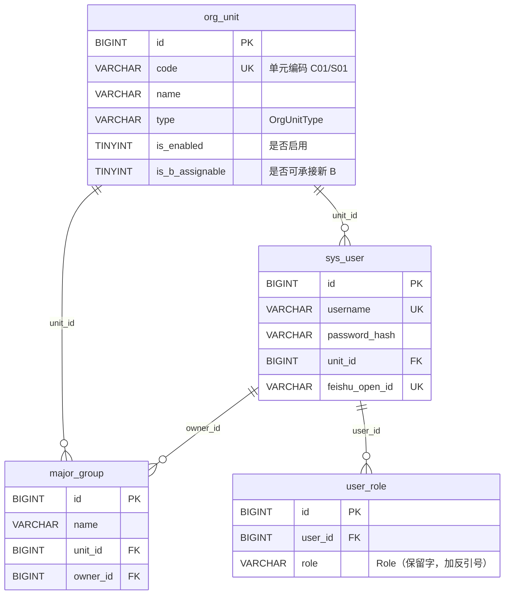
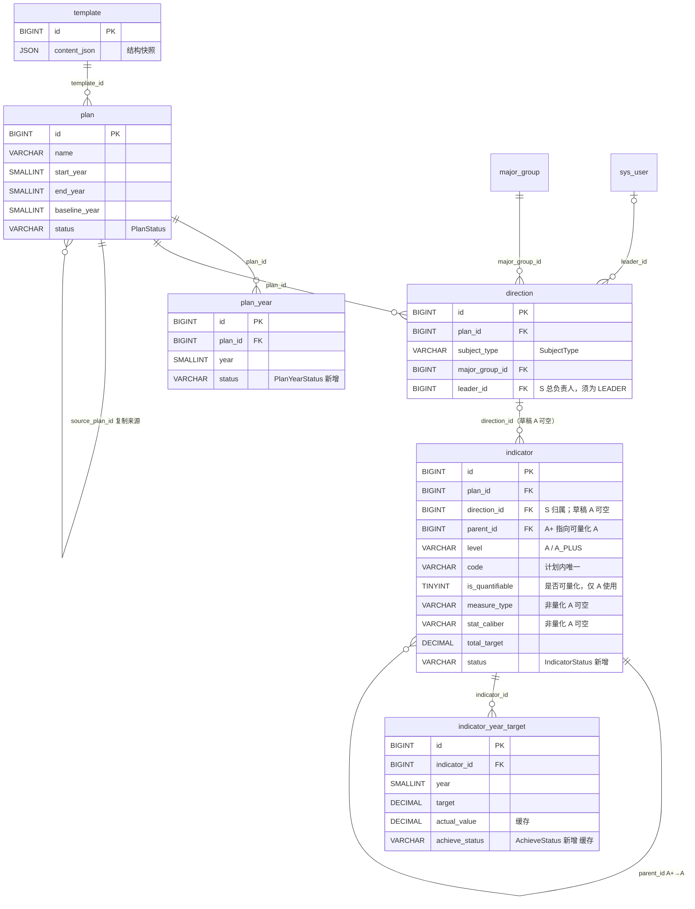
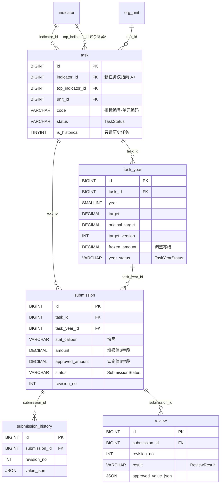
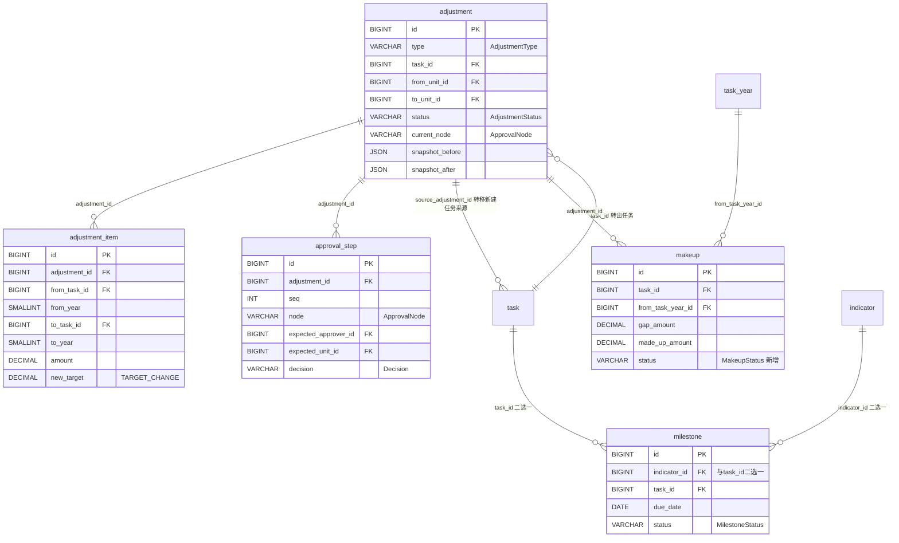
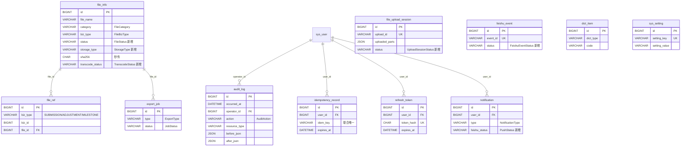

# 五年计划指标管理平台 · 数据库设计

| 项目 | 内容 |
| --- | --- |
| 数据库 | MySQL 8.0（验证版本 8.0.44）/ InnoDB / utf8mb4 / utf8mb4_0900_ai_ci / 时区 +08:00 |
| 迁移管理 | Flyway：已执行的 V1–V6 脚本不再修改；S / A / A+ / B 目标结构由新增 `V7__s_four_level_model.sql` 迁移实现 |
| 演示数据 | `db/demo/demo_data.sql`（非 Flyway，生产不执行）、`db/demo/typical_queries.sql` |
| 后端 | Spring Boot 3 + MyBatis-Plus |
| 规模假设 | 教职工约 1000 人；每计划约 300 条 A/A+ 指标、3000 条 B 任务；五年填报约 5 万条；审计日志约 100 万条 |

---

## 1. 设计原则与命名规范

1. **命名**：表名、字段名一律小写下划线（snake_case）；表名用**单数**；不加前缀，仅系统表用 `sys_` 前缀（`sys_user`、`sys_setting`）。
2. **主键**：`id BIGINT`，雪花 ID 由应用生成，**不使用 AUTO_INCREMENT**。
3. **通用字段**：业务表统一带
   - `version INT NOT NULL DEFAULT 0`（乐观锁，MyBatis-Plus `@Version`）；
   - `created_at DATETIME(3)` / `created_by BIGINT` / `updated_at DATETIME(3)` / `updated_by BIGINT`；
   - `deleted BIGINT NOT NULL DEFAULT 0`（逻辑删除：0 = 未删除；删除时写入**本行 id**。唯一索引带上 `deleted` 后，已删数据不与新数据冲突，且同一张表不会出现两行 deleted = 同一个 id）。
   - 以下三类表按需取舍（不带 `version` / `deleted`）：**日志类**（`audit_log`）、**记录类**（`idempotency_record`、`feishu_event`、`notification`、`refresh_token`、`submission_history`、`review`、`file_upload_session`）、**纯关联表**（`user_role`、`file_ref`）。`approval_step` 是审批流数据，带 `updated_at` 但不带 `version` / `deleted`（审批环节只追加、只回填一次决定）。
4. **字段类型约定**：
   - 数量类（amount、分子、分母、总量）：`DECIMAL(20,4)`；
   - 目标值与比率类（target、rate、percent，可能存 0.15 这类小数）：`DECIMAL(20,6)`；
   - 布尔：`TINYINT(1)`，字段名以 `is_` / `has_` 开头；
   - 枚举：`VARCHAR(32)`，取值与 API 约定第 9 章一致（全大写加下划线）；**不使用 MySQL ENUM 类型**；关键枚举加 `CHECK` 约束；
   - 年度 `SMALLINT`；日期 `DATE`；时间 `DATETIME(3)`（毫秒）；
   - JSON 用 MySQL `JSON` 类型；说明类长文本 `VARCHAR(2000)`，名称类 `VARCHAR(200)`。
5. **不建物理外键**（逻辑外键由应用保证），但每个逻辑外键字段都建索引，字段字典中注明引用表。
6. 每张表、每个字段都有中文 `COMMENT`。
7. **派生数据可重算**：所有缓存字段（完成值、完成率、达成状态等）必须能从原始数据（`submission` 认定值 + `task_year` 目标）重新计算，见第 7 节规则 4。

---

## 2. 设计决策

> 每条写明：问题 / 方案 / 理由。

| # | 问题 | 方案 | 理由 |
| --- | --- | --- | --- |
| D1 | A 与 A+ 指标分表还是同表？ | **同表** `indicator`，用 `parent_id` + `level` 区分；`CHECK` 保证 `level=A_PLUS ⇔ parent_id IS NOT NULL`。 | 两者字段几乎一致；编号唯一性（plan_id+code）跨两级统一；A+ 不再有下级由应用保证（查询时只需一层 join）。 |
| D2 | 分解矩阵草稿存哪里？ | **不另建草稿表**。草稿即 `task` / `task_year` 中 `status = PENDING_DISTRIBUTION` 的行，下发时改状态并做平衡校验。 | 草稿与正式数据结构完全相同，另建表会导致下发时整批搬移；状态机天然支持。 |
| D3 | 逻辑删除与唯一索引冲突？ | `deleted BIGINT`：未删为 0，删除时写**本行 id**；唯一索引一律带 `deleted`。 | 若用 0/1 标记，删除两行同 code 数据后唯一索引仍冲突；写本行 id 使每行 deleted 值唯一，历史数据不挡新数据。 |
| D4 | 物理外键？ | 不建。逻辑外键由应用保证，引用字段全部建索引。 | 高频写入（填报、审核、调整生效事务）避免外键锁检查开销；方便分库与数据迁移；团队以 MyBatis-Plus 手工控制事务。 |
| D5 | 枚举实现？ | `VARCHAR(32)` + `CHECK` 约束，不用 ENUM。 | ENUM 增删值需要 ALTER TABLE；VARCHAR+CHECK 同样能在库层拦非法值（已做反例验证），且与 API 约定第 9 章字符串完全对齐。 |
| D6 | MetricValue 存 JSON 还是独立字段？ | `submission` 用 **6 个独立填报字段**（amount/total/numerator/denominator/percent/achieved）+ 6 个对应**认定字段**（approved_*），另存 `stat_caliber` 快照；提交时的原始快照另存 `submission_history.value_json`。 | 汇总 SQL（Σ分子÷Σ分母、求和、取最后总量）直接对列聚合，无需 JSON 解析；认定值与填报值分列才能支持“核减”。 |
| D7 | 防止同一额度被重复申请调整？ | `task_year.frozen_amount` + 乐观锁：申请时 `UPDATE task_year SET frozen_amount = frozen_amount + #{amount}, version = version + 1 WHERE id = #{id} AND version = #{version} AND target - frozen_amount >= #{amount}`；审批中 `year_status = ADJUSTING` 并记 `status_before_adjusting`。 | 数据库行锁 + 乐观锁版本号 + 余额条件三重保证；并发申请必有一方影响行数为 0 而失败。 |
| D8 | 完成值/完成率等派生数据？ | 在 `task_year`、`indicator_year_target` 上设缓存字段（`actual_*`、`completion_rate`、`achieve_status`、`calculated_at`），审核通过 / 调整生效 / 年度核算三个时机由应用重算刷新。 | 大屏与工作台查询全是读多写少；缓存可从 submission 认定值全量重算（规则 4 给出 SQL），无一致性问题。 |
| D9 | 审计日志不可篡改？ | **双保险**：① `BEFORE UPDATE` / `BEFORE DELETE` 触发器 `SIGNAL SQLSTATE '45000'`；② 应用账号对 `audit_log` 只授 `SELECT, INSERT`（见第 9 节 GRANT）。 | 即使应用被注入拿到连接，也无法改删日志；触发器已实测拦截（第 11 节）。 |
| D10 | 待办是否建表？ | 不建表，由业务表 `UNION ALL` 查询（方案见 7.9）。 | 待办是状态的投影，建表会产生双写不一致；所需索引已随业务表建好，EXPLAIN 验证走索引。 |
| D11 | `task` / `task_year` / `submission` 冗余 `plan_id`、`indicator_id`、`unit_id`、`top_indicator_id`？ | 保留冗余列并建索引。 | 大屏排名、数据权限（按单元/按负责人过滤）、平衡校验都少一层 join；冗余列在任务创建时写入后不再变化，无维护成本。 |
| D12 | MySQL 8.0 保留字 `ROLE`？ | `user_role.role` 建表时不加反引号可以，但 **INSERT/SELECT 列清单必须写反引号 `` `role` ``**，否则报误导性错误（ERROR 1136）。 | 实测踩坑；已在 V2 脚本注释中标注，应用层 SQL（XML）统一加反引号。 |
| D13 | S / A / A+ / B 如何落库并保留既有任务？ | `direction` 复用为 S 后台目录并增加 `leader_id`；A 以 `indicator.is_quantifiable` 区分量化属性，新 B 的 `indicator_id` 只能指向 A+；`org_unit.is_b_assignable` 与 `is_enabled` 共同控制新 B 承接资格。既有 A 直承及 C09/C10/S01 任务以 `task.is_historical=1` 只读保留，原 ID、编号、目标、已审核值、快照和审计均不变。 | 非量化 A 不生成任务；历史目标继续参与 A+ 守恒，历史已审核值保留在历史统计中，当前待办、预警、可执行数量及年度批处理排除历史任务，无需删除或重编号。 |

### 2.1 V7 字段变更、可空约束与回填顺序

`V7__s_four_level_model.sql` 只新增迁移，不改写已执行的 V1–V6。目标字段和约束如下；运行期业务代码只读取新字段，不保留旧字段兼容分支。

| 表 | V7 变更 | 目标可空性、默认值与校验 |
| --- | --- | --- |
| `direction` | 新增 `leader_id`，新增 `idx_direction_leader(leader_id)` | `BIGINT NULL DEFAULT NULL`；配置时由应用校验用户启用且具有 LEADER 角色，不新增数据范围或审批节点 |
| `org_unit` | 新增 `is_b_assignable` | `TINYINT(1) NOT NULL DEFAULT 0`；与 `is_enabled` 共同控制新 B 承接，初始仅 C01–C08 置 1 |
| `indicator` | 将旧 `is_divisible` 重命名为 `is_quantifiable`，保留原布尔值；A+ 的旧值回填为 NULL | `TINYINT(1) NULL DEFAULT NULL`，仅 A 使用；A 定稿时必填，A+ 必须为 NULL，父 A 必须可量化 |
| `indicator` | 删除 `undertake_unit_id`；存量库若存在引用该列的旧索引，随列一并清理 | 不再保存默认承接单元，不恢复 S01 直承规则；既有任务只通过 `task.is_historical` 保留 |
| `indicator` | `direction_id` 改为可空 | `BIGINT NULL DEFAULT NULL`；仅草稿 A 可暂空，定稿时所有 A 必须归属 S，A+ 沿用父 A，条件必填由应用校验 |
| `indicator` | `measure_type`、`stat_caliber`、`unit_label`、`target_direction` 改为可空；`rollup_mode`、`baseline_value`、`total_target` 保持可空 | 非量化 A 的量化字段为 NULL；可量化 A / A+ 在定稿时按类型必填。枚举 CHECK 继续拦截非空非法值，组合合法性及条件必填由应用校验 |
| `task` | 新增 `is_historical`，新增 `idx_task_history(plan_id, is_historical)` | `TINYINT(1) NOT NULL DEFAULT 0`；1 表示只读历史任务，目标和已审核完成值不删除 |

`indicator_year_target.target` 继续保持可空，用于草稿及 BOOLEAN 非计划完成年；这不放松定稿时的年度目标完整性和守恒校验。非量化 A 不生成 `indicator_year_target`、`task` 或执行数据。数据库列可空只承载草稿和非量化 A，**不代表可量化指标可以空着定稿**。

迁移按以下顺序执行和校验：

1. 先新增字段、索引并调整可空性，再重命名量化属性、删除旧承接字段；不得通过删表重建迁移，不得改变既有雪花 ID。
2. 初始化承接资格：C01–C08 的 `is_b_assignable=1`，其余单元保持默认 0。编码只允许出现在本次种子/迁移回填中，运行期分解、下发和转移不得按编码判断。
3. 回填量化属性：仅 A 保留 `is_quantifiable` 值，A+ 置 NULL；按新契约将非量化 A 的量化字段置空，但不删除任何既有任务、目标、填报、审核、快照或审计记录。
4. 将原 A 直承任务及非八院既有任务的 `is_historical` 置 1，保留原 `task.code`、`indicator_id`、`unit_id`、状态及 `task_year` 目标；历史目标继续进入 A+ 守恒，已审核完成值继续进入历史统计。
5. 逐笔终止历史任务的在途填报和调整，记录体系调整原因、快照、审批与审计轨迹，释放未生效的 `frozen_amount` 并恢复调整前年度状态；不得自动审核通过或自动使调整生效。
6. 迁移后校验：新 B 只能隶属 A+，A+ 父级必须为可量化 A；历史任务无未终止在途记录、无未释放冻结额度；A+ 各年“历史冻结目标 + 非历史 B 目标”守恒；当前待办、预警和可执行数量不包含历史任务。

---

## 3. ER 图（Mermaid erDiagram，按模块拆分）

### 3.1 组织与用户



### 3.2 计划、模板与指标体系



### 3.3 B 任务与填报审核



### 3.4 指标调整与审批、里程碑与补做



### 3.5 文件与系统支撑



---

## 4. 表清单

共 **31 张表**，九个模块：

| 模块 | 表 | 中文名 | 预估数据量（5 年） |
| --- | --- | --- | --- |
| 一 组织与用户 | org_unit | 执行单元 | 11 |
| | major_group | 专业群 | ≤ 50 |
| | sys_user | 用户 | ~1000 |
| | user_role | 用户角色 | ~1200 |
| 二 计划与模板 | template | 计划模板 | ≤ 20 |
| | plan | 计划 | ≤ 5 |
| | plan_year | 计划年度 | ≤ 25 |
| 三 指标体系 | direction | S 级任务（后台目录） | 每计划 ≤ 50 |
| | indicator | 指标（A / A+） | 每计划 ~300 |
| | indicator_year_target | 指标年度目标与完成缓存 | 指标数 × 5 ≈ 1500/计划 |
| 四 B 任务 | task | B 任务 | 每计划 ~3000 |
| | task_year | B 任务年度 | 任务数 × 5 ≈ 1.5 万/计划 |
| 五 填报与审核 | submission | 填报 | 五年 ~5 万 |
| | submission_history | 填报历史快照 | ~6 万 |
| | review | 审核记录 | ~5 万 |
| 六 调整与审批 | adjustment | 调整申请 | 每计划数百 |
| | adjustment_item | 调整明细 | 调整数 × 1~N |
| | approval_step | 审批环节 | 调整数 × ≤3 |
| 七 里程碑与补做 | milestone | 里程碑 | 每计划数百 |
| | makeup | 待补做 | 每计划数百 |
| 八 文件 | file_info | 文件 | ~数万 |
| | file_upload_session | 分片上传会话 | 临时，24h 过期 |
| | file_ref | 业务文件关联 | ~数万 |
| 九 系统与支撑 | audit_log | 审计日志（只追加） | ~100 万 |
| | idempotency_record | 幂等记录 | 临时，24h 过期 |
| | refresh_token | 刷新令牌 | 在线用户 × ≤2 |
| | notification | 站内消息 | ~数十万 |
| | export_job | 异步导出任务 | ~数千 |
| | feishu_event | 飞书事件去重 | 按事件量 |
| | dict_item | 字典 | 数百 |
| | sys_setting | 系统参数 | 数十 |

---

## 5. 字段字典

> 通用字段说明（下各表不再重复展开语义）：
> `version` INT NOT NULL DEFAULT 0 乐观锁版本号；`created_at` DATETIME(3) NOT NULL DEFAULT CURRENT_TIMESTAMP(3)；`created_by` / `updated_by` BIGINT NULL 引用 sys_user.id；`updated_at` DATETIME(3) NOT NULL DEFAULT CURRENT_TIMESTAMP(3) ON UPDATE CURRENT_TIMESTAMP(3)；`deleted` BIGINT NOT NULL DEFAULT 0 逻辑删除（0 未删除，否则为本行 id）。

### 5.1 org_unit 执行单元

| 字段 | 类型 | 可空 | 默认 | 说明 / 枚举 |
| --- | --- | --- | --- | --- |
| id | BIGINT | 否 | — | 主键，雪花 ID |
| code | VARCHAR(16) | 否 | — | 单元编码（C01…S01），用于 B 任务编号；uk_org_unit_code(code, deleted) |
| name | VARCHAR(200) | 否 | — | 单元名称 |
| type | VARCHAR(32) | 否 | — | OrgUnitType：COLLEGE / INTERNATIONAL_COLLEGE / MARXISM_COLLEGE / SCHOOL_OFFICE（CHECK） |
| sort | INT | 否 | 0 | 排序号 |
| is_enabled | TINYINT(1) | 否 | 1 | 是否启用；组织停用的独立配置 |
| is_b_assignable | TINYINT(1) | 否 | 0 | 是否可承接新 B；新 B 必须同时满足本字段与 is_enabled 为 1，初始仅 C01–C08 为 1，资格不得按编码硬编码 |
| + 通用 6 字段 | | | | version / created_at / created_by / updated_at / updated_by / deleted |

### 5.2 major_group 专业群

| 字段 | 类型 | 可空 | 默认 | 说明 |
| --- | --- | --- | --- | --- |
| id | BIGINT | 否 | — | 主键 |
| name | VARCHAR(200) | 否 | — | 专业群名称 |
| unit_id | BIGINT | 否 | — | 所属学院，引用 org_unit.id |
| owner_id | BIGINT | 是 | NULL | 专业群负责人，引用 sys_user.id |
| is_enabled | TINYINT(1) | 否 | 1 | 是否启用 |
| + 通用 6 字段 | | | | |

### 5.3 sys_user 用户

| 字段 | 类型 | 可空 | 默认 | 说明 |
| --- | --- | --- | --- | --- |
| id | BIGINT | 否 | — | 主键 |
| username | VARCHAR(64) | 否 | — | 登录名；uk_sys_user_username(username, deleted) |
| password_hash | VARCHAR(100) | 否 | — | 密码哈希（BCrypt） |
| name | VARCHAR(64) | 否 | — | 姓名 |
| phone | VARCHAR(32) | 是 | NULL | 手机号（响应与日志中脱敏） |
| email | VARCHAR(128) | 是 | NULL | 邮箱 |
| unit_id | BIGINT | 是 | NULL | 所属执行单元，引用 org_unit.id；校级角色为空 |
| feishu_open_id | VARCHAR(64) | 是 | NULL | 飞书 open_id；uk_sys_user_feishu_open_id(feishu_open_id, deleted) |
| feishu_union_id | VARCHAR(64) | 是 | NULL | 飞书 union_id |
| is_enabled | TINYINT(1) | 否 | 1 | 是否启用 |
| login_fail_count | INT | 否 | 0 | 连续登录失败次数 |
| locked_until | DATETIME(3) | 是 | NULL | 账号锁定截止时间 |
| last_login_at | DATETIME(3) | 是 | NULL | 最近登录时间 |
| + 通用 6 字段 | | | | |

### 5.4 user_role 用户角色（纯关联表：不带 version / deleted）

| 字段 | 类型 | 可空 | 默认 | 说明 / 枚举 |
| --- | --- | --- | --- | --- |
| id | BIGINT | 否 | — | 主键 |
| user_id | BIGINT | 否 | — | 引用 sys_user.id；uk_user_role(user_id, role) |
| `role` | VARCHAR(32) | 否 | — | Role：ADMIN / LEADER / SCHOOL_OWNER / UNIT_OWNER（CHECK）。**保留字，SQL 列清单须加反引号** |
| created_at / created_by | | | | 仅创建审计字段 |

### 5.5 template 计划模板

| 字段 | 类型 | 可空 | 默认 | 说明 |
| --- | --- | --- | --- | --- |
| id | BIGINT | 否 | — | 主键 |
| name | VARCHAR(200) | 否 | — | 模板名称 |
| description | VARCHAR(2000) | 是 | NULL | 模板说明 |
| content_json | JSON | 否 | — | 后台结构快照：保留 S 及 A 归属、指标定义、默认分解规则，不含执行数据；模板结构、原始 JSON 预览及普通业务导出必须剔除 S 名称和 direction_id，复制时由后台携带 |
| source_plan_id | BIGINT | 是 | NULL | 来源计划，引用 plan.id |
| is_enabled | TINYINT(1) | 否 | 1 | 是否启用 |
| + 通用 6 字段 | | | | |

### 5.6 plan 计划

| 字段 | 类型 | 可空 | 默认 | 说明 / 枚举 |
| --- | --- | --- | --- | --- |
| id | BIGINT | 否 | — | 主键 |
| name | VARCHAR(200) | 否 | — | 计划名称 |
| start_year | SMALLINT | 否 | — | 起始年份；CHECK end_year >= start_year |
| end_year | SMALLINT | 否 | — | 结束年份 |
| baseline_year | SMALLINT | 否 | — | 基线年（起始前一年） |
| settle_deadline | CHAR(5) | 否 | '01-15' | 年度核算截止的月-日 |
| status | VARCHAR(32) | 否 | DRAFT | PlanStatus：DRAFT / ACTIVE / ARCHIVED（CHECK） |
| source | VARCHAR(32) | 否 | BLANK | PlanSource：BLANK / TEMPLATE / COPY（CHECK） |
| template_id | BIGINT | 是 | NULL | 来源模板，引用 template.id |
| source_plan_id | BIGINT | 是 | NULL | 复制来源计划，引用 plan.id |
| is_receiver_confirm_required | TINYINT(1) | 否 | 1 | 转移是否需接收方确认（FR-M6-07） |
| finalized_at | DATETIME(3) | 是 | NULL | 指标体系定稿时间 |
| finalized_by | BIGINT | 是 | NULL | 定稿操作人，引用 sys_user.id |
| + 通用 6 字段 | | | | |

### 5.7 plan_year 计划年度

| 字段 | 类型 | 可空 | 默认 | 说明 / 枚举 |
| --- | --- | --- | --- | --- |
| id | BIGINT | 否 | — | 主键 |
| plan_id | BIGINT | 否 | — | 引用 plan.id；uk_plan_year(plan_id, year, deleted) |
| year | SMALLINT | 否 | — | 年度（自然年） |
| status | VARCHAR(32) | 否 | NOT_ACTIVATED | **PlanYearStatus（新增）**：NOT_ACTIVATED / ACTIVE / LOCKED（CHECK） |
| activated_at / activated_by | DATETIME(3) / BIGINT | 是 | NULL | 激活时间与操作人 |
| settled_at / settled_by | DATETIME(3) / BIGINT | 是 | NULL | 核算锁定时间与操作人 |
| last_unlock_reason | VARCHAR(500) | 是 | NULL | 最近一次解锁原因（敏感操作必填） |
| + 通用 6 字段 | | | | |

### 5.8 direction S 级任务（后台目录）

| 字段 | 类型 | 可空 | 默认 | 说明 / 枚举 |
| --- | --- | --- | --- | --- |
| id | BIGINT | 否 | — | 主键 |
| plan_id | BIGINT | 否 | — | 引用 plan.id |
| subject_type | VARCHAR(32) | 否 | — | 既有 SubjectType：SCHOOL / MAJOR_GROUP（CHECK）；仅后台存储，S 不作为普通业务或统计维度 |
| major_group_id | BIGINT | 是 | NULL | 既有专业群关联，引用 major_group.id（CHECK：SCHOOL 或 major_group_id 非空） |
| leader_id | BIGINT | 是 | NULL | S 总负责人，引用 sys_user.id；配置时用户须启用且具有 LEADER 角色，仅建立责任关联 |
| name | VARCHAR(200) | 否 | — | S 级任务名称，仅系统管理展示 |
| sort | INT | 否 | 0 | 排序号 |
| + 通用 6 字段 | | | | |

S、总负责人及 A 归属只能由 ADMIN 在系统管理中配置；定稿后 S 结构和 A 归属锁定，总负责人仍可更换。`leader_id` 不新增角色、数据范围或调整审批节点。

### 5.9 indicator 指标（A / A+ 同表）

| 字段 | 类型 | 可空 | 默认 | 说明 / 枚举 |
| --- | --- | --- | --- | --- |
| id | BIGINT | 否 | — | 主键 |
| plan_id | BIGINT | 否 | — | 引用 plan.id |
| direction_id | BIGINT | 是 | NULL | S 归属，引用 direction.id；草稿 A 可空、定稿必填且仅 ADMIN 可修改，A+ 保存所属 A 的归属且不独立修改 |
| parent_id | BIGINT | 是 | NULL | A+ 指向所属可量化 A（引用 indicator.id）；A 为空。CHECK：level=A ⇔ parent_id 为空 |
| level | VARCHAR(32) | 否 | — | A / A_PLUS（CHECK）；B 不存入本表 |
| code | VARCHAR(32) | 否 | — | 指标编号，计划内唯一；uk_indicator_code(plan_id, code, deleted) |
| name | VARCHAR(200) | 否 | — | 指标名称 |
| nature | VARCHAR(32) | 否 | — | IndicatorNature：CONSTRAINT / DEVELOPMENT（CHECK） |
| is_quantifiable | TINYINT(1) | 是 | NULL | 是否可量化，仅 A 使用且定稿必填；A+ 为空并隶属于可量化 A。false 时只保留基础信息，不生成 A+ / B |
| measure_type | VARCHAR(32) | 是 | NULL | MeasureType：NUMBER / BOOLEAN / PERCENT_QUANTIFIABLE / PERCENT_DIRECT（CHECK 可空）；量化指标必填，非量化 A 为 NULL |
| stat_caliber | VARCHAR(32) | 是 | NULL | StatCaliber：INCREMENT / STOCK / GROWTH / RATIO / DIRECT_PERCENT / BOOLEAN（CHECK 可空）；量化指标必填，非量化 A 为 NULL |
| — | — | — | — | 量化指标的 CHECK 组合：NUMBER→INCREMENT/STOCK；BOOLEAN→BOOLEAN；PERCENT_QUANTIFIABLE→GROWTH/RATIO；PERCENT_DIRECT→DIRECT_PERCENT；非量化 A 不校验组合 |
| unit_label | VARCHAR(32) | 是 | NULL | 计量单位（字典 UNIT_LABEL 维护）；量化指标必填，非量化 A 为 NULL |
| target_direction | VARCHAR(32) | 是 | HIGHER_BETTER | TargetDirection：HIGHER_BETTER / LOWER_BETTER（CHECK 可空）；非量化 A 为 NULL |
| rollup_mode | VARCHAR(32) | 是 | NULL | RollupMode（仅可量化 A 有效）：AUTO_SUM / MANUAL（CHECK 可空） |
| description | VARCHAR(2000) | 是 | NULL | 指标填写或任务说明；非量化 A 仅维护此类基础信息 |
| evidence_requirement | VARCHAR(2000) | 是 | NULL | 佐证材料要求，仅量化指标使用 |
| min_file_count | INT | 否 | 0 | 必须上传材料最少数量；非量化 A 固定为 0 |
| baseline_value | DECIMAL(20,4) | 是 | NULL | 基线值（GROWTH / STOCK 必填）；非量化 A 为 NULL |
| total_target | DECIMAL(20,6) | 是 | NULL | 五年目标总量（GROWTH/STOCK 为末年应达总量；BOOLEAN 为 1）；非量化 A 为 NULL |
| owner_id | BIGINT | 是 | NULL | 校级项目负责人，引用 sys_user.id；A+ 为空时沿用上级 A |
| sort | INT | 否 | 0 | 排序号 |
| status | VARCHAR(32) | 否 | DRAFT | **IndicatorStatus（新增）**：DRAFT / FINALIZED / DISTRIBUTED（CHECK） |
| + 通用 6 字段 | | | | |

非量化 A 不生成 `indicator_year_target`、`task` 或执行数据，不进入填报、审核、核算及完成率统计；量化 A 和 A+ 的量化字段仍在定稿时强制校验。只有 A+ 可以分解为新 B。

### 5.10 indicator_year_target 指标年度目标与完成情况缓存

| 字段 | 类型 | 可空 | 默认 | 说明 / 枚举 |
| --- | --- | --- | --- | --- |
| id | BIGINT | 否 | — | 主键 |
| indicator_id | BIGINT | 否 | — | 引用 indicator.id；uk_iyt(indicator_id, year, deleted) |
| year | SMALLINT | 否 | — | 年度 |
| target | DECIMAL(20,6) | 是 | NULL | 年度目标（BOOLEAN：计划完成年存 1，其他年份 NULL） |
| actual_value | DECIMAL(20,6) | 是 | NULL | 缓存：年度完成值（审核通过口径，按统计口径计算） |
| actual_numerator / actual_denominator | DECIMAL(20,4) | 是 | NULL | 缓存：RATIO 汇总分子 / 分母 |
| actual_total | DECIMAL(20,4) | 是 | NULL | 缓存：STOCK / GROWTH 年末总量 |
| completion_rate | DECIMAL(20,6) | 是 | NULL | 缓存：完成率（小数） |
| achieve_status | VARCHAR(32) | 是 | NULL | 缓存：**AchieveStatus（新增）**：NOT_STARTED / IN_PROGRESS / ACHIEVED / EXCEEDED / NOT_ACHIEVED / LAGGING（CHECK 可空） |
| calculated_at | DATETIME(3) | 是 | NULL | 缓存最近计算时间 |
| manual_actual_value | DECIMAL(20,6) | 是 | NULL | A 汇总方式为 MANUAL 时的人工认定完成值 |
| manual_note | VARCHAR(2000) | 是 | NULL | 人工认定说明 |
| + 通用 6 字段 | | | | |

### 5.11 task B 任务

| 字段 | 类型 | 可空 | 默认 | 说明 / 枚举 |
| --- | --- | --- | --- | --- |
| id | BIGINT | 否 | — | 主键 |
| plan_id | BIGINT | 否 | — | 引用 plan.id |
| indicator_id | BIGINT | 否 | — | 所属指标，引用 indicator.id；新 B 只能指向 A+，迁移保留的原 A 直承任务可指向 A 且必须标记历史；uk_task_indicator_unit(indicator_id, unit_id, deleted) |
| top_indicator_id | BIGINT | 否 | — | 冗余：所属 A，引用 indicator.id（汇总与数据权限） |
| unit_id | BIGINT | 否 | — | 承接执行单元，引用 org_unit.id |
| code | VARCHAR(48) | 否 | — | 任务编号 {指标编号}-{单元编码}；uk_task_code(plan_id, code, deleted) |
| owner_id | BIGINT | 是 | NULL | 学院项目负责人，引用 sys_user.id（下发前必填，50002） |
| status | VARCHAR(32) | 否 | PENDING_DISTRIBUTION | TaskStatus：PENDING_DISTRIBUTION / DISTRIBUTED / IN_PROGRESS / TRANSFERRED_OUT / CLOSED（CHECK）。**分解矩阵草稿 = PENDING_DISTRIBUTION** |
| distributed_at / distributed_by | DATETIME(3) / BIGINT | 是 | NULL | 下发时间与操作人 |
| accepted_at / accepted_by | DATETIME(3) / BIGINT | 是 | NULL | 学院确认接收时间与确认人 |
| source_adjustment_id | BIGINT | 是 | NULL | 转移自动新建任务的来源调整单，引用 adjustment.id |
| is_historical | TINYINT(1) | 否 | 0 | 是否只读历史任务；迁移时将原 A 直承及 C09/C10/S01 既有任务置 1，保留原 ID、编号、状态、目标、已审核值、快照和审计，不删除、不重编号 |
| + 通用 6 字段 | | | | |

新 B 的 `unit_id` 必须同时满足 `org_unit.is_enabled=1` 与 `is_b_assignable=1`，分解预览、草稿保存、下发和转移接收共用该校验，禁止按编码硬编码。历史任务的 `task_year.target` 永久冻结并作为 A+ 守恒基数；详情及既有记录按数据范围可读。所有针对历史任务的执行写操作由服务端统一拒绝并返回 `409 + 50006（TASK_HISTORICAL_READ_ONLY）`；当前待办、预警、提醒、可执行数量及年度批处理写入必须排除历史任务。

迁移历史任务时，其草稿、待审核等在途填报逐笔终止为 `WITHDRAWN` 并在 `submission.remark` 记录“任务层级与命名体系调整”原因，不自动审核通过；在途调整逐笔终止为 `REJECTED`、`current_node=NULL`，在 `adjustment.reason` 和未处理 `approval_step.comment` 记录同一原因并保留快照，不自动生效。同步释放 `task_year.frozen_amount`、恢复调整前状态，逐笔写审计日志；终止记录只读，不再进入待办或提醒。


### 5.12 task_year B 任务年度

| 字段 | 类型 | 可空 | 默认 | 说明 / 枚举 |
| --- | --- | --- | --- | --- |
| id | BIGINT | 否 | — | 主键 |
| task_id | BIGINT | 否 | — | 引用 task.id；uk_task_year(task_id, year, deleted) |
| year | SMALLINT | 否 | — | 年度 |
| plan_id / indicator_id / unit_id | BIGINT | 否 | — | 冗余列，便于汇总 |
| target | DECIMAL(20,6) | 是 | NULL | 当前生效年度目标（BOOLEAN：计划完成年存 1）；历史任务该值冻结，只能作为守恒和历史统计基数 |
| original_target | DECIMAL(20,6) | 是 | NULL | 下发时原始目标（调整后不变，便于追溯） |
| target_version | INT | 否 | 1 | 目标版本号，每次调整生效 +1 |
| frozen_amount | DECIMAL(20,4) | 否 | 0 | 调整审批中冻结额度（防重复申请） |
| actual_value | DECIMAL(20,6) | 是 | NULL | 缓存：年度完成值（审核通过口径） |
| actual_numerator / actual_denominator | DECIMAL(20,4) | 是 | NULL | 缓存：RATIO 分子 / 分母 |
| actual_total | DECIMAL(20,4) | 是 | NULL | 缓存：STOCK / GROWTH 最新审核通过总量 |
| is_achieved | TINYINT(1) | 是 | NULL | 缓存：是否达标 |
| completion_rate | DECIMAL(20,6) | 是 | NULL | 缓存：完成率（小数） |
| year_status | VARCHAR(32) | 否 | NOT_ACTIVATED | TaskYearStatus：NOT_ACTIVATED / IN_PROGRESS / PENDING_REVIEW / ADJUSTING / ACHIEVED / NOT_ACHIEVED / MAKEUP_PENDING / MADE_UP（CHECK） |
| status_before_adjusting | VARCHAR(32) | 是 | NULL | 进入 ADJUSTING 前的状态，审批结束后恢复用 |
| settled_at | DATETIME(3) | 是 | NULL | 年度核算锁定时间 |
| + 通用 6 字段 | | | | |

### 5.13 submission 填报

| 字段 | 类型 | 可空 | 默认 | 说明 / 枚举 |
| --- | --- | --- | --- | --- |
| id | BIGINT | 否 | — | 主键 |
| task_id | BIGINT | 否 | — | 引用 task.id |
| task_year_id | BIGINT | 否 | — | 引用 task_year.id |
| year | SMALLINT | 否 | — | 填报年度 |
| plan_id / indicator_id / unit_id | BIGINT | 否 | — | 冗余列 |
| stat_caliber | VARCHAR(32) | 否 | — | 统计口径快照（填报时的口径，CHECK 同 StatCaliber） |
| amount | DECIMAL(20,4) | 是 | NULL | 填报值：INCREMENT 本次新增数量 |
| total | DECIMAL(20,4) | 是 | NULL | 填报值：STOCK / GROWTH 当前总量 |
| numerator / denominator | DECIMAL(20,4) | 是 | NULL | 填报值：RATIO 分子 / 分母 |
| percent | DECIMAL(20,6) | 是 | NULL | 填报值：DIRECT_PERCENT 直填百分比（小数） |
| achieved | TINYINT(1) | 是 | NULL | 填报值：BOOLEAN 是否完成 |
| approved_amount / approved_total / approved_numerator / approved_denominator / approved_percent / approved_achieved | 同上 | 是 | NULL | 认定值：审核认定（核减后）的六字段 |
| remark | VARCHAR(2000) | 是 | NULL | 完成情况说明 |
| source_note | VARCHAR(2000) | 是 | NULL | 数据来源说明（直填百分比型必填） |
| status | VARCHAR(32) | 否 | DRAFT | SubmissionStatus：DRAFT / PENDING_REVIEW / APPROVED / REJECTED / WITHDRAWN（CHECK） |
| revision_no | INT | 否 | 0 | 提交次数（每次提交 +1，对应 history / review） |
| submitted_at / submitted_by | DATETIME(3) / BIGINT | 是 | NULL | 最近提交时间与提交人 |
| reviewed_at / reviewer_id | DATETIME(3) / BIGINT | 是 | NULL | 最近审核时间与审核人 |
| is_proxy | TINYINT(1) | 否 | 0 | 是否管理员代填 |
| proxy_reason | VARCHAR(500) | 是 | NULL | 代填原因（敏感操作必填） |
| + 通用 6 字段 | | | | |

### 5.14 submission_history 填报历史快照（记录类：不带 version / deleted）

| 字段 | 类型 | 可空 | 默认 | 说明 |
| --- | --- | --- | --- | --- |
| id | BIGINT | 否 | — | 主键 |
| submission_id | BIGINT | 否 | — | 引用 submission.id；uk_submission_history(submission_id, revision_no) |
| revision_no | INT | 否 | — | 提交序号 |
| value_json | JSON | 否 | — | 提交时填报值快照（MetricValue） |
| file_ids_json | JSON | 否 | — | 提交时引用文件 id 数组 |
| submitted_at / submitted_by | DATETIME(3) / BIGINT | 否 | — | 提交时间与提交人 |

### 5.15 review 审核记录（记录类：不带 version / deleted）

| 字段 | 类型 | 可空 | 默认 | 说明 / 枚举 |
| --- | --- | --- | --- | --- |
| id | BIGINT | 否 | — | 主键 |
| submission_id | BIGINT | 否 | — | 引用 submission.id |
| revision_no | INT | 否 | — | 对应提交序号 |
| reviewer_id | BIGINT | 否 | — | 审核人，引用 sys_user.id |
| result | VARCHAR(32) | 否 | — | ReviewResult：APPROVED / REJECTED（CHECK） |
| comment | VARCHAR(2000) | 是 | NULL | 审核意见（驳回必填，60004） |
| approved_value_json | JSON | 是 | NULL | 认定值快照（核减时记录原值与认定值） |
| is_proxy | TINYINT(1) | 否 | 0 | 是否管理员代审 |
| proxy_reason | VARCHAR(500) | 是 | NULL | 代审原因（敏感操作必填） |
| created_at | DATETIME(3) | 否 | CURRENT_TIMESTAMP(3) | 审核时间 |

### 5.16 adjustment 调整申请

| 字段 | 类型 | 可空 | 默认 | 说明 / 枚举 |
| --- | --- | --- | --- | --- |
| id | BIGINT | 否 | — | 主键 |
| plan_id | BIGINT | 否 | — | 引用 plan.id |
| type | VARCHAR(32) | 否 | — | AdjustmentType：POSTPONE / TRANSFER / POSTPONE_TRANSFER / TARGET_CHANGE（CHECK） |
| task_id | BIGINT | 是 | NULL | 转出 B 任务，引用 task.id；TARGET_CHANGE 可为空 |
| indicator_id | BIGINT | 否 | — | 涉及的 A+（或目标调整的 A），引用 indicator.id |
| from_unit_id / to_unit_id | BIGINT | 是 | NULL | 转出 / 接收执行单元，引用 org_unit.id |
| status | VARCHAR(32) | 否 | PENDING_OWNER_REVIEW | AdjustmentStatus：PENDING_OWNER_REVIEW / PENDING_RECEIVER_CONFIRM / PENDING_LEADER_APPROVAL / APPROVED / REJECTED / WITHDRAWN（CHECK） |
| current_node | VARCHAR(32) | 是 | NULL | 当前环节：OWNER_REVIEW / RECEIVER_CONFIRM / LEADER_APPROVAL；结束后为空（CHECK 可空） |
| applicant_id | BIGINT | 否 | — | 申请人，引用 sys_user.id |
| reason | VARCHAR(2000) | 否 | — | 调整原因 |
| snapshot_before / snapshot_after | JSON | 是 | NULL | 调整前后涉及的全部 B 年度目标快照（原指标 / 变更后指标两组数据） |
| effective_at | DATETIME(3) | 是 | NULL | 生效时间 |
| withdrawn_at | DATETIME(3) | 是 | NULL | 撤回时间 |
| + 通用 6 字段 | | | | |

### 5.17 adjustment_item 调整明细

| 字段 | 类型 | 可空 | 默认 | 说明 |
| --- | --- | --- | --- | --- |
| id | BIGINT | 否 | — | 主键 |
| adjustment_id | BIGINT | 否 | — | 引用 adjustment.id |
| from_task_id | BIGINT | 是 | NULL | 转出 B 任务；TARGET_CHANGE 时为空 |
| from_year | SMALLINT | 是 | NULL | 转出年度 |
| to_task_id | BIGINT | 是 | NULL | 接收 B 任务（生效时回填；接收方原无该 A+ 任务时为新建任务） |
| to_unit_id / to_year | BIGINT / SMALLINT | 是 | NULL | 接收单元 / 接收年度 |
| amount | DECIMAL(20,4) | 是 | NULL | 调整数量（POSTPONE / TRANSFER 类） |
| new_target | DECIMAL(20,6) | 是 | NULL | 新目标值（TARGET_CHANGE） |
| target_indicator_id | BIGINT | 是 | NULL | 目标调整的指标（TARGET_CHANGE） |
| + 通用 6 字段 | | | | |

### 5.18 approval_step 审批环节（记录类：不带 version / deleted）

| 字段 | 类型 | 可空 | 默认 | 说明 / 枚举 |
| --- | --- | --- | --- | --- |
| id | BIGINT | 否 | — | 主键 |
| adjustment_id | BIGINT | 否 | — | 引用 adjustment.id；uk_approval_step(adjustment_id, seq) |
| seq | INT | 否 | — | 环节顺序号（从 1 开始） |
| node | VARCHAR(32) | 否 | — | ApprovalNode：OWNER_REVIEW / RECEIVER_CONFIRM / LEADER_APPROVAL（CHECK） |
| expected_approver_id | BIGINT | 是 | NULL | 期望处理人，引用 sys_user.id；RECEIVER_CONFIRM 环节可为空（按接收单元负责人判断） |
| expected_unit_id | BIGINT | 是 | NULL | 期望处理单元（RECEIVER_CONFIRM），引用 org_unit.id |
| decision | VARCHAR(32) | 是 | NULL | Decision：APPROVE / REJECT；未处理为空（CHECK 可空） |
| comment | VARCHAR(2000) | 是 | NULL | 审批意见 |
| decided_at / decided_by | DATETIME(3) / BIGINT | 是 | NULL | 处理时间与处理人 |
| created_at / updated_at | DATETIME(3) | 否 | — | 创建 / 更新时间 |

### 5.19 milestone 里程碑

| 字段 | 类型 | 可空 | 默认 | 说明 / 枚举 |
| --- | --- | --- | --- | --- |
| id | BIGINT | 否 | — | 主键 |
| plan_id | BIGINT | 否 | — | 引用 plan.id |
| indicator_id | BIGINT | 是 | NULL | 关联指标（与 task_id 二选一，CHECK 异或） |
| task_id | BIGINT | 是 | NULL | 关联任务（与 indicator_id 二选一） |
| name | VARCHAR(200) | 否 | — | 里程碑名称 |
| due_date | DATE | 否 | — | 计划完成日期 |
| deliverable | VARCHAR(2000) | 是 | NULL | 交付物要求 |
| related_year | SMALLINT | 是 | NULL | 关联年度目标 |
| status | VARCHAR(32) | 否 | NOT_STARTED | MilestoneStatus：NOT_STARTED / IN_PROGRESS / COMPLETED / OVERDUE / POSTPONED（CHECK） |
| completed_at | DATETIME(3) | 是 | NULL | 完成时间 |
| + 通用 6 字段 | | | | |

### 5.20 makeup 待补做

| 字段 | 类型 | 可空 | 默认 | 说明 / 枚举 |
| --- | --- | --- | --- | --- |
| id | BIGINT | 否 | — | 主键 |
| task_id | BIGINT | 否 | — | 引用 task.id |
| from_task_year_id | BIGINT | 否 | — | 未达标的 B 年度，引用 task_year.id |
| from_year / to_year | SMALLINT | 否 | — | 未达标年度 / 补做年度 |
| gap_amount | DECIMAL(20,4) | 否 | — | 缺口数量 |
| made_up_amount | DECIMAL(20,4) | 否 | 0 | 已补做数量 |
| status | VARCHAR(32) | 否 | PENDING | **MakeupStatus（新增）**：PENDING / DONE / CANCELLED（CHECK） |
| adjustment_id | BIGINT | 是 | NULL | 关联的延期调整单，引用 adjustment.id |
| + 通用 6 字段 | | | | |

### 5.21 file_info 文件

| 字段 | 类型 | 可空 | 默认 | 说明 / 枚举 |
| --- | --- | --- | --- | --- |
| id | BIGINT | 否 | — | 主键 |
| file_name | VARCHAR(255) | 否 | — | 原始文件名 |
| ext | VARCHAR(16) | 否 | — | 扩展名（小写，不含点） |
| size | BIGINT | 否 | — | 文件大小（字节） |
| mime_type | VARCHAR(128) | 否 | — | MIME 类型 |
| category | VARCHAR(32) | 否 | — | FileCategory：DOCUMENT / PDF / IMAGE / VIDEO / ARCHIVE（CHECK） |
| biz_type | VARCHAR(32) | 否 | — | FileBizType：SUBMISSION_ATTACHMENT / ADJUSTMENT_ATTACHMENT / MILESTONE_ATTACHMENT / IMPORT_FILE（CHECK） |
| status | VARCHAR(32) | 否 | TEMP | **FileStatus（新增）**：TEMP 临时（超 24h 未绑定自动清理）/ BOUND 已绑定（CHECK） |
| storage_type | VARCHAR(32) | 否 | LOCAL | **StorageType（新增）**：LOCAL / MINIO（CHECK） |
| storage_key | VARCHAR(512) | 否 | — | 存储键（路径或对象键） |
| sha256 | CHAR(64) | 否 | — | SHA-256（秒传与完整性校验，建索引） |
| transcode_status | VARCHAR(32) | 是 | NULL | **TranscodeStatus（新增）**：PROCESSING / SUCCEEDED / FAILED（CHECK 可空） |
| preview_key | VARCHAR(512) | 是 | NULL | 预览转换产物存储键 |
| uploaded_by / uploaded_at | BIGINT / DATETIME(3) | 否 | — | 上传人 / 上传时间 |
| bound_at | DATETIME(3) | 是 | NULL | 绑定时间 |
| + 通用 6 字段 | | | | |

### 5.22 file_upload_session 分片上传会话（记录类）

| 字段 | 类型 | 可空 | 默认 | 说明 / 枚举 |
| --- | --- | --- | --- | --- |
| id | BIGINT | 否 | — | 主键 |
| upload_id | VARCHAR(64) | 否 | — | 上传会话标识（UUID），唯一 |
| file_name / size / mime_type / sha256 | | 否 | — | 整文件信息 |
| part_size / part_count | INT | 否 | — | 分片大小（默认 5MB）/ 分片总数 |
| uploaded_parts | JSON | 否 | — | 已上传分片编号数组（断点续传） |
| status | VARCHAR(32) | 否 | UPLOADING | **UploadSessionStatus（新增）**：UPLOADING / COMPLETED / EXPIRED（CHECK） |
| expires_at | DATETIME(3) | 否 | — | 会话过期时间 |
| created_by / created_at | | 否 | — | 发起人 / 创建时间 |

### 5.23 file_ref 业务文件关联（纯关联表）

| 字段 | 类型 | 可空 | 默认 | 说明 / 枚举 |
| --- | --- | --- | --- | --- |
| id | BIGINT | 否 | — | 主键 |
| biz_type | VARCHAR(32) | 否 | — | SUBMISSION / ADJUSTMENT / MILESTONE（CHECK） |
| biz_id | BIGINT | 否 | — | 业务数据 id；uk_file_ref(biz_type, biz_id, file_id) |
| file_id | BIGINT | 否 | — | 引用 file_info.id |
| sort | INT | 否 | 0 | 排序号 |
| created_at | DATETIME(3) | 否 | — | 创建时间 |

### 5.24 audit_log 审计日志（只追加）

| 字段 | 类型 | 可空 | 默认 | 说明 / 枚举 |
| --- | --- | --- | --- | --- |
| id | BIGINT | 否 | — | 主键 |
| occurred_at | DATETIME(3) | 否 | CURRENT_TIMESTAMP(3) | 操作时间 |
| operator_id | BIGINT | 是 | NULL | 操作人，引用 sys_user.id；系统操作为空 |
| operator_name | VARCHAR(64) | 否 | — | 操作人姓名快照 |
| roles | JSON | 是 | NULL | 操作人当时角色数组 |
| unit_id / plan_id | BIGINT | 是 | NULL | 操作人所属单元 / 相关计划 |
| action | VARCHAR(32) | 否 | — | AuditAction：LOGIN / CREATE / UPDATE / DELETE / IMPORT / EXPORT / FINALIZE / DISTRIBUTE / ACCEPT / SUBMIT / WITHDRAW / REVIEW / ADJUST_APPLY / ADJUST_DECIDE / SETTLE / UNLOCK / PERMISSION_CHANGE / FILE_DOWNLOAD（CHECK） |
| resource_type | VARCHAR(64) | 否 | — | 资源类型，如 indicator / task / submission / adjustment |
| resource_id / resource_code | BIGINT / VARCHAR(64) | 是 | NULL | 资源 id / 编号（如 A01-2-C03） |
| before_json / after_json | JSON | 是 | NULL | 变更前 / 后数据 |
| stakeholder_ids | JSON | 是 | NULL | 相关干系人 user id 数组 |
| reason | VARCHAR(500) | 是 | NULL | 操作原因（敏感操作必填） |
| client_type | VARCHAR(32) | 是 | NULL | ClientType：WEB / FEISHU_PC / FEISHU_MOBILE / SCREEN（CHECK 可空） |
| ip / user_agent / request_id | | 是 | NULL | 客户端信息 / 请求追踪 ID（X-Request-Id） |

**保护**：`BEFORE UPDATE` / `BEFORE DELETE` 触发器 SIGNAL 45000；应用账号只授 SELECT + INSERT（见第 9 节）。不带 version / deleted / updated_*。

### 5.25 idempotency_record 幂等记录（记录类）

| 字段 | 类型 | 可空 | 默认 | 说明 |
| --- | --- | --- | --- | --- |
| id | BIGINT | 否 | — | 主键 |
| user_id | BIGINT | 否 | — | 提交人；uk_idempotency(user_id, idem_key) |
| idem_key | VARCHAR(64) | 否 | — | 幂等键（UUID） |
| method_path | VARCHAR(255) | 否 | — | 请求方法与路径 |
| request_hash | CHAR(64) | 否 | — | 请求体 SHA-256（同 Key 不同请求体返回 409+10004） |
| response_status | INT | 否 | — | 首次响应 HTTP 状态码 |
| response_body | JSON | 是 | NULL | 首次响应体（重复请求直接返回） |
| created_at / expires_at | DATETIME(3) | 否 | — | 创建时间 / 过期时间（24 小时） |

### 5.26 refresh_token 刷新令牌（记录类；存哈希不存明文）

| 字段 | 类型 | 可空 | 默认 | 说明 |
| --- | --- | --- | --- | --- |
| id | BIGINT | 否 | — | 主键 |
| user_id | BIGINT | 否 | — | 引用 sys_user.id |
| token_hash | CHAR(64) | 否 | — | refreshToken 的 SHA-256，唯一 |
| expires_at | DATETIME(3) | 否 | — | 过期时间（签发后 7 天） |
| revoked_at | DATETIME(3) | 是 | NULL | 吊销时间（退出 / 被替换） |
| replaced_by_id | BIGINT | 是 | NULL | 替换它的新令牌 id（旋转刷新） |
| client_type / ip / created_at | | 是 | — | 客户端类型（CHECK 可空）/ 签发 IP / 签发时间 |

### 5.27 notification 站内消息（记录类）

| 字段 | 类型 | 可空 | 默认 | 说明 / 枚举 |
| --- | --- | --- | --- | --- |
| id | BIGINT | 否 | — | 主键 |
| user_id | BIGINT | 否 | — | 接收人，引用 sys_user.id |
| type | VARCHAR(32) | 否 | — | NotificationType：TASK_DISTRIBUTED / DEADLINE_REMINDER / REVIEW_RESULT / ADJUSTMENT_TODO / ADJUSTMENT_RESULT / WARNING（CHECK） |
| title / content | VARCHAR(200) / VARCHAR(2000) | 否 | — | 标题 / 内容 |
| biz_type / biz_id / link | | 是 | NULL | 关联业务与跳转链接（飞书 AppLink / 站内路由） |
| read_at | DATETIME(3) | 是 | NULL | 阅读时间；未读为空 |
| feishu_status | VARCHAR(32) | 否 | PENDING | **PushStatus（新增）**：PENDING / SENT / FAILED / SKIPPED（CHECK） |
| feishu_retry_count | INT | 否 | 0 | 飞书推送已重试次数（指数退避最多 3 次） |
| created_at | DATETIME(3) | 否 | — | 创建时间 |

### 5.28 export_job 异步导出任务

| 字段 | 类型 | 可空 | 默认 | 说明 / 枚举 |
| --- | --- | --- | --- | --- |
| id | BIGINT | 否 | — | 主键 |
| type | VARCHAR(32) | 否 | — | ExportType：INDICATORS / TASKS / STATS_REPORT / SETTLEMENT / AUDIT_LOGS（CHECK） |
| params | JSON | 否 | — | 导出参数（过滤条件） |
| status | VARCHAR(32) | 否 | PENDING | JobStatus：PENDING / RUNNING / SUCCEEDED / FAILED（CHECK） |
| file_id | BIGINT | 是 | NULL | 结果文件，引用 file_info.id |
| error_message | VARCHAR(2000) | 是 | NULL | 失败原因 |
| created_by / started_at / finished_at / created_at / updated_at | | — | — | 创建人 / 开始 / 完成 / 创建 / 更新时间 |

### 5.29 feishu_event 飞书事件去重（记录类）

| 字段 | 类型 | 可空 | 默认 | 说明 / 枚举 |
| --- | --- | --- | --- | --- |
| id | BIGINT | 否 | — | 主键 |
| event_id | VARCHAR(64) | 否 | — | 飞书事件 id，唯一（去重） |
| event_type | VARCHAR(128) | 否 | — | 事件类型 |
| payload | JSON | 否 | — | 事件报文 |
| received_at / processed_at | DATETIME(3) | — | — | 接收 / 处理完成时间 |
| status | VARCHAR(32) | 否 | RECEIVED | **FeishuEventStatus（新增）**：RECEIVED / PROCESSED / FAILED（CHECK） |

### 5.30 dict_item 字典

| 字段 | 类型 | 可空 | 默认 | 说明 |
| --- | --- | --- | --- | --- |
| id | BIGINT | 否 | — | 主键 |
| dict_type | VARCHAR(64) | 否 | — | 字典类型（UNIT_LABEL 计量单位 / MATERIAL_TYPE 材料类型）；uk_dict(dict_type, code, deleted) |
| code | VARCHAR(64) | 否 | — | 字典编码 |
| label | VARCHAR(200) | 否 | — | 显示名 |
| sort / is_enabled | INT / TINYINT(1) | 否 | 0 / 1 | 排序 / 启用 |
| + 通用 6 字段 | | | | |

### 5.31 sys_setting 系统参数

| 字段 | 类型 | 可空 | 默认 | 说明 |
| --- | --- | --- | --- | --- |
| id | BIGINT | 否 | — | 主键 |
| setting_key | VARCHAR(128) | 否 | — | 参数键；uk_sys_setting(setting_key, deleted) |
| setting_value | VARCHAR(2000) | 否 | — | 参数值 |
| value_type | VARCHAR(32) | 否 | STRING | STRING / NUMBER / BOOLEAN / JSON（CHECK） |
| description | VARCHAR(500) | 是 | NULL | 参数说明 |
| + 通用 6 字段 | | | | |

---

## 6. 索引说明

> 只列非主键索引；唯一索引同时承担"唯一性约束"职责。所有唯一索引带 `deleted`（逻辑删除配合，见 D3）。

| 表 | 索引 | 服务的查询 |
| --- | --- | --- |
| org_unit | uk_org_unit_code(code, deleted) | 按编码定位单元；B 任务编号生成时取 code |
| major_group | idx_major_group_unit(unit_id) | 查学院下的专业群 |
| major_group | idx_major_group_owner(owner_id) | 查某负责人管理的专业群 |
| sys_user | uk_sys_user_username(username, deleted) | 登录按用户名查 |
| sys_user | uk_sys_user_feishu_open_id(feishu_open_id, deleted) | 飞书免登绑定查询 |
| sys_user | idx_sys_user_unit(unit_id) | 查单元成员；待办按单元匹配用户 |
| user_role | uk_user_role(user_id, role) | 查用户角色集（鉴权） |
| user_role | idx_user_role_role(role) | 按角色反查用户（如全部 LEADER） |
| plan | idx_plan_status(status) | 列执行中计划 |
| plan_year | uk_plan_year(plan_id, year, deleted) | 年度激活 / LOCKED 判断（规则 7） |
| direction | idx_direction_plan(plan_id) | 系统管理列计划下 S 级任务 |
| direction | idx_direction_leader(leader_id) | 按 S 总负责人查询责任关联；不改变 LEADER 数据范围 |
| indicator | uk_indicator_code(plan_id, code, deleted) | 编号唯一；按编号查指标 |
| indicator | idx_indicator_parent(parent_id) | 查可量化 A 下全部 A+ |
| indicator | idx_indicator_direction(direction_id) | 系统管理维护 S 下的 A 归属；普通业务和统计不按 S 查询 |
| indicator | idx_indicator_owner(owner_id) | 校级负责人待办 / 数据权限按 owner 过滤 |
| indicator | idx_indicator_plan_level(plan_id, level) | 列计划内 A / A+ |
| indicator_year_target | uk_iyt(indicator_id, year, deleted) | 年度目标读写；平衡校验 join |
| task | uk_task_indicator_unit(indicator_id, unit_id, deleted) | A+ 分解唯一性（同 A+ 同单元只一个任务）；大屏查询覆盖索引 |
| task | uk_task_code(plan_id, code, deleted) | 任务编号唯一；按编号查任务 |
| task | idx_task_unit_status(unit_id, status) | 学院工作台 B 列表；待确认接收（DISTRIBUTED + accepted_at IS NULL） |
| task | idx_task_top_indicator(top_indicator_id) | 按 A 汇总任务；负责人待审核（join submission） |
| task | idx_task_owner(owner_id) | 学院负责人查自己的任务 |
| task | idx_task_history(plan_id, is_historical) | 当前待办、预警、可执行数量和年度批处理排除历史；历史统计仍按原记录查询 |
| task_year | uk_task_year(task_id, year, deleted) | 任务年度定位（填报、调整、核算读写） |
| task_year | idx_task_year_unit_year(unit_id, year) | 学院年度汇总、工作台 |
| task_year | idx_task_year_indicator_year(indicator_id, year) | A+ 分解平衡校验（规则 2） |
| task_year | idx_task_year_plan_year(plan_id, year) | 大屏按年度全量扫描 |
| task_year | idx_task_year_status(year_status) | 待填报 / 待审核 / ADJUSTING 批量过滤 |
| submission | idx_submission_task_year(task_id, year) | 任务某年填报记录 |
| submission | idx_submission_status(status) | 待审核列表（PENDING_REVIEW） |
| submission | idx_submission_unit(unit_id) | 学院填报历史 |
| submission | idx_submission_indicator(indicator_id) | 指标汇总（RATIO Σ÷Σ 等） |
| submission | idx_submission_task_year_id(task_year_id) | 按年度填报定位 |
| submission_history | uk_submission_history(submission_id, revision_no) | 历史快照版本链 |
| review | idx_review_submission(submission_id) | 填报的审核记录 |
| review | idx_review_reviewer(reviewer_id) | 审核人操作记录 |
| adjustment | idx_adjustment_task(task_id) | 任务调整历史时间线 |
| adjustment | idx_adjustment_status(status) | 审批中调整列表 |
| adjustment | idx_adjustment_applicant(applicant_id) | 我的申请 |
| adjustment | idx_adjustment_plan(plan_id) | 计划内调整 |
| adjustment | idx_adjustment_indicator(indicator_id) | 指标调整历史 |
| adjustment_item | idx_adjustment_item_adjustment(adjustment_id) | 查调整明细 |
| adjustment_item | idx_adjustment_item_from_task(from_task_id) | 转出任务相关明细 |
| approval_step | uk_approval_step(adjustment_id, seq) | 环节定位与推进 |
| approval_step | idx_approval_step_todo(expected_approver_id, decision) | 我的待审批（decision IS NULL） |
| approval_step | idx_approval_step_unit_todo(expected_unit_id, decision) | 接收方确认待办 |
| milestone | idx_milestone_indicator(indicator_id) / idx_milestone_task(task_id) | 指标 / 任务的里程碑列表 |
| makeup | idx_makeup_task(task_id) / idx_makeup_status(status) | 任务补做列表 / 待补做总览 |
| file_info | idx_file_sha256(sha256) | 秒传（同 hash 直接绑定） |
| file_info | idx_file_status(status) | TEMP 超时清理扫描 |
| file_info | idx_file_uploaded_by(uploaded_by) | 我的上传 |
| file_upload_session | uk_upload_session(upload_id) | 断点续传定位会话 |
| file_upload_session | idx_upload_session_sha256(sha256) | 秒传预检 |
| file_ref | uk_file_ref(biz_type, biz_id, file_id) | 业务附件列表；防重复绑定 |
| file_ref | idx_file_ref_file(file_id) | 反查文件被哪些业务引用 |
| audit_log | idx_audit_occurred_at(occurred_at) | 时间范围查询（最常用） |
| audit_log | idx_audit_action(action) | 按动作筛选 |
| audit_log | idx_audit_unit(unit_id) / idx_audit_plan(plan_id) | 按单元 / 计划维度筛选 |
| audit_log | idx_audit_resource(resource_type, resource_id) | 某资源的操作历史 |
| audit_log | idx_audit_request(request_id) | 请求追踪 |
| idempotency_record | uk_idempotency(user_id, idem_key) | 幂等判断（24h 内同 Key 直接返回首次响应） |
| idempotency_record | idx_idempotency_expires(expires_at) | 过期清理 |
| refresh_token | uk_refresh_token_hash(token_hash) | 刷新令牌校验 |
| refresh_token | idx_refresh_token_user(user_id) | 用户令牌管理 / 全端下线 |
| notification | idx_notification_user_read(user_id, read_at) | 我的未读消息 |
| notification | idx_notification_feishu_status(feishu_status) | 飞书推送 / 失败重试扫描 |
| export_job | idx_export_job_creator(created_by) | 我的导出任务 |
| export_job | idx_export_job_status(status) | 调度扫描排队任务 |
| feishu_event | uk_feishu_event(event_id) | 事件去重 |
| dict_item | uk_dict(dict_type, code, deleted) | 字典查询 |
| sys_setting | uk_sys_setting(setting_key, deleted) | 参数读取 |

---

## 7. 业务规则在数据层的落实

### 规则 1：INCREMENT 各年度目标之和 = total_target（应用保证）

可量化指标定稿（FINALIZED）时校验；非量化 A 没有年度目标，跳过本规则：

```sql
SELECT SUM(target) AS year_sum, (SELECT total_target FROM indicator WHERE id = #{indicatorId}) AS total_target
FROM indicator_year_target
WHERE indicator_id = #{indicatorId} AND deleted = 0;
-- year_sum 必须等于 total_target，否则拒绝定稿（错误码见 API 约定）
```

BOOLEAN 口径例外：仅计划完成年存 1，其余年份 NULL，天然满足"总量 = 1"。

### 规则 2：同一 A+ 下历史冻结目标 + 非历史 B 目标 = A+ 目标（应用保证，下发时校验）

非历史草稿（PENDING_DISTRIBUTION）可以不平衡；**下发时**执行平衡校验，不平衡则拒绝下发。`SUM` 必须包含历史任务的冻结目标，历史行只读、不可通过分解或调整修改；可编辑行只能来自符合承接资格的单元。比率类指标不做目标求和校验。

```sql
SELECT ty.year,
       SUM(ty.target)   AS b_sum,
       SUM(CASE WHEN t.is_historical = 1 THEN ty.target ELSE 0 END) AS historical_frozen_sum,
       SUM(CASE WHEN t.is_historical = 0 THEN ty.target ELSE 0 END) AS active_b_sum,
       MAX(iyt.target)  AS a_plus_target,
       SUM(ty.target) - MAX(iyt.target) AS diff
FROM task_year ty
JOIN task t ON t.id = ty.task_id AND t.deleted = 0
JOIN indicator_year_target iyt
  ON iyt.indicator_id = ty.indicator_id AND iyt.year = ty.year AND iyt.deleted = 0
WHERE ty.deleted = 0 AND ty.indicator_id = #{aPlusId}
GROUP BY ty.year
HAVING diff <> 0;
-- 返回空集才允许下发；调整生效后也必须重新通过该校验
-- b_sum = historical_frozen_sum + active_b_sum，历史目标不得以“排除历史”为由从守恒中剔除
```

### 规则 3：可量化 A 汇总方式为 AUTO_SUM 时，各 A+ 目标之和 = A 目标（应用保证，定稿时校验）

```sql
SELECT p.year, SUM(c.target) AS a_plus_sum, MAX(p.target) AS a_target,
       SUM(c.target) - MAX(p.target) AS diff
FROM indicator_year_target p
JOIN indicator ci ON ci.parent_id = p.indicator_id AND ci.deleted = 0
JOIN indicator_year_target c ON c.indicator_id = ci.id AND c.year = p.year AND c.deleted = 0
WHERE p.indicator_id = #{aId} AND p.deleted = 0
GROUP BY p.year
HAVING diff <> 0;
```

rollup_mode = MANUAL 时不做该校验，完成值由人工认定（`manual_actual_value` / `manual_note`）。

### 规则 4：完成值汇总 B → A+ → A（应用计算并刷新缓存）

历史任务的已审核完成值仍参与本规则及历史统计，不得在完成值汇总 SQL 中追加 `is_historical=0`；该条件只用于当前待办、预警、可执行数量和批处理等执行视图。

**汇总 SQL（按口径）**：

- **INCREMENT：求和**

```sql
SELECT SUM(s.approved_amount)
FROM submission s
WHERE s.deleted = 0 AND s.indicator_id = #{indicatorId} AND s.year = #{year} AND s.status = 'APPROVED';
```

- **STOCK：取当年最后一次审核通过的总量**

```sql
SELECT s.approved_total
FROM submission s
WHERE s.deleted = 0 AND s.indicator_id = #{indicatorId} AND s.year = #{year}
  AND s.status = 'APPROVED' AND s.approved_total IS NOT NULL
ORDER BY s.reviewed_at DESC, s.id DESC
LIMIT 1;
```

- **GROWTH：今年总量 ÷ 去年总量 − 1（第一年"去年"取 baseline_value）**

```sql
SELECT iyt.year, iyt.target AS target_total,
       SUM(s.approved_total) AS actual_total,
       ROUND(SUM(s.approved_total) / COALESCE(prev.actual_total, i.baseline_value) - 1, 6) AS growth_rate
FROM submission s
JOIN indicator i ON i.id = s.indicator_id AND i.deleted = 0
JOIN indicator_year_target iyt
  ON iyt.indicator_id = s.indicator_id AND iyt.year = s.year AND iyt.deleted = 0
LEFT JOIN indicator_year_target prev
  ON prev.indicator_id = s.indicator_id AND prev.year = s.year - 1 AND prev.deleted = 0
WHERE s.deleted = 0 AND s.indicator_id = #{indicatorId} AND s.year = #{year} AND s.status = 'APPROVED'
GROUP BY iyt.year, iyt.target, i.baseline_value, prev.actual_total;
```

- **RATIO：Σ分子 ÷ Σ分母（禁止平均各单元百分比）**

```sql
SELECT SUM(s.approved_numerator)   AS sum_numerator,
       SUM(s.approved_denominator) AS sum_denominator,
       SUM(s.approved_numerator) / SUM(s.approved_denominator) AS ratio
FROM submission s
WHERE s.deleted = 0 AND s.indicator_id = #{indicatorId} AND s.year = #{year} AND s.status = 'APPROVED';
```

- **BOOLEAN：是否完成** —— 任一条 APPROVED 且 approved_achieved = 1 即完成：

```sql
SELECT MAX(s.approved_achieved) FROM submission s
WHERE s.deleted = 0 AND s.indicator_id = #{indicatorId} AND s.year = #{year} AND s.status = 'APPROVED';
```

**缓存刷新时机**：三级缓存按 B（`task_year`）→ A+（`indicator_year_target`）→ A（`indicator_year_target`，AUTO_SUM 时先求和）顺序刷新：
1. **审核通过**：重算该 task_year 与该指标链路的当年缓存；
2. **调整生效**：重算涉及的转出 / 接收任务与指标链路的当年缓存；
3. **年度核算（SETTLE）**：重算非历史任务该年缓存并终态化（ACHIEVED / NOT_ACHIEVED / MAKEUP_PENDING），同时写其 `task_year.settled_at`；历史 `task_year` 不改状态、不写核算字段、不生成补做，A / A+ 汇总仍保留其已审核完成值。
缓存均可由上述 SQL 全量重算（D8），`calculated_at` 记录最近计算时间。

### 规则 5：调整申请冻结额度（数据库行锁 + 乐观锁保证）

申请时必须先确认来源及接收任务均为非历史任务；历史任务直接返回 `50006`，不得执行额度冻结。非历史任务在事务内执行（影响行数必须为 1，否则申请失败）：

```sql
UPDATE task_year
SET frozen_amount = frozen_amount + #{amount},
    year_status = 'ADJUSTING',
    status_before_adjusting = year_status,
    version = version + 1
WHERE id = #{taskYearId}
  AND version = #{expectedVersion}
  AND deleted = 0
  AND year_status <> 'ADJUSTING'
  AND target - frozen_amount >= #{amount};
```

并发场景：两行同事务按 id 顺序申请行锁，`version` 条件 + `target - frozen_amount >= amount` 条件保证后提交者影响行数为 0 → 申请失败，杜绝同一额度重复冻结。审批结束（生效 / 驳回 / 撤回）时释放冻结并恢复 `status_before_adjusting`。

### 规则 6：调整生效事务（应用保证，单事务完成）

最后一个环节（LEADER_APPROVAL）APPROVE 后，在同一事务内按以下顺序写库（**加锁顺序固定为 adjustment → task_year（按 id 升序）→ task → indicator_year_target，避免死锁**）：

1. `SELECT ... FOR UPDATE` 锁定 adjustment（防并发生效）；
2. 按明细逐条锁定并更新 `task_year`（id 升序）：转出方 `target = target - amount`，接收方 `target = target + amount`，双方 `target_version + 1`、`frozen_amount` 释放、`year_status` 恢复；
3. 接收方原无该 A+ 任务时：`INSERT task`（`source_adjustment_id` = 本单）+ `INSERT task_year`；
4. 转出方全部年度 target = 0 时：`task.status = 'TRANSFERRED_OUT'`；
5. 同步 `indicator_year_target` 对应年度目标（POSTPONE / TRANSFER 会改变 A+ 年度分布）；
6. 回写 `adjustment`：`status = 'APPROVED'`、`current_node = NULL`、`effective_at`、`snapshot_after`（snapshot_before 在申请时已写）；
7. 写 `approval_step` 最后环节决定；写 `audit_log`（ADJUST_DECIDE / UPDATE）；写 `notification`（调整结果）；
8. 重新执行规则 2 平衡校验，不通过则回滚（防御性）。

TARGET_CHANGE 只改 `indicator_year_target.target` / `total_target` 与快照，不动 B（仅管理员发起）。

### 规则 7：年度锁定后禁止写入（应用保证）

```sql
SELECT status FROM plan_year WHERE plan_id = #{planId} AND year = #{year} AND deleted = 0;
```

所有填报提交、审核、调整申请与生效、核算写操作前先查：`status = 'LOCKED'` 则拒绝（错误码按 API 约定）。解锁（UNLOCK）为敏感操作，必填 reason，回写 `last_unlock_reason` 并记审计。`task_year.settled_at` 非空视为该任务年度已锁定（双重判断）。

### 规则 8：审计日志不可修改（数据库保证）

- 触发器（V1 已建，第 11 节实测拦截）：

```sql
CREATE TRIGGER trg_audit_log_no_update BEFORE UPDATE ON audit_log
FOR EACH ROW SIGNAL SQLSTATE '45000' SET MESSAGE_TEXT = 'audit_log is append-only: UPDATE not allowed';
CREATE TRIGGER trg_audit_log_no_delete BEFORE DELETE ON audit_log
FOR EACH ROW SIGNAL SQLSTATE '45000' SET MESSAGE_TEXT = 'audit_log is append-only: DELETE not allowed';
```

- 账号权限：应用账号对 `audit_log` 只授 `SELECT, INSERT`（见第 9 节 GRANT）。

---

## 8. 典型查询 SQL

完整脚本见 [typical_queries.sql](../db/demo/typical_queries.sql)（每条查询前注释写明预期结果；a / b / h / i 附 EXPLAIN）。此处收录核心九条：

```sql
-- a. 学院工作台：C05（unit_id=105）2026/2027 的 B 列表
SELECT t.code, ty.year, ty.target, ty.original_target, ty.target_version, ty.year_status
FROM task t
JOIN task_year ty ON ty.task_id = t.id AND ty.deleted = 0
WHERE t.deleted = 0 AND t.unit_id = 105 AND ty.year IN (2026, 2027)
ORDER BY t.code, ty.year;

-- b. 校级负责人 owner1（203）的待审核列表
--    （A+ 的 owner 为空时沿用上级 A 的 owner，故用 task.top_indicator_id 关联 A）
SELECT s.id, t.code, s.year, s.stat_caliber, s.numerator, s.denominator, s.total, s.submitted_at
FROM submission s
JOIN task t ON t.id = s.task_id AND t.deleted = 0
JOIN indicator a ON a.id = t.top_indicator_id AND a.deleted = 0
WHERE s.deleted = 0 AND s.status = 'PENDING_REVIEW' AND a.owner_id = 203
  AND t.is_historical = 0
ORDER BY s.submitted_at;

-- c. A01-2（2003）B 分解平衡校验（见规则 2 的 SQL）+ 总量守恒
SELECT SUM(ty.target) AS b_total,
       (SELECT total_target FROM indicator WHERE id = 2003) AS a_plus_total_target
FROM task_year ty
JOIN task t ON t.id = ty.task_id AND t.deleted = 0
WHERE ty.deleted = 0 AND ty.indicator_id = 2003;

-- d. A02-1（2012）2026 占比汇总：Σ分子÷Σ分母（正确）vs AVG(各单元比)（错误，禁止）
SELECT SUM(s.approved_numerator) / SUM(s.approved_denominator) AS ratio_correct
FROM submission s
WHERE s.deleted = 0 AND s.indicator_id = 2012 AND s.year = 2026 AND s.status = 'APPROVED';

-- e. A03-1（2022）2026 增长率（见规则 4 GROWTH SQL）

-- f. 任务 A01-2-C03（4003）的调整历史时间线
SELECT a.id AS adjustment_id, a.type, a.status, a.created_at AS applied_at,
       ap.seq, ap.node, ap.decision, ap.decided_at, ap.decided_by
FROM adjustment a
LEFT JOIN approval_step ap ON ap.adjustment_id = a.id
WHERE a.deleted = 0 AND a.task_id = 4003
ORDER BY a.created_at, ap.seq;

-- g. 按时间范围查询审计日志
SELECT id, occurred_at, operator_name, action, resource_type, resource_code
FROM audit_log
WHERE occurred_at >= '2026-04-01 00:00:00' AND occurred_at < '2026-05-01 00:00:00'
ORDER BY occurred_at;

-- h. 大屏：2026 年各执行单元完成率排名
SELECT u.code, u.name,
       COUNT(ty.id) AS target_count,
       SUM(CASE WHEN ty.year_status = 'ACHIEVED' THEN 1 ELSE 0 END) AS achieved_count,
       ROUND(SUM(CASE WHEN ty.year_status = 'ACHIEVED' THEN 1 ELSE 0 END) / COUNT(ty.id), 4) AS complete_rate
FROM task_year ty
JOIN task t ON t.id = ty.task_id AND t.deleted = 0
JOIN org_unit u ON u.id = ty.unit_id
WHERE ty.deleted = 0 AND ty.plan_id = 1001 AND ty.year = 2026
  AND t.is_historical = 0
  AND ty.target IS NOT NULL AND ty.target > 0
GROUP BY u.id, u.code, u.name
ORDER BY complete_rate DESC, u.code;

-- i. 我的待办（UNION ALL 四分支，见 7.9）
```

### 7.9 / 8.i "我的待办"查询方案（不建表）

四分支 `UNION ALL`，各分支走对应索引：

```sql
SELECT todo_type, biz_id, biz_code, detail, todo_since FROM (
  -- 待审核（校级负责人）：idx_submission_status + task 主键 eq_ref + idx_indicator_owner
  SELECT 'REVIEW' AS todo_type, s.id AS biz_id, t.code AS biz_code,
         CONCAT(s.year, ' 年填报待审核') AS detail, s.submitted_at AS todo_since
  FROM submission s
  JOIN task t ON t.id = s.task_id AND t.deleted = 0
  JOIN indicator a ON a.id = t.top_indicator_id AND a.deleted = 0
  WHERE s.deleted = 0 AND s.status = 'PENDING_REVIEW' AND a.owner_id = #{userId}
    AND t.is_historical = 0
  UNION ALL
  -- 待填报（学院）：idx_task_year_status + idx_sys_user_unit
  SELECT 'FILL', ty.id, t.code, CONCAT(ty.year, ' 年待填报'), ty.updated_at
  FROM task_year ty
  JOIN task t ON t.id = ty.task_id AND t.deleted = 0
  JOIN sys_user su ON su.unit_id = t.unit_id AND su.deleted = 0
  WHERE ty.deleted = 0 AND ty.year_status IN ('IN_PROGRESS','MAKEUP_PENDING') AND su.id = #{userId}
    AND t.is_historical = 0
  UNION ALL
  -- 待确认接收（学院）：idx_task_unit_status + idx_sys_user_unit
  SELECT 'ACCEPT', t.id, t.code, '任务待确认接收', t.distributed_at
  FROM task t
  JOIN sys_user su ON su.unit_id = t.unit_id AND su.deleted = 0
  WHERE t.deleted = 0 AND t.status = 'DISTRIBUTED' AND t.accepted_at IS NULL AND su.id = #{userId}
    AND t.is_historical = 0
  UNION ALL
  -- 待审批（调整各环节）：idx_approval_step_todo；RECEIVER_CONFIRM 环节用 idx_approval_step_unit_todo
  SELECT 'APPROVAL', ap.adjustment_id, tk.code,
         CONCAT('调整审批待处理（', ap.node, '）'), ap.created_at
  FROM approval_step ap
  JOIN adjustment adj ON adj.id = ap.adjustment_id AND adj.deleted = 0
  LEFT JOIN task tk ON tk.id = adj.task_id AND tk.deleted = 0
  WHERE ap.expected_approver_id = #{userId} AND ap.decision IS NULL
    AND adj.status IN ('PENDING_OWNER_REVIEW','PENDING_RECEIVER_CONFIRM','PENDING_LEADER_APPROVAL')
    AND (tk.id IS NULL OR tk.is_historical = 0)
    AND NOT EXISTS (
      SELECT 1 FROM adjustment_item ai
      JOIN task ht ON ht.id = ai.from_task_id
      WHERE ai.adjustment_id = adj.id AND ai.deleted = 0 AND ht.is_historical = 1
    )
) todo
ORDER BY todo_since;
```

RECEIVER_CONFIRM 环节的待办按 `expected_unit_id + decision IS NULL`（idx_approval_step_unit_todo）查出后再匹配该单元负责人，并套用 APPROVAL 分支相同的在途状态、历史任务及 `adjustment_item` 排除条件。

---

## 9. 数据库账号权限与备份建议

### 9.1 账号与权限

```sql
-- 应用账号（最小权限）：业务表增删改查，audit_log 只读 + 追加
CREATE USER 'metrics_app'@'%' IDENTIFIED BY '<强密码，按企业规范>';
GRANT SELECT, INSERT, UPDATE, DELETE ON metrics_db.* TO 'metrics_app'@'%';

-- 关键：收回 audit_log 的 UPDATE / DELETE（MySQL 8.0.16+ 需开启 partial_revokes）
SET PERSIST partial_revokes = ON;
REVOKE UPDATE, DELETE ON metrics_db.audit_log FROM 'metrics_app'@'%';

-- 若版本不支持 partial_revokes，则退化为逐表授权：
--   对 30 张业务表 GRANT SELECT, INSERT, UPDATE, DELETE ON metrics_db.<table> ...
--   对 audit_log 单独：
GRANT SELECT, INSERT ON metrics_db.audit_log TO 'metrics_app'@'%';

-- Flyway 迁移账号（仅部署使用，与应用账号分离）
CREATE USER 'metrics_ddl'@'localhost' IDENTIFIED BY '<强密码>';
GRANT ALL PRIVILEGES ON metrics_db.* TO 'metrics_ddl'@'localhost';

-- 只读账号（报表 / 排查问题用）
CREATE USER 'metrics_read'@'%' IDENTIFIED BY '<强密码>';
GRANT SELECT ON metrics_db.* TO 'metrics_read'@'%';
```

应用账号无 DDL 权限，无法删除触发器；配合 audit_log 双触发器构成规则 8 的双保险。

### 9.2 audit_log 分区评估（结论：暂不分区）

- 估算：100 万条 / 5 年，单行 < 2KB，总数据量 < 2GB；InnoDB B 树在该量级下，`idx_audit_occurred_at` 时间范围查询代价为 O(log N + 结果行数)，完全够用。
- 最常用查询是"时间范围 + 可选维度筛选"（验证记录 g 已实测走 `idx_audit_occurred_at`）。
- **结论**：当前规模**不分区**，避免分区带来的唯一索引限制与运维复杂度。若未来超千万行，再按月/年做 `RANGE COLUMNS(occurred_at)` 分区（历史分区只读归档），届时需重建主键为 `(id, occurred_at)`。

### 9.3 备份建议

| 项目 | 策略 |
| --- | --- |
| 全量备份 | `mysqldump --single-transaction --routines --triggers` 每日 1 次低峰执行，保留 30 天 |
| 增量备份 | 开启 binlog（ROW 模式），binlog 保留 7 天，支持 PITR 时间点恢复 |
| audit_log | 只追加表，可单独按季度导出归档到冷存储；归档后在线表 TRUNCATE 由 DBA 用专用账号执行（应用账号无权） |
| 临时表清理 | 定时任务清理：`idempotency_record`（expires_at 过期）、`file_upload_session`（EXPIRED）、`file_info`（TEMP 超 24h，连同存储文件） |
| 演练 | 每季度一次恢复演练，验证备份可用性 |

---

## 10. 新增枚举清单

以下 10 个枚举为本次数据库设计新增（API 约定第 9 章原有枚举之外），已追加到 `API统一约定文档.md` 第 9 章枚举表末尾：

| 枚举 | 值 | 中文 | 用于 |
| --- | --- | --- | --- |
| PlanYearStatus | NOT_ACTIVATED / ACTIVE / LOCKED | 未激活 / 已激活 / 已核算锁定 | plan_year.status |
| IndicatorStatus | DRAFT / FINALIZED / DISTRIBUTED | 草稿 / 已定稿 / 已下发 | indicator.status |
| MakeupStatus | PENDING / DONE / CANCELLED | 待补做 / 已补做 / 已取消 | makeup.status |
| FileStatus | TEMP / BOUND | 临时 / 已绑定 | file_info.status |
| StorageType | LOCAL / MINIO | 本地 / 对象存储 | file_info.storage_type |
| PushStatus | PENDING / SENT / FAILED / SKIPPED | 待推送 / 已推送 / 推送失败 / 无需推送 | notification.feishu_status |
| AchieveStatus | NOT_STARTED / IN_PROGRESS / ACHIEVED / EXCEEDED / NOT_ACHIEVED / LAGGING | 未开始 / 进行中 / 已达成 / 超额达成 / 未达成 / 进度滞后 | indicator_year_target.achieve_status（缓存） |
| TranscodeStatus | PROCESSING / SUCCEEDED / FAILED | 转码中 / 成功 / 失败 | file_info.transcode_status |
| UploadSessionStatus | UPLOADING / COMPLETED / EXPIRED | 上传中 / 已完成 / 已过期 | file_upload_session.status |
| FeishuEventStatus | RECEIVED / PROCESSED / FAILED | 已接收 / 已处理 / 处理失败 | feishu_event.status |

---

## 11. 验证记录

> 环境：本机临时 MySQL 8.0.44（mysql-memory-server，127.0.0.1）。执行顺序 V1__init.sql → V2__seed.sql → demo_data.sql，全部 exit=0 无报错；typical_queries.sql 全部执行，实际输出如下（原始输出存于 `db/demo/verify_queries_output.txt`、`db/demo/verify_constraints_output.txt`）。

### 11.1 查询 a：C05 学院 2026/2027 B 列表（EXPLAIN + 结果）

EXPLAIN：`task` 走 `idx_task_unit_status`（ref, rows=2），`task_year` 走 `uk_task_year`（ref）——**用到索引**。

实际结果 4 行，与预期一致（**A01-2-C05 2027 target=2、original_target=1、version=2，可见转入的 1 项**）：

```text
| code      | year | target   | original_target | target_version | year_status   |
| A01-2-C05 | 2026 | 0.000000 |        0.000000 |              1 | NOT_ACTIVATED |
| A01-2-C05 | 2027 | 2.000000 |        1.000000 |              2 | NOT_ACTIVATED |
| A02-1-C05 | 2026 | 0.550000 |        0.550000 |              1 | IN_PROGRESS   |
| A02-1-C05 | 2027 | 0.580000 |        0.580000 |              1 | NOT_ACTIVATED |
```

### 11.2 查询 b：owner1 待审核列表（EXPLAIN + 结果）

EXPLAIN：`submission` 走 `idx_submission_status`（ref, rows=2），`task` 主键 eq_ref，`indicator` 主键 eq_ref——**用到索引**。

实际结果 1 行，与预期一致（6007 属 A03-1 owner=204，正确地被排除）：

```text
| id   | code      | year | stat_caliber | numerator | denominator | total | submitted_at            |
| 6002 | A02-1-C02 | 2026 | RATIO        |   45.0000 |     80.0000 |  NULL | 2026-03-06 09:00:00.000 |
```

### 11.3 查询 c：A01-2 分解平衡校验（转移后守恒）

逐年 diff 全为 0，总量 4 = 4 **守恒**（调整 7001 生效后仍平衡）：

```text
| year | b_sum | a_plus_target | diff     |
| 2026 |   0.000000 |      0.000000 | 0.000000 |
| 2027 |   2.000000 |      2.000000 | 0.000000 |
| 2028 |   0.000000 |      0.000000 | 0.000000 |
| 2029 |   1.000000 |      1.000000 | 0.000000 |
| 2030 |   1.000000 |      1.000000 | 0.000000 |

| b_total | a_plus_total_target |
|     4.000000 |            4.000000 |
```

### 11.4 查询 d：RATIO 汇总 Σ÷Σ vs 错误平均

```text
| sum_numerator | sum_denominator | ratio_correct |
|       88.0000 |        150.0000 |    0.58666667 |

| ratio_wrong_do_not_use |
|         0.590000000000 |
```

正确算法 88/150 ≈ 0.586667；错误平均算法 0.59，二者不同——**必须使用 Σ分子÷Σ分母**。

### 11.5 查询 e：A03 增长率

```text
| year | target_total | actual_total | growth_rate |
| 2026 |  1028.350000 |    1050.0000 |    0.050000 |
```

第一年"去年"取基线值 1000：1050/1000 − 1 = 0.05（5.00%），与预期一致。

### 11.6 查询 f：调整历史时间线（7001）

```text
| adjustment_id | type              | status   | seq  | node             | decision | decided_by |
|          7001 | POSTPONE_TRANSFER | APPROVED |    1 | OWNER_REVIEW     | APPROVE  |        203 |
|          7001 | POSTPONE_TRANSFER | APPROVED |    2 | RECEIVER_CONFIRM | APPROVE  |        215 |
|          7001 | POSTPONE_TRANSFER | APPROVED |    3 | LEADER_APPROVAL  | APPROVE  |        202 |
```

三个环节完整，与预期一致。

### 11.7 查询 g：审计日志时间范围查询（2026-04）

```text
| id   | occurred_at             | operator_name                | action        | resource_type | resource_code |
| 8004 | 2026-04-01 09:00:00.000 | 数字影视传媒产业学院负责人   | ADJUST_APPLY  | adjustment    | A01-2-C03     |
| 8005 | 2026-04-03 09:00:00.000 | 校级负责人·林华              | ADJUST_DECIDE | adjustment    | A01-2-C03     |
| 8006 | 2026-04-06 10:00:00.000 | 校领导·陈明                  | ADJUST_DECIDE | adjustment    | A01-2-C03     |
```

3 行，与预期一致（走 `idx_audit_occurred_at`）。

### 11.8 查询 h：大屏完成率排名（EXPLAIN + 结果）

EXPLAIN：`task` 走 `uk_task_indicator_unit` 覆盖索引扫描（Using index, rows=16），`task_year` 走 `uk_task_year` eq_ref，`org_unit` 主键 eq_ref——**用到索引**（本查询语义要求扫全计划全单元，索引覆盖扫描是最优形态）。

```text
| code | name                 | target_count | achieved_count | complete_rate |
| C01  | 智能产业学院         |            2 |              2 |        1.0000 |
| C03  | 数字影视传媒产业学院 |            1 |              1 |        1.0000 |
| C02  | 数字金融产业学院     |            1 |              0 |        0.0000 |
| C04  | 数据产业学院         |            2 |              0 |        0.0000 |
| C05  | 游戏产业学院         |            1 |              0 |        0.0000 |
| C06  | 智能建造产业学院     |            2 |              0 |        0.0000 |
| C07  | 现代通信产业学院     |            1 |              0 |        0.0000 |
| C08  | 未来技术产业学院     |            1 |              0 |        0.0000 |
```

8 行，与预期一致（C01、C03 并列 100%）。

### 11.9 查询 i：我的待办（EXPLAIN + 结果）

EXPLAIN：REVIEW 分支走 `idx_submission_status`；APPROVAL 分支走 `idx_approval_step_todo`（ref, const,const）；FILL / ACCEPT 分支对 owner1（无学院身份）为 `no matching row in const table`——**各分支用到索引**。

```text
| todo_type | biz_id | biz_code  | detail                                 | todo_since              |
| REVIEW    |   6002 | A02-1-C02 | 2026 年填报待审核                      | 2026-03-06 09:00:00.000 |
| APPROVAL  |   7002 | A01-2-C01 | 调整审批待处理（OWNER_REVIEW）         | 2026-10-23 10:02:03.262 |
```

2 行，与预期一致。

### 11.10 触发器反例（规则 8）

```text
UPDATE audit_log  → ERROR 1644 (45000): audit_log is append-only: UPDATE not allowed
DELETE audit_log  → ERROR 1644 (45000): audit_log is append-only: DELETE not allowed
```

拦截后确认数据完好：`audit_rows = 8`，未受损。

### 11.11 CHECK 约束反例（D1 / D5）

插入 `level='A_PLUS'` 且 `parent_id = NULL` 的指标：

```text
ERROR 3819 (HY000): Check constraint 'chk_indicator_parent' is violated.
```

被正确拒绝，`bad_rows = 0`（库中无非法数据）。

---

## 附：种子数据说明（V2__seed.sql）

- **11 个执行单元**（C01–C08 COLLEGE、C09 INTERNATIONAL_COLLEGE、C10 MARXISM_COLLEGE、S01 SCHOOL_OFFICE），与 PRD 2.1 一致；V7 初始化仅 C01–C08 的 `is_b_assignable=1`，其余单元为 0，组织 `is_enabled` 初始仍为 1；
- **计量单位字典** UNIT_LABEL：项、个、人、人次、门、篇、部、本、万元、%；
- **系统参数**：文件格式与大小上限（对应 API 约定 8.5：文档/PDF 50MB、图片 20MB、视频 500MB、压缩包 200MB）、临时文件保留 24h、预警阈值 0.5、截止提醒 7 天、核算截止日 01-15、登录失败 5 次锁 30 分钟、accessToken 120 分钟、refreshToken 7 天、幂等 24h；
- **开发测试账号 15 个**：admin（ADMIN）、leader（LEADER）、owner1 / owner2（SCHOOL_OWNER）、c01–c10、s01（UNIT_OWNER）；密码统一 `Test@123456`（BCrypt cost=10，哈希值直接写入 SQL 并在注释中注明明文）。
- **⚠️ 生产上线前必须删除这些测试账号或重置密码，密码哈希不得外泄。**
